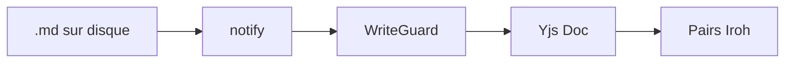
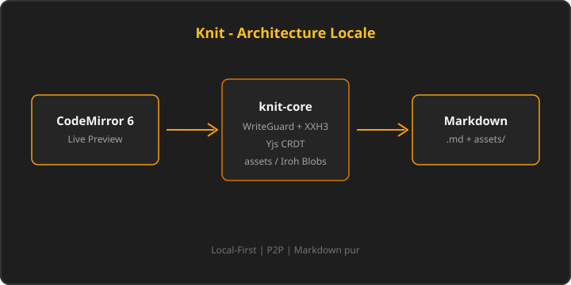

# Document Long — Banc d'Essai de Performance et Defilement

Ce document dense mesure le rendu Live Preview, le defilement fluide et le comportement des widgets CodeMirror 6 (tableaux, code, Mermaid, taches, images).

Consultez egalement [[accueil.md|la note d'accueil]] et [[live-preview.md|la demonstration Live Preview]].

---

## Chapitre 1 : Philosophie du Local-First

Le mouvement Local-First redefinit la relation entre l'utilisateur, ses donnees et ses applications. Contrairement aux modeles Cloud centralises traditionnels ou les donnees resident sur des serveurs distants, le Local-First place les fichiers locaux au coeur du systeme.

### Les Avantages Fondamentaux
1. **Disponibilite Immediate** : Fonctionnement hors ligne total sans aucune degradation.
2. **Confidentialite Absolue** : Vos donnees vous appartiennent, stockees en texte clair.
3. **Perennite Garantie** : Aucune dependance envers un editeur tiers ou un abonnement.
4. **Vitesse Instantanee** : Zero latence reseau lors de la lecture ou de l'ecriture.

> [!NOTE]
> Knit stocke vos notes en Markdown pur et vos medias dans `assets/`. Aucune base opaque.

---

## Chapitre 2 : La Synchronisation Peer-to-Peer

La synchronisation s'effectue directement entre pairs (P2P) a l'aide de structures de donnees sans conflit (CRDT Yjs) et de protocoles modernes comme Iroh et QUIC.

- [x] Initialisation du noeud P2P local
- [x] Decouverte automatique des pairs sur reseau local (mDNS)
- [x] Connexion via ticket chiffre
- [/] Synchronisation transparente en arriere-plan !p1 @Thomas
- [ ] Propagation des blobs `assets/` via Iroh !p2 @vault @2026-10-28
- [?] Faut-il un relay optionnel pour les reseaux restreints ?
- [>] Reporter le benchmark WAN au sprint suivant
- [-] Ancienne piste WebRTC abandonnee

| Couche | Technologie | Role |
| :--- | :--- | :--- |
| Texte | Yjs CRDT | Fusion concurrente des notes |
| Transport | Iroh / QUIC | Connexion P2P chiffree |
| Medias | Iroh Blobs | Sync des fichiers `assets/` |
| Disque | WriteGuard Rust | Anti-boucle watcher |

---

## Chapitre 3 : Architecture Octet pour Octet

Knit n'altere jamais votre formatage. Chaque saut de ligne, indentation ou commentaire est preserve de maniere bijective.

```rust
pub fn check_integrity(content: &str) -> bool {
    !content.is_empty()
}
```

```typescript
export function measureScrollFps(samples: number[]): number {
  if (samples.length === 0) return 0;
  return samples.reduce((a, b) => a + b, 0) / samples.length;
}
```






---

## Chapitre 4 : Widgets Live Preview sous charge

### Liste imbriquee

1. Niveau racine A
   - Sous-point A.1 avec `code inline`
   - Sous-point A.2 vers [[kanban.md|Kanban]]
2. Niveau racine B
   - Sous-point B.1 tags #perf/scroll #editor/cm6
   - Sous-point B.2 priorite !p3

### Callouts multiples

> [!TIP]
> Basculez Source / Live Preview avec <kbd>Ctrl+E</kbd> au milieu de ce document pour verifier l'absence de saut de layout.

> [!WARNING]
> Un document tres long reste du Markdown lisible hors Knit : ouvrez-le dans VS Code pour confirmer l'absence de balises proprietaires.

### Mini-sommaire

```knit-toc
depth: 2
collapsible: true
```

---

## Chapitre 5 : Scenarios de defilement

Paragraphe repetitif volontaire pour exercer le viewport :

Le rendu Live Preview de Knit projette des widgets immersifs uniquement lorsque le curseur est hors de la zone concernee. Tables, blocs de code, images et callouts partagent le meme contrat bijectif : source brute au focus, carte feutree hors focus. Cette approche elimine les artefacts de surlignage et conserve un ratio pixel-perfect avec le mode debug global.

Le rendu Live Preview de Knit projette des widgets immersifs uniquement lorsque le curseur est hors de la zone concernee. Tables, blocs de code, images et callouts partagent le meme contrat bijectif : source brute au focus, carte feutree hors focus. Cette approche elimine les artefacts de surlignage et conserve un ratio pixel-perfect avec le mode debug global.

Le rendu Live Preview de Knit projette des widgets immersifs uniquement lorsque le curseur est hors de la zone concernee. Tables, blocs de code, images et callouts partagent le meme contrat bijectif : source brute au focus, carte feutree hors focus. Cette approche elimine les artefacts de surlignage et conserve un ratio pixel-perfect avec le mode debug global.

---

## Chapitre 6 : Conclusion et Perspectives

La robustesse architecturale garantit une fluidite sans compromis, meme lors de l'edition simultanee de plusieurs documents volumineux. Prochaine etape produit : Agenda global (Sprint 6ter) sans compromettre le Markdown pur.

- [ ] Valider 60 FPS sur machine de reference !p2 @Sublix
- [x] Couvrir images + Mermaid + knit-toc dans ce banc
