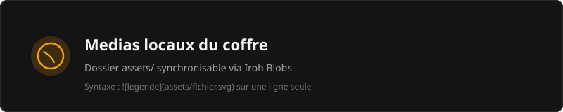

# Galerie Visuelle & Base de Donnees par Cartes

Cette note est configuree en **vue Galerie** (`type: gallery`). Elle projette les notes du coffre sous forme de cartes d'inspiration database/Pinterest, enrichies de leurs metadonnees Frontmatter (`statut`, `tags`, `banner`), de leurs WikiLinks et de leurs medias.

---

## Documents & Modules Principaux du Coffre

- [[accueil.md|Accueil & Vision]]
- [[projet/agenda.md|Agenda & Jalons du Projet]]
- [[canvas.md|Tableau Blanc Interactif]]
- [[diaporama.md|Diaporama & Presentation]]
- [[live-preview.md|Live Preview & HTML Securise]]
- [[blocs-dynamiques.md|Moteur Dataview & Blocs]]
- [[kanban.md|Tableau Kanban Agile]]
- [[table.md|Inventaire Synthétique Table]]
- [[liens-navigation.md|Navigation, Survol & Graphe]]
- [[document-long.md|Banc de Test Document Long]]
- [[wiki/architecture.md|Architecture Technique P2P]]
- [[wiki/piliers.md|Les 9 Piliers Fondamentaux]]

---

## Visuels & Schemas du Coffre

---

## Fonctionnalites Cles de la Galerie (Sprint 6ter)

- **Cartes riches** : Generation automatique des bannières visuelles d'apres les champs `banner: ...` ou `image: ...` du frontmatter YAML.
- **Pastilles reactives** : Affichage automatique des statuts (en dore) et des tags `#tag` extraits de chaque note.
- **Glisser-Deposer (D&D)** : Les cartes peuvent etre deplacees avec feedback fantôme (`opacity: 0.35`) et cadre d'insertion en tirets dore `var(--knit-primary)`.
- **Ouverture directe** : Un clic sur une carte ouvre instantanement la note correspondante dans un onglet Knit.
- **Bascule Source `</>`** : Retrouvez la liste Markdown pure des WikiLinks a tout moment via le bouton *Source*.
