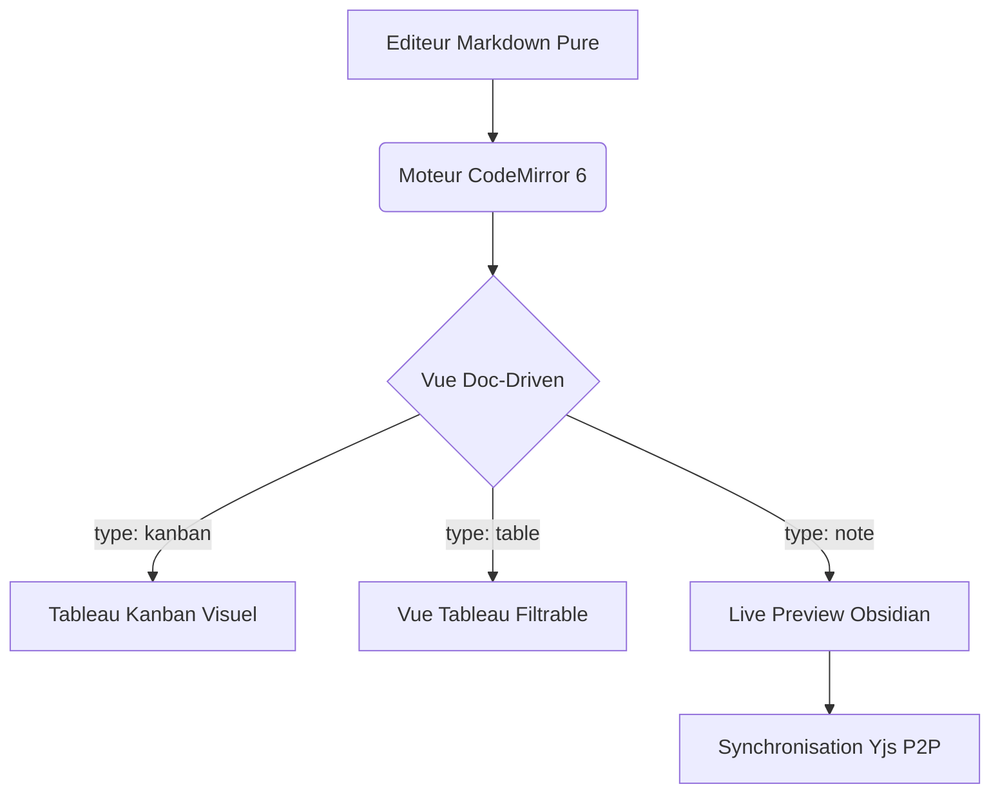

# Demonstration Complete Live Preview Knit

Ce document rassemble l'ensemble des fonctionnalites Markdown et des normes visuelles supportees par Knit v0.3.0. Il sert de banc d'essai pour valider le rendu dynamique Live Preview, la synchronisation du curseur et la coherence de la marge.

Consultez egalement les specifications d'architecture dans [[wiki/architecture|Architecture Technique]] et les principes fondamentaux dans [[wiki/piliers|Les 9 Piliers de Knit]].

---

## 1. Niveaux de Titres et Progression Automatique

### Sous-titre Niveau 3
#### Sous-titre Niveau 4
##### Sous-titre Niveau 5
###### Sous-titre Niveau 6 (Majuscules feutrees)

La barre de progression sous le titre principal calcule dynamiquement le pourcentage des taches de ce document.

---

## 2. Les 7 Statuts de Taches Standardises (B-054)

Chaque case ci-dessous est interactive. Un simple clic change son etat selon le cycle standardise :

- [ ] Tache standard a realiser (A faire)
- [/] Tache en cours d'execution (En cours avec jauge)
- [x] Tache validee et terminee (Fait avec texte barre)
- [-] Tache annulee ou abandonnee (Annule)
- [?] Tache en attente d'arbitrage ou question (Question)
- [>] Tache reportee a un sprint ulterieur (Reporte avec fleche)
- [!] Tache urgente necessitant une intervention immediate (Urgent)

---

## 3. Priorites Inline, Mentions et Echeances

- [ ] Corriger le conflit de synchronisation CRDT Yjs !p1 @Thomas @2026-10-20 14:00-15:30
- [ ] Optimiser la palette de couleurs d'accentuation !p2 @vault @2026-10-21
- [ ] Nettoyer les classes CSS obsoletes !p3 due: 2026-10-25
- [ ] Deploiement de la version P2P sur le reseau Iroh !p1 @Thomas H.

---

## 4. Formatage Markdown Inline Enrichi

- **Texte en gras** pour souligner les elements essentiels.
- *Texte en italique* pour les nuances et precisions.
- ~~Texte barre~~ pour indiquer les elements depricies.
- `cargo run --release -p knit-app` pour le code en ligne.
- Lien Markdown externe : [Depot GitHub de Knit](https://github.com/Domaine-Tech/knit).
- WikiLink simple : [[accueil.md]].
- WikiLink avec alias : [[wiki/architecture|Consulter l'architecture]].
- WikiLink d'ancre : [[wiki/architecture#Moteur CRDT|Aller au Moteur CRDT]].
- Tags hierarchiques : #dev/rust/p2p #ui/codemirror #sprint-6

---

## 5. Tableaux Markdown GFM (Alignement Parfait 1:1 et Liens Interactifs)

Survolez les liens dans les cellules pour afficher l'apercu dynamique flottant (US B-053). Utilisez **Ctrl + Clic** pour ouvrir la cible correspondante.

| Type de Cible | Intitule | Destinataire / Statut | Lien Interactif | Action Attendue |
| :--- | :--- | :---: | :--- | :--- |
| **Note Existante** | Document long | `Valide` | [[document-long.md]] | Ouvre la note avec apercu snippet |
| **Alias WikiLink** | Vue Synthetique | `Actif` | [[table.md|Inventaire Composants]] | Ouvre la vue Tableau |
| **Tableau Kanban** | Taches P2P | `En cours` | [[kanban.md]] | Ouvre le tableau Kanban |
| **Ancre Interne** | Statuts de taches | `Local` | [[#2. Les 7 Statuts de Taches Standardises (B-054)]] | Defile vers la section 2 |
| **Lien Web Externe** | GitHub Repo | `HTTPS` | [Depot GitHub Knit](https://github.com/Domaine-Tech/knit) | Ouvre le navigateur systeme |
| **URL Brute** | Documentation | `Web` | https://github.com/Domaine-Tech/knit | Ouvre le navigateur |
| **Dossier Local** | Configuration | `Dossier` | [Dossier .knit](./.knit/) | Ouvre l'explorateur de fichiers |

---

## 6. Scripts et Blocs de Code avec Bouton Copier

### Script Shell Unix / Bash

```bash
#!/usr/bin/env bash
# Verifier la conformite du depot Knit
echo "Lancement des verifications..."
cargo test --workspace
npm run lint --prefix knit-app
echo "Verifications terminees avec succes."
```

### Module TypeScript

```typescript
// Interface de configuration d'un noeud pair P2P
export interface PeerConfig {
  nodeId: string;
  listenPort: number;
  enableRelay: boolean;
  heartbeatIntervalMs: number;
}
```

---

## 7. Diagrammes Mermaid Inline



---

## 8. Callouts GFM (Alertes Feutrees)

> [!NOTE]
> Information contextuelle sobre : le formatage CommonMark est applique a la volee sans transformer le document en format proprietaire.

> [!TIP]
> Raccourci clavier : utilisez Ctrl+E pour basculer instantanement entre la vue visuelle et le code source brut.

> [!WARNING]
> Attention lors de la modification des en-tetes YAML : veillez a conserver les tirets triples de delimitation.

> [!IMPORTANT]
> L'interoperabilite avec Obsidian et VS Code est garantie par l'absence totale de base de donnees centrale.

---

## 9. Citations et Listes Imbriquees

> La simplicite est la condition prealable a la fiabilite.
> — Edsger W. Dijkstra

1. Premier point structure
   - Sous-element detaille A
   - Sous-element detaille B
2. Deuxieme point structure
   - Validation croisee
   - Synchronisation sans conflit
