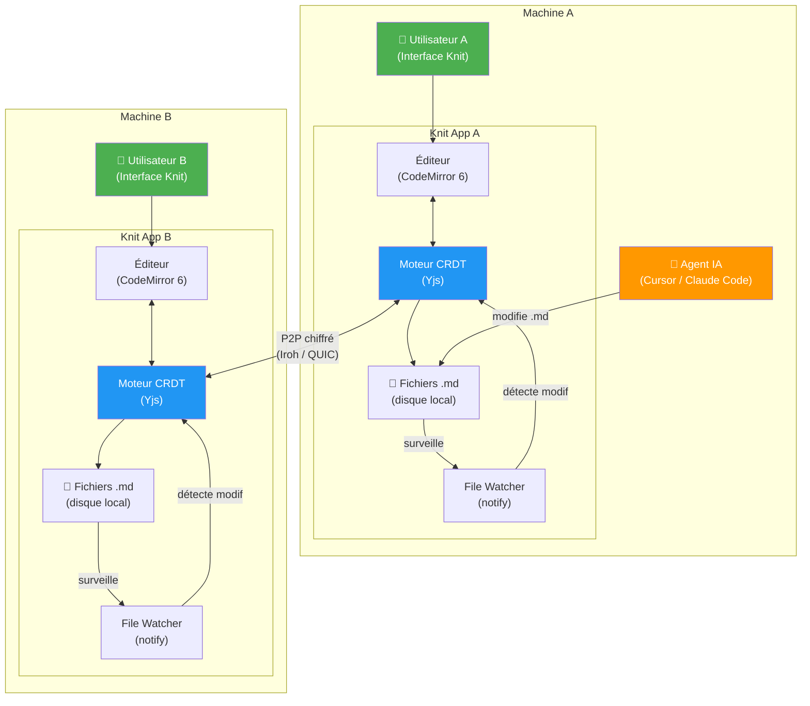
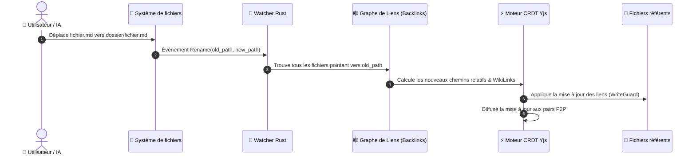
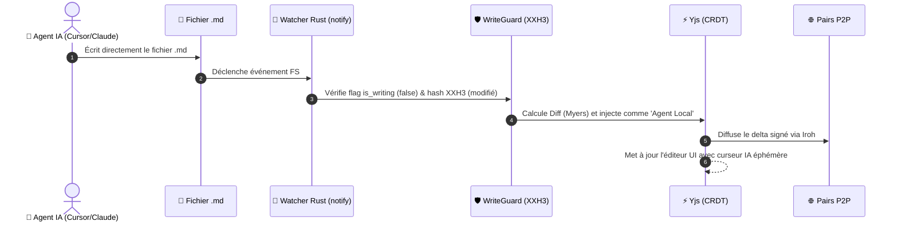

# 🏗️ Architecture Technique

> Document de référence pour l'architecture logicielle de Knit.

---

## Vue d'ensemble



---

## Architecture modulaire

```
knit/
├── knit-core/              # Crate Rust : noyau sans interface
│   ├── src/
│   │   ├── lib.rs          # Point d'entrée
│   │   ├── crdt/           # Gestion Yjs (bindings WASM)
│   │   │   ├── mod.rs
│   │   │   ├── document.rs # Un Y.Doc par fichier .md
│   │   │   └── sync.rs     # Protocole de synchronisation
│   │   ├── watcher/        # File Watcher + WriteGuard
│   │   │   ├── mod.rs
│   │   │   ├── guard.rs    # Triple garde anti-boucle
│   │   │   └── debounce.rs # Debounce 100ms
│   │   ├── network/        # Couche réseau P2P
│   │   │   ├── mod.rs
│   │   │   ├── iroh.rs     # Node Iroh embarqué
│   │   │   ├── blobs.rs    # Transfert P2P Iroh Blobs (images, pièces jointes)
│   │   │   ├── mdns.rs     # Découverte LAN
│   │   │   └── protocol.rs # Protocole Yjs sur QUIC
│   │   ├── vault/          # Gestion du coffre-fort
│   │   │   ├── mod.rs
│   │   │   ├── init.rs     # Création / jonction de vault
│   │   │   ├── assets.rs   # Sauvegarde des images et pièces jointes
│   │   │   ├── config.rs   # .knit/config.yaml
│   │   │   └── identity.rs # Keypair Ed25519
│   │   └── markdown/       # Parseur Markdown
│   │       ├── mod.rs
│   │       ├── frontmatter.rs # YAML frontmatter
│   │       └── diff.rs     # Calcul de diff texte
│   └── Cargo.toml
│
├── knit-app/               # Application Tauri (interface graphique)
│   ├── src-tauri/
│   │   ├── src/
│   │   │   ├── main.rs     # Point d'entrée Tauri
│   │   │   └── commands.rs # Commandes IPC Tauri (I/O, assets, toasts)
│   │   ├── Cargo.toml      # Dépend de knit-core
│   │   └── tauri.conf.json
│   ├── src/                 # Frontend React
│   │   ├── App.tsx
│   │   ├── components/
│   │   │   ├── Editor/      # CodeMirror 6 + Paste image handler
│   │   │   ├── Sidebar/     # Navigation vault
│   │   │   ├── Kanban/      # Vue Kanban
│   │   │   ├── Mermaid/     # Rendu Mermaid
│   │   │   ├── Toast/       # Système de Toast centralisé (bottom-right)
│   │   │   └── Wizard/      # Wizard init
│   │   ├── theme/
│   │   │   ├── tokens.css   # Design tokens
│   │   │   └── theme.ts     # Logique thème + hue
│   │   └── stores/          # État global (toastStore, vaultStore)
│   ├── index.html
│   └── package.json
│
└── Cargo.toml               # Workspace Cargo
```

---

## Stack technologique

| Composant | Technologie | Version | Rôle |
|---|---|---|---|
| **Shell natif** | Tauri v2 | v2.12+ | Conteneur multiplateforme. ~10 Mo |
| **Moteur CRDT** | Yjs | Stable | Fusion sans conflit. Intégration CodeMirror native |
| **Réseau P2P** | Iroh | v1.0+ | Connexion pair-à-pair QUIC, NAT traversal, E2E |
| **File Watcher** | notify (Rust) | Mature | Détection modifications < 1 ms |
| **Éditeur** | CodeMirror 6 | Stable | Texte brut Markdown, fidélité parfaite au `.md` |
| **Interface** | React | v18+ | Frontend UI |
| **Diagrammes** | Mermaid.js | v11+ | Rendu SVG inline dans l'éditeur |
| **Hash rapide** | xxhash-rust | Stable | XXH3 pour le WriteGuard (anti-boucle) |
| **Découverte LAN** | mdns-sd | Stable | mDNS/DNS-SD pour le P2P local sans relay |

---

## Boucles critiques de synchronisation & refactoring

| Boucle | Déclencheur | Flux |
|---|---|---|
| **Humain → Réseau** | L'utilisateur tape dans l'éditeur | Éditeur → CRDT → P2P → Pairs + écriture `.md` sur disque |
| **IA → Réseau** | Un agent IA modifie un `.md` | File Watcher → diff → CRDT → P2P → Pairs |
| **Réseau → Local** | Un pair envoie une modification | P2P → CRDT → mise à jour éditeur + écriture `.md` sur disque |
| **Déplacement / Renommage** | Un fichier est déplacé ou renommé (UI ou disque) | File Watcher/UI → Index Backlinks → Recalcul chemins relatifs → Mise à jour atomique CRDT des fichiers référents |

---

## 🔗 Refactoring Automatique des Liens (Auto-Link Refactoring)

Lorsqu'un fichier ou un sous-dossier est déplacé ou renommé (par exemple `wiki/archi.md` déplacé vers `wiki/core/architecture.md`), **aucun lien ne doit être cassé**.



### 1. Le Graphe de Liens Inversés (Backlink Graph)
Knit maintient en mémoire un graphe orienté de toutes les relations entre documents :
- Pour chaque fichier, Knit connaît la liste exacte des notes qui pointent vers lui.
- Le graphe est mis à jour à chaque modification sans re-scanner tout le disque.

### 2. Détection bidirectionnelle (UI et Disque)
- **Déplacement dans Knit (UI)** : Glisser-déposer un fichier dans un autre dossier de la sidebar ou renommer la note.
- **Déplacement externe (Disque / IA)** : Si Cursor, Claude Code ou une commande terminal (`mv`) déplace le fichier, l'événement `notify::Rename` est immédiatement intercepté par le backend Rust.

### 3. Mise à jour intelligente des deux formats de liens
- **Liens Markdown relatifs standards** :
  - `[Architecture](../wiki/archi.md)` est recalculé en fonction de la position respective de la note appelante : `[Architecture](../wiki/core/architecture.md)`.
- **WikiLinks (`[[...]]`)** :
  - `[[archi]]` est mis à jour en `[[architecture]]` ou `[[core/architecture]]`.
- **Images & Pièces Jointes (`assets/`)** :
  - Si une image est renommée ou déplacée, toutes les balises `` sont refactorisées automatiquement.

### 4. Notification & Traçabilité
- Un toast discret informe l'utilisateur : *"📁 Fichier déplacé : 6 liens mis à jour dans 3 fichiers"*.
- L'opération est enregistrée dans l'historique CRDT de chaque fichier référent (avec possibilité de Time Travel/Undo).

---

## Structure du coffre-fort

### Ce qui est synchronisé (P2P) vs local

```
mon-coffre-fort/
├── .knit/                   # ❌ PAS synchronisé (local uniquement)
│   ├── config.yaml          #    Préférences personnelles (thème, hue)
│   ├── identity/
│   │   ├── keypair.bin      #    Clé privée Ed25519 de CE pair (chmod 0600)
│   │   ├── profile.json     #    Profil local (nom, prénom, email, rôle, toggle privacy)
│   │   └── avatar.png       #    Photo de profil personnalisée (optionnelle)
│   ├── crdt-state/          #    État CRDT binaire
│   ├── snapshots/           #    Snapshots compactés
│   └── cache/               #    Cache local (mermaid SVGs, etc.)
│
├── .knitshare               # ✅ Synchronisé — config partagée du coffre
├── KNIT.md                  # ✅ Synchronisé — instructions pour les IA
├── assets/                  # ✅ Synchronisé (via Iroh Blobs) — images & pièces jointes
├── wiki/                    # ✅ Synchronisé
├── projet/                  # ✅ Synchronisé
│   ├── taches/
│   └── sprints/
└── README.md                # ✅ Synchronisé
```

### Format des tâches

```markdown
---
id: task-001
type: tache
titre: Créer le moteur de synchronisation P2P
statut: en-cours
assigne: Thomas
priorite: haute
sprint: 2026-W42
echeance: 2026-10-20
tags: [backend, p2p, mvp]
---

# Créer le moteur de synchronisation P2P

## Critères d'acceptation
- [x] Initialiser Tauri avec le plugin Iroh
- [ ] Tester la synchronisation entre 2 PC
```

---

## Sécurité réseau

### Modèle hybride

| Contexte | Mécanisme | Serveur impliqué ? |
|---|---|---|
| **LAN** (même réseau) | mDNS/DNS-SD | ❌ Aucun |
Le relay Iroh ne voit que des paquets chiffrés opaques. Il ne peut jamais lire le contenu des fichiers.

---

## 🤖 Mécanique d'Intégration des Agents IA

Comment Knit gère-t-il les modifications effectuées par une IA externe (Cursor, Claude Code, script) ?



1. **Écriture directe sur le disque** : L'IA ne passe par aucune API fermée, elle édite directement le fichier `.md`.
2. **Attribution de l'auteur** : Le système sait que l'opération ne vient ni de l'UI locale ni d'un pair P2P distant. L'opération est donc signée et identifiée comme provenant de `🤖 Agent Local (externe)`.
3. **Concurrence Humain ↔ IA sans conflit** : Si un humain tape dans l'UI pendant que l'IA réécrit une section, le CRDT fusionne les modifications caractère par caractère sans message d'écrasement ou boîte de dialogue bloquante.

---

## ⚡ Performance & Optimisations Implémentées

Knit a été pensé dès sa conception pour éviter tous les pièges de performance des applications de bureau modernes :

| Domaine | Problème classique | Solution optimisée dans Knit | Gain concret |
|---|---|---|---|
| **Moteur d'application** | Electron consomme 300 à 600 Mo de RAM | **Tauri v2 (Rust + Webview OS)** | **< 30 Mo de RAM** au repos, démarrage en < 500ms |
| **File Watching** | Boucle CPU 100% lors des sauvegardes | **Triple Garde WriteGuard (Flag + Hash XXH3 + Debounce)** | **0% CPU** consommé en idle, zéro boucle infinie |
| **Calcul d'intégrité** | MD5/SHA256 lents sur les gros fichiers | **XXH3 (xxhash-rust)** | **~15 Go/s** de débit (hash d'un fichier en < 1 microseconde) |
| **Gestion des Médias** | Saturation de la mémoire CRDT par les images | **Iroh Blobs séparé du CRDT Yjs** | Historique Yjs ultra-léger, streaming efficace des images |
| **Taille de l'historique** | OpLog CRDT infini avec le temps | **Snapshots compactés toutes les 200 opérations** | Espace disque borné dans `.knit/snapshots/` |
| **Rendu Diagrammes** | Saccades lors de la frappe dans un bloc Mermaid | **Debounce 300ms + Cache SVG vectoriel** | Fluidité à 60 fps maintenue pendant la saisie |
| **Notifications UI** | Spam de popups si l'IA modifie 50 fichiers | **Toast Event Debounce & Compteur dynamique** | Un seul toast groupé : *"X fichiers synchronisés"* |
| **Arbre de fichiers** | Ralentissement au-delà de 5 000 fichiers | **Virtualisation de l'arborescence (Windowing)** | Scalable jusqu'à **50 000+ notes** sans lag |

