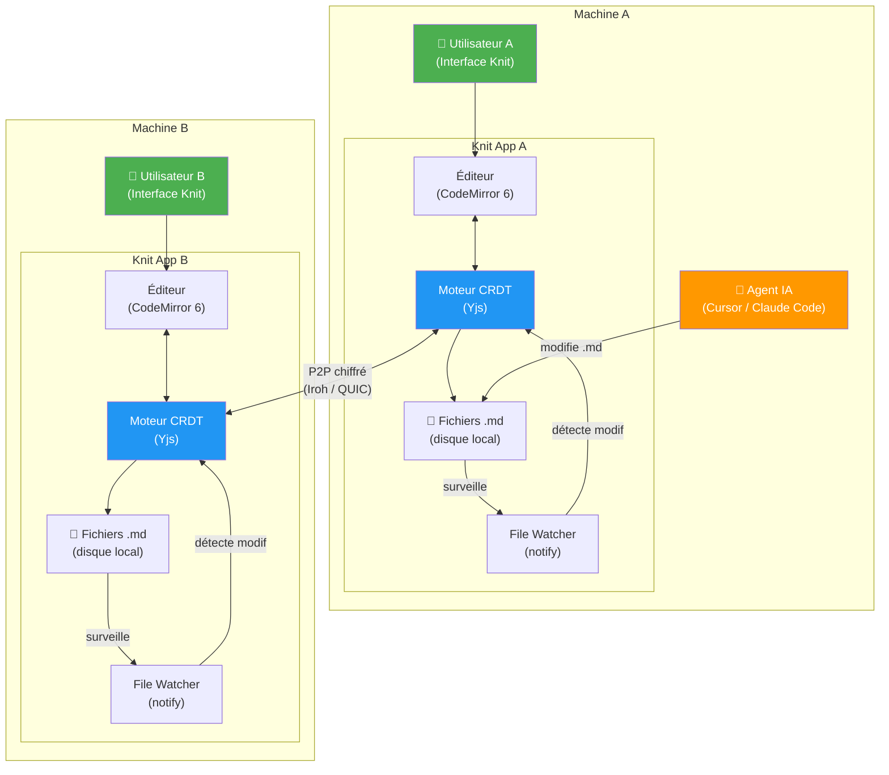
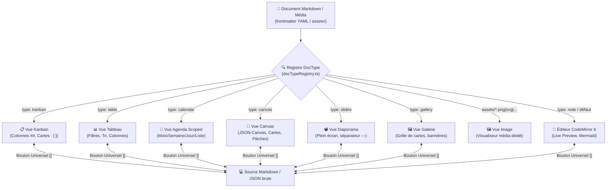
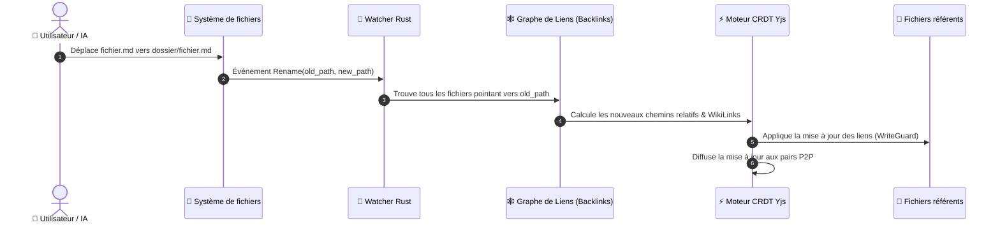
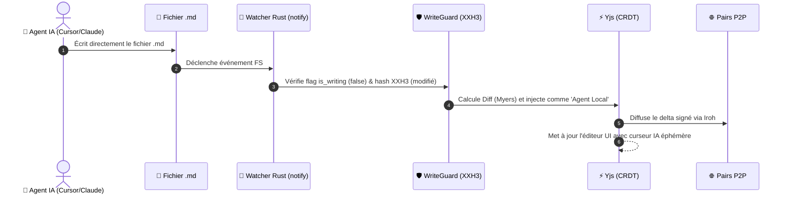

# 🏗️ Architecture Technique

> Document de référence pour l'architecture logicielle de Knit.

---

## Vue d'ensemble



---

## Architecture modulaire

```
knit/
├── knit-core/              # Crate Rust : noyau sans interface
│   ├── src/
│   │   ├── lib.rs          # Point d'entrée
│   │   ├── crdt/           # Gestion Yjs (bindings WASM)
│   │   │   ├── mod.rs
│   │   │   ├── document.rs # Un Y.Doc par fichier .md
│   │   │   └── sync.rs     # Protocole de synchronisation
│   │   ├── watcher/        # File Watcher + WriteGuard
│   │   │   ├── mod.rs
│   │   │   ├── guard.rs    # Triple garde anti-boucle
│   │   │   └── debounce.rs # Debounce 100ms
│   │   ├── network/        # Couche réseau P2P
│   │   │   ├── mod.rs
│   │   │   ├── iroh.rs     # Node Iroh embarqué
│   │   │   ├── blobs.rs    # Transfert P2P Iroh Blobs (images, pièces jointes)
│   │   │   ├── mdns.rs     # Découverte LAN
│   │   │   └── protocol.rs # Protocole Yjs sur QUIC
│   │   ├── vault/          # Gestion du coffre-fort
│   │   │   ├── mod.rs
│   │   │   ├── init.rs     # Création / jonction de vault
│   │   │   ├── assets.rs   # Sauvegarde des images et pièces jointes
│   │   │   ├── config.rs   # .knit/config.yaml
│   │   │   ├── identity.rs # Profil et clé (helpers)
│   │   │   ├── person.rs   # Profil machine, verrou de slot
│   │   │   └── share.rs    # id + nom du .knitshare
│   │   ├── markdown/       # Parseur Markdown & Moteurs d'indexation
│   │   │   ├── mod.rs
│   │   │   ├── frontmatter.rs # YAML frontmatter
│   │   │   ├── diff.rs     # Calcul de diff texte
│   │   │   ├── suggest.rs  # Projection autocomplétion (KnitSuggestIndex < 2ms)
│   │   │   ├── calendar.rs # Projection agenda (KnitCalendarIndex @dates, @heures, @assignations)
│   │   │   └── vault_index.rs # Scan unique B-057 (FM + suggest + tâches + agenda)
│   │   └── vault/          # Gestion du coffre-fort
│   │       ├── mod.rs
│   │       ├── init.rs     # Création / jonction de vault
│   │       ├── tree.rs     # Arborescence et filtrage de fichiers (markdown + médias)
│   │       ├── assets.rs   # Sauvegarde des images et pièces jointes
│   │       ├── config.rs   # .knit/config.yaml
│   │       ├── identity.rs # Profil et clé (helpers)
│   │       ├── person.rs   # Profil machine, verrou de slot
│   │       └── share.rs    # id + nom du .knitshare
│   └── Cargo.toml
│
├── knit-app/               # Application Tauri (interface graphique)
│   ├── src-tauri/
│   │   ├── src/
│   │   │   ├── main.rs     # Point d'entrée Tauri
│   │   │   └── commands.rs # Commandes IPC Tauri (I/O, assets, calendar, toasts)
│   │   ├── Cargo.toml      # Dépend de knit-core
│   │   └── tauri.conf.json
│   ├── src/                 # Frontend React 19 + TypeScript strict
│   │   ├── App.tsx
│   │   ├── components/
│   │   │   ├── Editor/      # CodeMirror 6, Live Preview, Widgets, Hover Preview, Backlinks
│   │   │   ├── Sidebar/     # Arborescence, recherche, tags, panneau agenda
│   │   │   ├── Tabs/        # TabBar universelle, split view, drag & drop d'onglets
│   │   │   ├── Header/      # En-tête, synchronisation, bouton Agenda global (Ctrl+Shift+A)
│   │   │   ├── Kanban/      # Vue Kanban agile (colonnes ##, cartes - [ ])
│   │   │   ├── Calendar/    # Agenda scoped (CalendarView), modale globale (GlobalAgendaModal), widget
│   │   │   ├── Canvas/      # Vue Tableau Blanc infini (JSON-Canvas 2D)
│   │   │   ├── Slides/      # Vue Diaporama plein écran (séparateurs ---)
│   │   │   ├── Gallery/     # Vue Galerie multimédia de cartes
│   │   │   ├── Graph/       # Vue Graphe Local interactif 2D
│   │   │   ├── Modal/       # QuickSwitcher, Palette de commandes, modales d'ajout
│   │   │   ├── Toast/       # Système de Toast centralisé (bottom-right)
│   │   │   └── Wizard/      # Wizard d'accueil
│   │   ├── theme/
│   │   │   ├── tokens.css   # Design tokens HSL (--knit-hue)
│   │   │   └── theme.ts     # Thème clair/sombre
│   │   ├── utils/
│   │   │   └── docTypeRegistry.ts # Registre unique des types Doc-Driven (source de vérité)
│   │   └── stores/          # État global (vaultStore, tabStore, toastStore, debugStore)
│   ├── index.html
│   └── package.json
│
└── Cargo.toml               # Workspace Cargo
```

---

## Stack technologique

| Composant | Technologie | Version | Rôle |
|---|---|---|---|
| **Shell natif** | Tauri v2 | v2.12+ | Conteneur multiplateforme. ~10 Mo |
| **Moteur CRDT** | Yjs | Stable | Fusion sans conflit. Intégration CodeMirror native |
| **Réseau P2P** | Iroh | v1.0+ | Connexion pair-à-pair QUIC, NAT traversal, E2E |
| **File Watcher** | notify (Rust) | Mature | Détection modifications < 1 ms |
| **Éditeur** | CodeMirror 6 | Stable | Texte brut Markdown, fidélité parfaite au `.md` |
| **Interface** | React | v18+ | Frontend UI |
| **Diagrammes** | Mermaid.js | v11+ | Rendu SVG inline dans l'éditeur |
| **Hash rapide** | xxhash-rust | Stable | XXH3 pour le WriteGuard (anti-boucle) |
| **Découverte LAN** | mdns-sd | Stable | mDNS/DNS-SD pour le P2P local sans relay |

---

## Boucles critiques de synchronisation & refactoring

| Boucle | Déclencheur | Flux |
|---|---|---|
| **Humain → Réseau** | L'utilisateur tape dans l'éditeur | Éditeur → CRDT → P2P → Pairs + écriture `.md` sur disque |
| **IA → Réseau** | Un agent IA modifie un `.md` | File Watcher → diff → CRDT → P2P → Pairs |
| **Réseau → Local** | Un pair envoie une modification | P2P → CRDT → mise à jour éditeur + écriture `.md` sur disque |
| **Déplacement / Renommage** | Un fichier est déplacé ou renommé (UI ou disque) | File Watcher/UI → Index Backlinks → Recalcul chemins relatifs → Mise à jour atomique CRDT des fichiers référents |

---

## 📑 Architecture "Doc-Driven Views" (Vues Déclarées dans le Document)

Plutôt que d'imposer un mode d'affichage global déconnecté des fichiers, Knit utilise un modèle de **résolution de vue piloté par le document** (*Doc-Driven Views*) :



### 1. Résolution & Cycle de vie par Onglet (`Tab`)
- Chaque onglet (`Tab`) dans `tabStore` possède son type de vue résolu (`viewMode: 'editor' | 'kanban' | 'table' | 'calendar' | 'canvas' | 'slides' | 'gallery' | 'image'`) et son flag d'affichage brut `isRawSource`.
- La barre d'onglets (`TabBar`) est **universelle et permanente** : elle reste affichée en haut de l'espace de travail quel que soit le type de vue active (hors médias qui n'ont pas de mode source).
- L'icône de l'onglet et de l'arbre s'adapte dynamiquement au type déclaré via la source unique de vérité `docTypeRegistry.ts` (`CONVERTIBLE_DOC_TYPES`).
- **Principe « un onglet = un fichier physique »** : les vues transverses applicatives (Agenda Global du coffre) s'ouvrent en **modale immersive** (`GlobalAgendaModal`, `Ctrl+Shift+A`, Header ou Sidebar) sans créer d'onglet virtuel. Seuls les documents Markdown `type: calendar` délimités à un dossier (`folderScope`) s'ouvrent en onglet standard.

### 2. Conversions Non-Destructives
- La modification du type de vue via le menu contextuel (clic droit explorateur, onglet ou toolbar) met à jour la clé `type:` dans le Frontmatter YAML via la commande `update_frontmatter_field`.
- La conversion d'une note en Kanban préserve les sections `##` comme colonnes ou initialise 3 colonnes standards (`À faire`, `En cours`, `Terminé`) sans aucune perte de texte libre.

### 3. Architecture d'Interception Inline (CodeMirror 6 WidgetType)
Le moteur d'interception de blocs de code dans l'éditeur CodeMirror 6 utilise des décorations `WidgetType` réactives :
- **Blocs Mermaid** (Sprint 6) : ```` ```mermaid ```` → rendu en SVG vectoriel interactif inline avec debounce 300ms.
- **Blocs Dynamiques & Requêtes** (Sprint 6bis — livré) : ```` ```knit-files ````, ```` ```knit-query ````, ```` ```knit-toc ````, ```` ```knit-tasks ```` → interrogent l'index Frontmatter en mémoire (`frontmatterIndex` / `vaultStore.queryFiles()`) et projettent une table, une liste ou un sommaire en temps réel sans altérer le disque.
- **Index coffre unifié (B-057)** : un seul parcours Rust (`get_vault_index` / `vault_index.rs`) hydrate FM, suggest, tâches inline et agenda ; `queryFiles()` reste synchrone sur la Map TS.
- **Invalidation** : `invalidate_vault_index` + rebuild au chargement / watcher ; `upsert` unitaire via `index_markdown_content`.
- **Mutations** : `knit-tasks` bascule une case source via Yjs (`crdtManager`) ou `writeFile` ; `knit-query` peut réécrire `statut:` via `updateFrontmatter`.
- **Assistant tableaux GFM (B-047)** : mini-toolbar (+ ligne / colonne, alignement, supprimer) + `formatTableColumns` dans l'éditeur.
- En mode Source `</>`, le bloc de code brut redevient directement modifiable en texte simple.

---

## 🔗 Refactoring Automatique des Liens (Auto-Link Refactoring)

Lorsqu'un fichier ou un sous-dossier est déplacé ou renommé (par exemple `wiki/archi.md` déplacé vers `wiki/core/architecture.md`), **aucun lien ne doit être cassé**.



### 1. Le Graphe de Liens Inversés (Backlink Graph)
Knit maintient en mémoire un graphe orienté de toutes les relations entre documents :
- Pour chaque fichier, Knit connaît la liste exacte des notes qui pointent vers lui.
- Le graphe est mis à jour à chaque modification sans re-scanner tout le disque.

### 2. Détection bidirectionnelle (UI et Disque)
- **Déplacement dans Knit (UI)** : Glisser-déposer un fichier dans un autre dossier de la sidebar ou renommer la note.
- **Déplacement externe (Disque / IA)** : Si Cursor, Claude Code ou une commande terminal (`mv`) déplace le fichier, l'événement `notify::Rename` est immédiatement intercepté par le backend Rust.

### 3. Mise à jour intelligente des deux formats de liens
- **Liens Markdown relatifs standards** :
  - `[Architecture](../wiki/archi.md)` est recalculé en fonction de la position respective de la note appelante : `[Architecture](../wiki/core/architecture.md)`.
- **WikiLinks (`[[...]]`)** :
  - `[[archi]]` est mis à jour en `[[architecture]]` ou `[[core/architecture]]`.
- **Images & Pièces Jointes (`assets/`)** :
  - Si une image est renommée ou déplacée, toutes les balises `` sont refactorisées automatiquement.

### 4. Notification & Traçabilité
- Un toast discret informe l'utilisateur : *"📁 Fichier déplacé : 6 liens mis à jour dans 3 fichiers"*.
- L'opération est enregistrée dans l'historique CRDT de chaque fichier référent (avec possibilité de Time Travel/Undo).

---

## Structure du coffre-fort

### Ce qui est synchronisé (P2P) vs local

```
mon-coffre-fort/
├── .knit/                   # ❌ PAS synchronisé (local uniquement)
│   ├── config.yaml          #    Préférences personnelles (thème, hue)
│   ├── crdt-state/          #    Updates Yjs des fichiers fermés (local)
│   ├── snapshots/           #    Snapshots compactés
│   └── cache/               #    Cache local (mermaid SVGs, etc.)
│
├── .knitshare               # ✅ Répliqué — nom + id du coffre (pas la personne)
├── KNIT.md                  # ✅ Synchronisé — guide universel pour IA
├── .cursor/rules/knit.mdc   # ✅ Synchronisé — règles pour Cursor IDE
├── CLAUDE.md                # ✅ Synchronisé — instructions Claude Code
├── .agents/skills/knit/     # ✅ Synchronisé — skill Antigravity & Gemini
├── .github/copilot-instructions.md # ✅ Synchronisé — instructions GitHub Copilot
├── assets/                  # ✅ Synchronisé (via Iroh Blobs) — images & pièces jointes
├── wiki/                    # ✅ Synchronisé
├── projet/                  # ✅ Synchronisé
│   ├── taches/
│   └── sprints/
└── README.md                # ✅ Synchronisé
```

La clé Ed25519 et le profil affiché (le nom que les autres voient) sont dans le répertoire de données de l'application, un slot verrouillé par fenêtre. Deux dossiers locaux ne partagent un coffre que s'ils portent le même `id` dans `.knitshare`. Un join copie les fichiers manquants après ce contrôle ; un dossier déjà occupé par un autre coffre n'est pas écrasé.

### Format des tâches

```markdown
---
id: task-001
type: tache
titre: Créer le moteur de synchronisation P2P
statut: en-cours
assigne: Thomas
priorite: haute
sprint: 2026-W42
echeance: 2026-10-20
tags: [backend, p2p, mvp]
---

# Créer le moteur de synchronisation P2P

## Critères d'acceptation
- [x] Initialiser Tauri avec le plugin Iroh
- [ ] Tester la synchronisation entre 2 PC
```

---

## Sécurité réseau

### Modèle hybride

| Contexte | Mécanisme | Serveur impliqué ? |
|---|---|---|
| **LAN** (même réseau) | mDNS/DNS-SD | ❌ Aucun |
Le relay Iroh ne voit que des paquets chiffrés opaques. Il ne peut jamais lire le contenu des fichiers.

---

## 🤖 Mécanique d'Intégration des Agents IA

Comment Knit gère-t-il les modifications effectuées par une IA externe (Cursor, Claude Code, script) ?



1. **Écriture directe sur le disque** : L'IA ne passe par aucune API fermée, elle édite directement le fichier `.md`.
2. **Attribution de l'auteur** : Le système sait que l'opération ne vient ni de l'UI locale ni d'un pair P2P distant. L'opération est donc signée et identifiée comme provenant de `🤖 Agent Local (externe)`.
3. **Concurrence Humain ↔ IA sans conflit** : Si un humain tape dans l'UI pendant que l'IA réécrit une section, le CRDT fusionne les modifications caractère par caractère sans message d'écrasement ou boîte de dialogue bloquante.

---

## ⚡ Performance & Optimisations Implémentées

Knit a été pensé dès sa conception pour éviter tous les pièges de performance des applications de bureau modernes :

| Domaine | Problème classique | Solution optimisée dans Knit | Gain concret |
|---|---|---|---|
| **Moteur d'application** | Electron consomme 300 à 600 Mo de RAM | **Tauri v2 (Rust + Webview OS)** | **< 30 Mo de RAM** au repos, démarrage en < 500ms |
| **File Watching** | Boucle CPU 100% lors des sauvegardes | **Triple Garde WriteGuard (Flag + Hash XXH3 + Debounce)** | **0% CPU** consommé en idle, zéro boucle infinie |
| **Calcul d'intégrité** | MD5/SHA256 lents sur les gros fichiers | **XXH3 (xxhash-rust)** | **~15 Go/s** de débit (hash d'un fichier en < 1 microseconde) |
| **Gestion des Médias** | Saturation de la mémoire CRDT par les images | **Iroh Blobs séparé du CRDT Yjs** | Historique Yjs ultra-léger, streaming efficace des images |
| **Taille de l'historique** | OpLog CRDT infini avec le temps | **Snapshots compactés toutes les 200 opérations** | Espace disque borné dans `.knit/snapshots/` |
| **Rendu Diagrammes** | Saccades lors de la frappe dans un bloc Mermaid | **Debounce 300ms + Cache SVG vectoriel** | Fluidité à 60 fps maintenue pendant la saisie |
| **Notifications UI** | Spam de popups si l'IA modifie 50 fichiers | **Toast Event Debounce & Compteur dynamique** | Un seul toast groupé : *"X fichiers synchronisés"* |
| **Arbre de fichiers** | Ralentissement au-delà de 5 000 fichiers | **Virtualisation de l'arborescence (Windowing)** | Scalable jusqu'à **50 000+ notes** sans lag |
| **Gestion mémoire CRDT** | Inflation de la RAM lors de l'ouverture de 100+ notes | **Pool LRU (max 20 Y.Docs en RAM)** | Empreinte RAM contenue à **< 60 Mo** en session prolongée |
| **Souveraineté Réseau** | Fuite involontaire de paquets vers des relays WAN | **Mode Réseau Local Strict (Air-Gapped Toggle)** | **0 paquet émis sur Internet**, P2P 100% LAN/mDNS |

