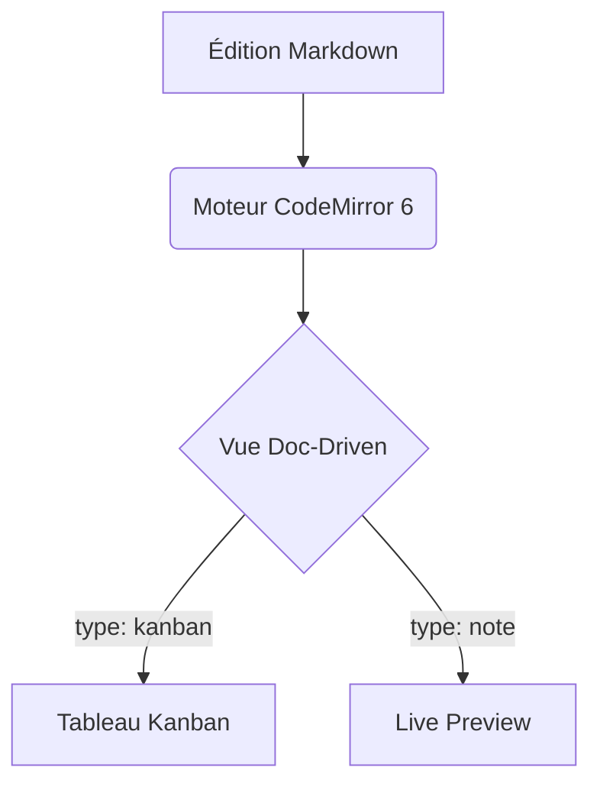

# 📝 Spécification Markdown & Propriétés YAML de Knit

> **Standard de données de Knit** : 100% Markdown pur (CommonMark / GFM) avec métadonnées Frontmatter YAML.  
> Aucune base de données propriétaire, interopérabilité totale avec Obsidian, VS Code, Git et Yjs.

---

## 1. Principes Fondamentaux

1. **Le Document pilote la Vue (*Doc-Driven Views*)** :
   Chaque note déclare son type d'affichage via son en-tête Frontmatter YAML (`type: ...`). Lorsqu'un utilisateur ouvre un fichier ou navigue entre des onglets, Knit résout instantanément la vue correspondante (**Note**, **Kanban**, ou **Tableau**) sans exiger de manipulation manuelle.
2. **Préservation absolue des données** :
   L'alternance entre vues visuelles (Kanban interactif, Tableau filtrable) et code source brut (`</>`) ne détruit jamais le texte, les commentaires ou les champs YAML non reconnus.
3. **Local-First & Zéro Lock-in** :
   Un tableau Kanban Knit ouvert dans Obsidian ou VS Code reste un fichier Markdown parfaitement lisible et éditable.

---

## 2. Propriétés Frontmatter YAML Supportées

Un document Markdown dans Knit commence par un bloc YAML délimité par `---` en tête de fichier :

```markdown
---
type: kanban
titre: Suivi Sprint 6
statut: en-cours
priorite: haute
assigne: Sublix
tags: [front, sprint-6, p2p]
echeance: 2027-01-12
id: TASK-042
---

# Suivi Sprint 6

Contenu du document...
```

### Table des Propriétés Standardisées

| Clé YAML | Alias acceptés | Types / Valeurs possibles | Description & Rôle dans Knit |
|---|---|---|---|
| **`type`** | `knit_view`, `view` | `note` (ou `markdown`), `kanban`, `table`<br/>*(Futurs v0.4.0 : `canvas`, `calendar`, `slides`, `gallery`)* | **Type de vue principale**. Définit si le document s'ouvre dans l'Éditeur de note, le Tableau Kanban ou la Vue Tableau. |
| **`titre`** | `title` | Texte (ex: `"Feuille de route 2027"`) | Titre d'affichage dans la TabBar et l'en-tête (si absent, le premier `# Titre` ou le nom de fichier est utilisé). |
| **`statut`** | `status` | `a-faire` (`todo`), `en-cours` (`in-progress`), `termine` (`done`), `bloque` (`blocked`) | Cycle de vie de la note/tâche. Affiche une pastille colorée interactive en haut de la note. |
| **`priorite`** | `priority` | `basse` (`low`), `moyenne` (`medium`), `haute` (`high`), `urgente` (`urgent`) | Niveau de criticité avec code couleur doux. |
| **`assigne`** | `assignee` | Chaîne (initiales ou prénom/pseudo, ex: `"Sublix"`, `"Thomas"`) | Collaborateur responsable. Affiche un badge avatar personnalisé dans l'en-tête. |
| **`tags`** | `tag` | Liste YAML `[projet, p2p]` ou multiligne `- front` | Catégorisation pour le volet d'exploration de tags et la recherche globale. |
| **`id`** | `ticket`, `key` | Chaîne (ex: `B-026`, `TASK-102`) | Identifiant de suivi court affiché en badge `#id`. |
| **`echeance`** | `due_date`, `due` | Date ISO `YYYY-MM-DD` | Date limite de réalisation. |
| **`created`** | `date` | Date/Heure ISO | Date de création du document. |
| **`updated`** | `modified` | Date/Heure ISO | Date de dernière modification substantielle. |
| **`icon`** | — | Emoji (`📋`, `🧶`) ou nom d'icône (`kanban`, `star`) | Icône personnalisée dans l'arbre de fichiers et l'onglet. |

> [!TIP]
> **Compatibilité Obsidian** : Le champ historique `kanban-plugin: basic` utilisé par le plugin Obsidian Kanban est également reconnu en lecture comme `type: kanban`.

---

## 3. Comportement des Vues Pilotées par le Document (*Doc-Driven Views*)

### Résolution de la Vue Active
Lors de la sélection d'un fichier ou du changement d'onglet actif :
1. **Lecture du Frontmatter** :
   - Si `type: kanban` (ou `view: kanban` ou `kanban-plugin: basic`) → Affichage direct en **Vue Kanban**.
   - Si `type: table` (ou `view: table`) → Affichage direct en **Vue Tableau**.
   - Si `type: note` (ou `markdown` ou absence de `type`) → Affichage en **Éditeur Markdown**.
2. **Détection heuristique de secours (si pas de frontmatter explicite)** :
   - Fichiers nommés `*.kanban.md` ou contenant des colonnes Kanban typiques → Vue Kanban.
   - Autres fichiers `.md` → Éditeur de note Markdown standard.
3. **Persistance par Onglet (`Tab`)** :
   - Chaque onglet retient sa vue et son état `isRawSource`.
   - Naviguer entre deux onglets n'altère jamais la vue du document d'à côté.

---

## 4. Règles de Conversion Intelligentes (Menu Contextuel)

L'utilisateur peut changer le type d'un document à tout moment via le menu contextuel :
- Clic droit sur le fichier dans l'explorateur (**TreeNode**).
- Clic droit sur l'onglet actif (**TabBar**).
- Menu déroulant dans l'en-tête du document.

```
Changer le type de vue ▸
  📝 Note Markdown classique
  📋 Tableau Kanban
  📊 Vue Tableau récapitulatif
```

### Scénario 1 : Conversion d'une Note Markdown vers un Tableau Kanban

| État initial du document | Action effectuée par Knit | Résultat visuel |
|---|---|---|
| **Le document contient déjà des sections `## Titre`** | Knit ajoute/met à jour `type: kanban` dans le frontmatter YAML sans toucher au texte. | Chaque section `##` devient une colonne Kanban. Les listes `- [ ]` et `- [x]` deviennent les cartes de leurs colonnes respectives. |
| **Le document n'a AUCUNE section `##`** (texte libre ou liste simple) | 1. Le titre `#` et les paragraphes d'introduction restent en *préambule*.<br/>2. Knit structure 3 colonnes standards :<br/>   - `## À faire` (reçoit les éléments `- [ ]` ou le texte initial)<br/>   - `## En cours`<br/>   - `## Terminé` (reçoit les éléments `- [x]`) | Le document est immédiatement un Kanban fonctionnel et ordonné, sans perte d'information. |

### Scénario 2 : Conversion vers la Vue Tableau

- Knit applique `type: table`.
- Les cartes sont projetées sous forme de tableau interactif avec tri par colonne, filtre textuel et cases à cocher synchronisées.

### Scénario 3 : Reconversion vers une Note Markdown classique

- Knit remplace `type: kanban` ou `type: table` par `type: note` (ou retire la clé).
- Le document redevient instantanément un fichier Markdown éditable en texte brut dans CodeMirror 6.
- Les sections `##` et cases à cocher `- [ ]` sont conservées à l'identique.

> [!NOTE]
> Toutes les conversions de type de document s'inscrivent dans l'historique global `historyStore` : une annulation avec `Ctrl+Z` ou via le Toast restaure immédiatement le format antérieur.

---

## 5. Bascule Universelle Source `</>` ↔ Rendu Visuel

Chaque vue dispose dans son en-tête d'un bouton d'action universel :

```
[ </> Code Source ] ↔ [ 👁️ Vue Visuelle ]  (Raccourci : Ctrl+E ou Ctrl+/)
```

- **En Vue Kanban** : Permet de basculer instantanément vers l'éditeur de texte CodeMirror 6 pour éditer directement le Markdown brut, puis de recliquer pour revenir au tableau visuel sans recharger la page.
- **En Vue Tableau** : Idem.
- **En Note Markdown** : Permet d'alterner entre le mode **Live Preview** (rendu dynamique des titres, gras, callouts et diagrammes Mermaid) et le mode **Source Brute** (syntaxe brute visible).

---

## 6. Syntaxes Markdown Riches Supportées

### 1. WikiLinks Bidirectionnels
```markdown
[[Nom de la note]]
[[dossier/nom-note|Texte alternatif du lien]]
```
- Autocomplétion instantanée à la frappe de `[[`.
- Renommage automatique des liens lors du déplacement d'une cible.

### 2. Blocs Diagrammes Mermaid Inline (Sprint 6)
````markdown

````
- Rendu SVG inline vivant avec coloration syntaxique et thème synchronisé `--knit-hue`.
- Clic direct sur le diagramme pour en modifier le code à la volée.

### 3. Callouts GFM (Alertes Épurées)
```markdown
> [!NOTE]
> Information contextuelle sobre avec bordure fine et fond neutre feutré.

> [!TIP]
> Astuce de productivité ou raccourci clavier.

> [!WARNING]
> Avertissement de compatibilité ou précaution d'usage.
```

### 4. Cases à cocher et Tâches
```markdown
- [ ] Tâche à réaliser
- [x] Tâche terminée
```
- Interactives au clic dans l'éditeur, dans la vue Kanban et dans la vue Tableau.

---

## 7. Blocs Dynamiques & Requêtes en Temps Réel (*Dynamic Query Blocks*)

Knit permet d'insérer des blocs de code déclaratifs qui génèrent des **vues dynamiques projetées en direct**, sans jamais avoir à modifier manuellement la page d'accueil ou le tableau de bord lorsqu'un fichier est créé ou déplacé sur le disque.

Le contenu sous-jacent reste un simple bloc de code Markdown, garantissant 0% de données polluées sur le disque.

### 1. Sommaire Dynamique (`knit-toc`)
Génère automatiquement la table des matières de la note courante, mise à jour en temps réel lors de la frappe :
````markdown
```knit-toc
depth: 3
collapsible: true
```
````
- Liste cliquable avec saut direct vers les titres `#`, `##`, `###`.
- S'insère en 1 seconde via la Slash command `/sommaire`.

### 2. Index Automatique de Fichiers (`knit-files`)
Élimine le besoin de maintenir manuellement des pages index (MOC / Map of Content). Liste ou affiche en cartes tous les fichiers d'un répertoire :
````markdown
```knit-files
folder: "projets/knit"
sort: updated desc
limit: 10
layout: table
```
````
- Dès qu'un fichier est créé dans `projets/knit/`, il apparaît automatiquement dans la liste sans toucher au document hôte.
- Met en valeur l'icône, le titre, le statut et la date de dernière modification.

### 3. Tableau Dynamique de Métadonnées (`knit-query`) (Dataview-like)
Agrège et filtre les propriétés YAML de l'ensemble du coffre sous forme de tableau interactif :
````markdown
```knit-query
from: "projets"
where: statut != "termine"
sort: priorite desc
columns: [titre, statut, priorite, assigne, echeance]
```
````
- Rendu d'un tableau triable et filtrable en direct.
- Cliquer sur un statut permet de le changer directement depuis le tableau projeté, mettant à jour le fichier cible sur le disque.

### 4. Agrégateur de Tâches Transversales (`knit-tasks`)
Rassemble toutes les cases `- [ ]` dispersées dans plusieurs documents pour créer une vue Todo globale :
````markdown
```knit-tasks
from: "sprint-6"
status: todo
group_by: file
```
````
- Cocher une case dans le bloc dynamique coche instantanément la case dans le fichier `.md` d'origine via CRDT / Yjs !

