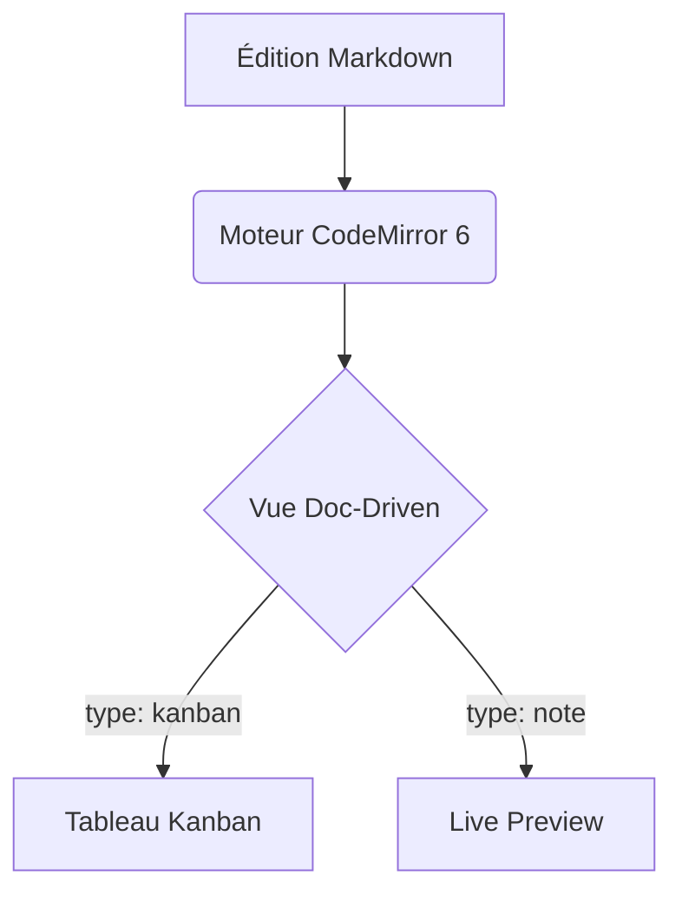

# 📝 Spécification Markdown & Propriétés YAML de Knit

> **Standard de données de Knit** : 100% Markdown pur (CommonMark / GFM) avec métadonnées Frontmatter YAML.  
> Aucune base de données propriétaire, interopérabilité totale avec Obsidian, VS Code, Git et Yjs.

---

## 1. Principes Fondamentaux

1. **Le Document pilote la Vue (*Doc-Driven Views*)** :
   Chaque note déclare son type d'affichage via son en-tête Frontmatter YAML (`type: ...`). Lorsqu'un utilisateur ouvre un fichier ou navigue entre des onglets, Knit résout instantanément la vue correspondante (**Note**, **Kanban**, ou **Tableau**) sans exiger de manipulation manuelle.
2. **Préservation absolue des données** :
   L'alternance entre vues visuelles (Kanban interactif, Tableau filtrable) et code source brut (`</>`) ne détruit jamais le texte, les commentaires ou les champs YAML non reconnus.
3. **Local-First & Zéro Lock-in** :
   Un tableau Kanban Knit ouvert dans Obsidian ou VS Code reste un fichier Markdown parfaitement lisible et éditable.

---

## 2. Propriétés Frontmatter YAML Supportées

Un document Markdown dans Knit commence par un bloc YAML délimité par `---` en tête de fichier :

```markdown
---
type: kanban
titre: Suivi Sprint 6
statut: en-cours
priorite: haute
assigne: Sublix
tags: [front, sprint-6, p2p]
echeance: 2027-01-12
id: TASK-042
---

# Suivi Sprint 6

Contenu du document...
```

### Table des Propriétés Standardisées

| Clé YAML | Alias acceptés | Types / Valeurs possibles | Description & Rôle dans Knit |
|---|---|---|---|
| **`type`** | `knit_view`, `view` | `note` (ou `markdown`), `kanban`, `table`, `calendar`, `canvas`, `slides`, `gallery` | **Type de vue principale**. Définit la vue Doc-Driven (éditeur, kanban, tableau, agenda, canvas, diaporama, galerie). |
| **`titre`** | `title` | Texte (ex: `"Feuille de route 2027"`) | Titre d'affichage dans la TabBar et l'en-tête (si absent, le premier `# Titre` ou le nom de fichier est utilisé). |
| **`statut`** | `status` | `a-faire` (`todo`), `en-cours` (`in-progress`), `termine` (`done`), `bloque` (`blocked`) | Cycle de vie de la note/tâche. Affiche une pastille colorée interactive en haut de la note. |
| **`priorite`** | `priority` | `basse` (`low`), `moyenne` (`medium`), `haute` (`high`), `urgente` (`urgent`) | Niveau de criticité avec code couleur doux. |
| **`assigne`** | `assignee` | Chaîne (initiales ou prénom/pseudo, ex: `"Sublix"`, `"Thomas"`) | Collaborateur responsable. Affiche un badge avatar personnalisé dans l'en-tête. |
| **`tags`** | `tag` | Liste YAML `[projet, p2p]` ou multiligne `- front` | Catégorisation pour le volet d'exploration de tags et la recherche globale. |
| **`id`** | `ticket`, `key` | Chaîne (ex: `B-026`, `TASK-102`) | Identifiant de suivi court affiché en badge `#id`. |
| **`echeance`** | `due_date`, `due` | Date ISO `YYYY-MM-DD` | Date limite de réalisation. |
| **`created`** | `date` | Date/Heure ISO | Date de création du document. |
| **`updated`** | `modified` | Date/Heure ISO | Date de dernière modification substantielle. |
| **`icon`** | — | Emoji (`📋`, `🧶`) ou nom d'icône (`kanban`, `star`) | Icône personnalisée dans l'arbre de fichiers et l'onglet. |

> [!TIP]
> **Compatibilité Obsidian** : Le champ historique `kanban-plugin: basic` utilisé par le plugin Obsidian Kanban est également reconnu en lecture comme `type: kanban`.

---

## 3. Comportement des Vues Pilotées par le Document (*Doc-Driven Views*)

### Résolution de la Vue Active
Lors de la sélection d'un fichier ou du changement d'onglet actif :
1. **Lecture du Frontmatter** :
   - Si `type: kanban` (ou `view: kanban` ou `kanban-plugin: basic`) → Affichage direct en **Vue Kanban**.
   - Si `type: table` (ou `view: table`) → Affichage direct en **Vue Tableau**.
   - Si `type: calendar` → **Vue Agenda scoped** en onglet fichier (agrégation `KnitCalendarIndex` sur le dossier hôte). L’Agenda **global** du coffre est une modale applicative (pas un fichier / pas un onglet virtuel).
   - Si `type: canvas` → **Vue Canvas** (JSON-Canvas).
   - Si `type: slides` → **Vue Diaporama** (séparateurs `---` hors frontmatter).
   - Si `type: gallery` → **Vue Galerie** (grille de cartes).
   - Si `type: note` (ou `markdown` ou absence de `type`) → Affichage en **Éditeur Markdown**.
2. **Détection heuristique de secours (si pas de frontmatter explicite)** :
   - Fichiers nommés `*.kanban.md` ou contenant des colonnes Kanban typiques → Vue Kanban.
   - Autres fichiers `.md` → Éditeur de note Markdown standard.
3. **Persistance par Onglet (`Tab`)** :
   - Chaque onglet retient sa vue et son état `isRawSource`.
   - Naviguer entre deux onglets n'altère jamais la vue du document d'à côté.

---

## 4. Règles de Conversion Intelligentes (Menu Contextuel)

L'utilisateur peut changer le type d'un document à tout moment via le menu contextuel :
- Clic droit sur le fichier dans l'explorateur (**TreeNode**).
- Clic droit sur l'onglet actif (**TabBar**).
- Menu déroulant dans l'en-tête du document.

```
Changer le type de vue ▸
  📝 Note Markdown classique
  📋 Tableau Kanban
  📊 Vue Tableau récapitulatif
```

### Scénario 1 : Conversion d'une Note Markdown vers un Tableau Kanban

| État initial du document | Action effectuée par Knit | Résultat visuel |
|---|---|---|
| **Le document contient déjà des sections `## Titre`** | Knit ajoute/met à jour `type: kanban` dans le frontmatter YAML sans toucher au texte. | Chaque section `##` devient une colonne Kanban. Les listes `- [ ]` et `- [x]` deviennent les cartes de leurs colonnes respectives. |
| **Le document n'a AUCUNE section `##`** (texte libre ou liste simple) | 1. Le titre `#` et les paragraphes d'introduction restent en *préambule*.<br/>2. Knit structure 3 colonnes standards :<br/>   - `## À faire` (reçoit les éléments `- [ ]` ou le texte initial)<br/>   - `## En cours`<br/>   - `## Terminé` (reçoit les éléments `- [x]`) | Le document est immédiatement un Kanban fonctionnel et ordonné, sans perte d'information. |

### Scénario 2 : Conversion vers la Vue Tableau

- Knit applique `type: table`.
- Les cartes sont projetées sous forme de tableau interactif avec tri par colonne, filtre textuel et cases à cocher synchronisées.

### Scénario 3 : Reconversion vers une Note Markdown classique

- Knit remplace le type par `type: note` (ou retire la clé).
- Le document redevient instantanément un fichier Markdown éditable en texte brut dans CodeMirror 6.
- Les sections `##` et cases à cocher `- [ ]` sont conservées à l'identique.

### Scénario 4 : Conversion vers la Vue Agenda de Projet

- Knit applique `type: calendar`.
- Le document s'ouvre en vue calendrier (Mois, Semaine, Jour, Liste) en agrégeant toutes les tâches `@YYYY-MM-DD`, heures et réunions contenues dans le dossier de la note (`folderScope`).

### Scénario 5 : Conversion vers la Vue Canvas (Tableau Blanc infini)

- Knit applique `type: canvas`.
- Knit initialise une structure standard JSON-Canvas ```` ```canvas {"nodes": [], "edges": []} ``` ```` préservant le texte préexistant en carte initiale.

### Scénario 6 : Conversion vers la Vue Diaporama

- Knit applique `type: slides`.
- Le document est segmenté en diapositives projetables plein écran à chaque séparateur horizontal `---`.

### Scénario 7 : Conversion vers la Vue Galerie

- Knit applique `type: gallery`.
- Projette les notes associées sous forme de grille de cartes visuelles exploitant les images `assets/` et les bannières déclarées (`banner:`, `cover:`).

> [!NOTE]
> Toutes les conversions de type de document s'inscrivent dans l'historique global `historyStore` : une annulation avec `Ctrl+Z` ou via le Toast restaure immédiatement le format antérieur.

---

## 5. Bascule Universelle Source `</>` ↔ Rendu Visuel

Chaque vue dispose dans son en-tête d'un bouton d'action universel :

```
[ </> Code Source ] ↔ [ 👁️ Vue Visuelle ]  (Raccourci : Ctrl+E ou Ctrl+/)
```

- **En Vue Kanban** : Permet de basculer instantanément vers l'éditeur de texte CodeMirror 6 pour éditer directement le Markdown brut, puis de recliquer pour revenir au tableau visuel sans recharger la page.
- **En Vue Tableau** : Idem.
- **En Vue Canvas, Diaporama, Galerie et Agenda** : Permet de basculer instantanément vers le texte brut (Markdown ou JSON-Canvas) sous-jacent pour un contrôle total sans perte de données.
- **En Note Markdown** : Permet d'alterner entre le mode **Live Preview** (rendu dynamique des titres, gras, callouts, blocs dynamiques et diagrammes Mermaid) et le mode **Source Brute** (syntaxe brute visible).

---

## 6. Syntaxes Markdown Riches Supportées

### 1. WikiLinks Bidirectionnels & Deep-Linking (B-026b & B-052)
```markdown
[[Nom de la note]]                       # Lien simple vers une note
[[dossier/nom-note|Texte alternatif]]    # Lien avec alias d'affichage
[[architecture#Moteur CRDT]]             # Deep-link vers une section/titre d'une autre note
[[#Installation]]                        # Ancre interne vers un titre de la note active
[[note^crdt-block]]                      # Référence de bloc/paragraphe spécifique
```
- **Autocomplétion déclenchée par `[[`** : liste les fichiers du coffre, propose les titres dès la saisie de `#` et les blocs sur `^`.
- **Refactoring automatique** : le déplacement ou renommage d'un document met à jour automatiquement tous ses liens référents.
- **Navigation au clic / `Ctrl+Clic`** : ouvre instantanément la cible dans l'onglet actif ou dans un nouvel onglet, avec scroll vers l'ancre ciblée.

### 2. Mentions de Collaborateurs, Dates Échéances & Attribution Vault (B-052 & B-031a)
```markdown
# Tâche assignée à un collaborateur précis avec date et plage horaire
- [ ] Préparer la démo client @Thomas H. @2026-10-20 14:00-15:30

# Tâche assignée collectivement à l'ensemble du coffre / équipe
- [ ] Sauvegarder les assets du vault @vault @2026-10-21

# Tâche avec échéance stricte sans heure
- [ ] Finaliser la relecture due: 2026-10-25
```
- **Déclencheurs** :
  - `@` : Autocomplète les collaborateurs locaux et l'entité spéciale `@vault` (assignation générale au coffre).
  - `@@` : Raccourcis de date (`@@aujourd'hui`, `@@demain`, `@@lundi`, `@@YYYY-MM-DD`).
- **Formats d'heures et durées supportés** :
  - Date simple : `@2026-10-20`
  - Date avec heure de début : `@2026-10-20 14:30` ou `@2026-10-20T14:30`
  - Date avec plage horaire : `@2026-10-20 14:00-15:30`
- **Frontmatter de document** (assignation globale au niveau de la note) :
  ```yaml
  ---
  title: Réunion Stratégie
  date: 2026-10-20T14:00:00
  assignee: @Thomas H.      # ou assignee: vault (partagée avec tous les pairs)
  participants: [@Sarah, @Alex]
  ---
  ```
- **Filtrage d'Agenda** : permet d'isoler en 1 clic « Mon Agenda » (tâches qui me sont attribuées + tâches `@vault` collectives) ou « Agenda Collaborateur X » ou « Agenda Coffre Complet ».

### 3. Smart UX de Rédaction & Navigation Humaine (B-053)
- **Smart Paste (Lien/Image sur sélection)** :
  - Sélectionner du texte et presser `Ctrl+V` avec une URL transforme le texte en `[Texte](url)` sans écraser la sélection.
  - Coller une image sur une sélection génère ``.
- **Auto-Wrap par symboles** :
  - Sélectionner un mot et taper `[` l'entoure de `[[...]]`.
  - Taper `*` l'entoure de `*...*` (ou `**...**`).
  - Taper `` ` `` l'entoure de `` `...` ``.
  - Taper `~` l'entoure de `~~...~~`.
- **Formatage dynamique des tableaux (`Tab` / `Entrée`)** :
  - `Tab` navigue vers la cellule suivante en alignant automatiquement les séparateurs `|`.
  - `Entrée` crée immédiatement la ligne suivante avec les barres verticales alignées.
- **Hover Preview (Prévisualisation flottante au survol)** :
  - Bus global `knit-hover-link` + `HoverPreviewHost` (pas limité à l’éditeur).
  - Survoler un `[[Lien]]` ou une cible fichier ouvre une infobulle avec le contenu Markdown ; pin sticky au survol de la fenêtre ou via `Ctrl`/`Cmd`.
- **Raccourci Note Quotidienne (`Ctrl+Shift+J` ou `Alt+D`)** :
  - Ouvre ou initialise instantanément la note du jour `journal/YYYY-MM-DD.md` avec le modèle par défaut.
- **Panneau latéral de Rétroliens (Backlinks Panel)** :
  - Volet dédié listant toutes les notes pointant vers le document actif (liens explicites `[[...]]` et mentions non liées).

### 4. Tags Hiérarchiques
```markdown
#projet
#projet/sprint-6
#dev/rust/p2p
```
- Déclenché à la frappe de `#` : suggestions instantanées avec compteur d'occurrences.

### 5. Blocs Diagrammes Mermaid Inline (Sprint 6)
````markdown

````
- Rendu SVG inline vivant avec coloration syntaxique et thème synchronisé `--knit-hue`.
- Clic direct sur le diagramme pour en modifier le code à la volée.

### 6. Callouts GFM (Alertes Épurées)
```markdown
> [!NOTE]
> Information contextuelle sobre avec bordure fine et fond neutre feutré.

> [!TIP]
> Astuce de productivité ou raccourci clavier.

> [!WARNING]
> Avertissement de compatibilité ou précaution d'usage.
```

### 7. Cases à cocher, Tâches Étendues & Indicateurs de Progrès (Sprint 6 — B-054)
```markdown
- [ ] Tâche à réaliser (statut: à faire)
- [/] Tâche en cours d'exécution (statut: en cours, icône sablier / demi-jauge)
- [x] Tâche validée et terminée (statut: fait, texte feutré barré)
- [-] Tâche annulée ou abandonnée (statut: annulé)
- [?] Tâche en attente d'arbitrage ou de retour (statut: question)
- [>] Tâche reportée ou déléguée (statut: reporté, flèche droite)
- [!] Tâche urgente / critique (statut: urgent, point d'exclamation)
```

#### Priorités Inline Ultra-Légères
```markdown
- [ ] Corriger le bug critique de fusion Yjs !p1 @Thomas H. @2026-10-20
- [ ] Améliorer la lisibilité du contraste !p2
- [ ] Nettoyer les dépendances non utilisées !p3
```
- **`!p1`** : Priorité urgente / critique (badge rouge doux feutré).
- **`!p2`** : Priorité haute (badge ambre feutré).
- **`!p3`** : Priorité basse / secondaire (badge gris feutré).

#### Mini-Barre de Progression Automatique (Inline Note Progress)
Lorsque Knit détecte des tâches `- [ ]` dans une note :
- Un indicateur discret de 2px de haut s'affiche sous le premier titre `#` :
  ```
  [████████████░░░░░░] 12 / 18 tâches complétées (67%)
  ```
- **Zéro surcharge** : Aucun code ou balise n'est écrit sur le disque ; l'indicateur est projeté en temps réel par le Live Preview de CodeMirror 6.
- **Bijectivité Kanban** : Déplacer une carte vers la colonne « En cours » met à jour la case en `- [/]`. La glisser dans « Terminé » la transforme en `- [x]`.

---

## 7. Blocs Dynamiques & Requêtes en Temps Réel (*Dynamic Query Blocks*)

> **Statut** : Sprint 6bis **livré** — runtime via Live Preview + `vaultStore.queryFiles()` / `frontmatterIndex`. Démo coffre : `demo_vault/blocs-dynamiques.md`.

Knit permet d'insérer des blocs de code déclaratifs qui génèrent des **vues dynamiques projetées en direct**, sans jamais avoir à modifier manuellement la page d'accueil ou le tableau de bord lorsqu'un fichier est créé ou déplacé sur le disque.

Le contenu sous-jacent reste un simple bloc de code Markdown, garantissant 0% de données polluées sur le disque.

### 1. Sommaire Dynamique (`knit-toc`)
Génère automatiquement la table des matières de la note courante, mise à jour en temps réel lors de la frappe :
````markdown
```knit-toc
depth: 3
collapsible: true
```
````
- Liste cliquable avec saut direct vers les titres `#`, `##`, `###`.
- S'insère en 1 seconde via la Slash command `/sommaire`.

### 2. Index Automatique de Fichiers (`knit-files`)
Élimine le besoin de maintenir manuellement des pages index (MOC / Map of Content). Liste ou affiche en cartes tous les fichiers d'un répertoire :
````markdown
```knit-files
folder: "projets/knit"
sort: updated desc
limit: 10
layout: table
```
````
- Dès qu'un fichier est créé dans `projets/knit/`, il apparaît automatiquement dans la liste sans toucher au document hôte.
- Met en valeur l'icône, le titre, le statut et la date de dernière modification.

### 3. Tableau Dynamique de Métadonnées (`knit-query`) (Dataview-like)
Agrège et filtre les propriétés YAML de l'ensemble du coffre sous forme de tableau interactif :
````markdown
```knit-query
from: "projets"
where: statut != "termine"
sort: priorite desc
columns: [titre, statut, priorite, assigne, echeance]
```
````
- Rendu d'un tableau triable et filtrable en direct.
- Cliquer sur un statut permet de le changer directement depuis le tableau projeté, mettant à jour le fichier cible sur le disque.

### 4. Agrégateur de Tâches Transversales (`knit-tasks`)
Rassemble toutes les cases `- [ ]` dispersées dans plusieurs documents pour créer une vue Todo globale :
````markdown
```knit-tasks
from: "sprint-6"
status: todo
group_by: file
```
````
- Cocher une case dans le bloc dynamique coche instantanément la case dans le fichier `.md` d'origine via CRDT / Yjs !

---

## 8. HTML sécurisé en Live Preview (B-059)

Knit autorise un sous-ensemble HTML standard dans le Markdown, projeté hors curseur :

| Balise | Rendu |
|---|---|
| `<kbd>` | Touche clavier stylisée |
| `<u>` | Souligné |
| `<mark>` | Surlignage feutré |
| `<sub>` / `<sup>` | Indice / exposant |
| `<br>` | Saut de ligne forcé |
| `<details>` / `<summary>` | Accordion natif |

**Sanitizer** : `<script>`, `<iframe>`, `<object>`, `<style>` et attributs `on*` sont systématiquement neutralisés (local + P2P). Le même filtre s'applique à `renderSimpleMarkdown` (infobulles, widgets).

**Démo** : `demo_vault/html-securise.md`.

