# 🧶 Knit — Les 9 Piliers du Projet

> Chaque décision technique et design doit pouvoir se rattacher à l'un de ces piliers. Si une feature ne sert aucun pilier, elle n'a pas sa place dans Knit.

---

## Vue d'ensemble

```mermaid
graph TD
    K["🧶 KNIT"]

    P1["📁 1. Local-First<br/>Tes données, ton disque"]
    P2["🔗 2. P2P Sans Serveur<br/>Les machines parlent entre elles"]
    P3["📝 3. Markdown Pur<br/>Fichiers .md lisibles partout"]
    P4["🤖 4. Agent-Friendly<br/>Les IA éditent nativement"]
    P5["⚡ 5. Zéro Conflit, Zéro Latence<br/>CRDT + temps réel"]
    P6["🎨 6. UI/UX Premium & Simple<br/>Belle, rapide, pas gadget"]
    P7["🖥️ 7. Multiplateforme<br/>Windows + Linux natif"]
    P8["🧩 8. Modulaire & Extensible<br/>Core séparé, plugins, templates"]
    P9["📊 9. Mermaid Natif<br/>Diagrammes rendus live dans léditeur"]

    K --> P1
    K --> P2
    K --> P3
    K --> P4
    K --> P5
    K --> P6
    K --> P7
    K --> P8
    K --> P9

    style K fill:#7C3AED,color:#fff,stroke:#5B21B6,stroke-width:3px
    style P1 fill:#1E293B,color:#E2E8F0,stroke:#334155
    style P2 fill:#1E293B,color:#E2E8F0,stroke:#334155
    style P3 fill:#1E293B,color:#E2E8F0,stroke:#334155
    style P4 fill:#1E293B,color:#E2E8F0,stroke:#334155
    style P5 fill:#1E293B,color:#E2E8F0,stroke:#334155
    style P6 fill:#1E293B,color:#E2E8F0,stroke:#334155
    style P7 fill:#1E293B,color:#E2E8F0,stroke:#334155
    style P8 fill:#1E293B,color:#E2E8F0,stroke:#334155
    style P9 fill:#1E293B,color:#E2E8F0,stroke:#334155
```



---

## Pilier 1 — 📁 Local-First

> *"Tes données restent sur ton disque. Toujours."*

| Aspect | Détail |
|---|---|
| **Principe** | Les fichiers vivent dans un dossier normal de l'explorateur. Pas de base de données opaque, pas de cloud obligatoire |
| **Conséquence** | L'app fonctionne **à 100% hors-ligne**. Le réseau est un bonus, pas une dépendance |
| **Propriété** | L'utilisateur est le seul propriétaire de ses données. Aucun compte, aucune inscription |
| **Persistance** | Le vault survit à la désinstallation de Knit — ce sont juste des fichiers |

**Règle d'or** : Si Knit disparaît demain, l'utilisateur garde un dossier de fichiers `.md` parfaitement lisibles.

---

## Pilier 2 — 🔗 P2P Sans Serveur Central

> *"Les machines parlent entre elles, directement."*

| Aspect | Détail |
|---|---|
| **Principe** | Synchronisation pair-à-pair via Iroh (QUIC). Pas de serveur central qui stocke ou route les données |
| **Bootstrap** | Relay Iroh pour la découverte initiale (il ne voit que des paquets chiffrés). mDNS en LAN pour du vrai 0-serveur |
| **Chiffrement** | E2E natif (Ed25519 + QUIC TLS 1.3). Le relay ne peut jamais lire le contenu |
| **Résilience** | Si un pair tombe, les autres continuent. Pas de single point of failure |

**Règle d'or** : Aucune donnée en clair ne transite par un tiers. Jamais.

---

## Pilier 3 — 📝 Markdown Pur

> *"Le format universel que tout le monde lit."*

| Aspect | Détail |
|---|---|
| **Principe** | Chaque page wiki, chaque tâche, chaque sprint = un fichier `.md` avec du YAML frontmatter |
| **Interopérabilité** | Lisible dans VS Code, Obsidian, GitHub, un terminal `cat`, un bloc-notes |
| **Pas de format propriétaire** | Zéro dépendance au format interne de Knit pour accéder à ses propres données |
| **Structure** | Organisation par dossiers (`wiki/`, `projet/taches/`, `projet/sprints/`) |

**Règle d'or** : Un fichier créé dans Knit doit être parfaitement lisible et modifiable dans n'importe quel éditeur de texte.

---

## Pilier 4 — 🤖 Agent-Friendly

> *"Cursor, Claude Code, Antigravity — ils sont chez eux dans le vault."*

| Aspect | Détail |
|---|---|
| **Principe** | Les agents IA ouvrent le dossier du vault et lisent/écrivent les `.md` directement. Knit détecte et propage les changements |
| **File Watcher** | Détection en < 1 ms de toute modification externe (notify crate) |
| **`KNIT.md`** | Fichier d'instructions à la racine pour guider les agents (conventions, structure, statuts valides) |
| **Boucle sûre** | Write Lock + hash pour éviter la boucle infinie Watcher ↔ CRDT |

**Règle d'or** : Si un agent IA modifie `task-042.md`, le changement apparaît dans l'interface Knit et chez tous les pairs en moins de 2 secondes.

### 🛡️ Règle de Développement IA : Le Typage Strict (sauf si contre-productif)

Pour garantir une collaboration fiable et sans régression entre développeurs humains et agents IA (Cursor, Claude Code, Antigravity) :

- **Le typage fort comme contrat d'interface** :
  - **TypeScript (`knit-app`)** : `strict: true`, interdiction des `any` paresseux, interfaces et types de données explicites. Les types stricts constituent le meilleur garde-fou empêchant les agents IA d'halluciner ou d'introduire des erreurs silencieuses.
  - **Rust (`knit-core` & `src-tauri`)** : Typage fort et exhaustif avec `Result<T, KnitError>` et `Option<T>`, zéro `unwrap()` ou `expect()` non maîtrisé en production.
- **La nuance pragmatique ("Sauf si contre-productif")** :
  - Le typage fort doit accélérer et fiabiliser le projet, jamais le paralyser.
  - Si un sur-typage théorique extrême (gymnastique de types génériques imbriqués, métaprogrammation complexe) complique inutilement la lecture du code ou bloque la productivité sans gain réel de robustesse, l'implémentation pragmatique et lisible l'emporte.

---

## Pilier 5 — ⚡ Zéro Conflit, Zéro Latence

> *"Deux personnes tapent au même endroit → ça fusionne, toujours."*

| Aspect | Détail |
|---|---|
| **Principe** | Moteur CRDT (Yjs) — les modifications concurrentes fusionnent mathématiquement sans conflit |
| **Latence** | LAN : < 5 ms. Internet : < 100 ms (via QUIC/Iroh) |
| **Hors-ligne** | Les opérations s'accumulent localement et se rejouent à la reconnexion |
| **Déterminisme** | Le résultat de la fusion est identique sur tous les pairs, quel que soit l'ordre de réception |

**Règle d'or** : Il est **impossible** de perdre du travail ou de créer un fichier `.sync-conflict`. Le CRDT garantit la convergence.

---

## Pilier 6 — 🎨 UI/UX Premium & Simple

> *"Belle, rapide, pas gadget. Pas de look « généré par une IA »."*

C'est le pilier qui fait que les gens **veulent** utiliser Knit au lieu d'être **obligés**. L'interface doit respirer la qualité artisanale.

### Principes directeurs

| Principe | Ce que ça veut dire concrètement |
|---|---|
| **Simple & efficace** | Chaque écran a un but unique. Pas de sidebar avec 40 icônes. Pas de menus imbriqués sur 5 niveaux |
| **Pas de look IA** | Pas de gradients néon, pas de glassmorphism excessif, pas de particules animées. Un design **humain**, chaleureux, maîtrisé |
| **Arrondis cohérents** | Tous les éléments utilisent des `border-radius` harmonieux (petits pour les boutons, moyens pour les cartes, grands pour les modales). Rien de carré brut, rien de trop rond |
| **Animations subtiles** | Transitions douces sur les états (hover, focus, ouverture de panneau). Jamais de bounce ou de spring exagéré. L'animation est au service de la compréhension, pas du spectacle |
| **Densité d'information** | L'interface montre ce qu'il faut, quand il faut. Un mode compact pour les power users, un mode aéré par défaut |

### Système de thème centralisé

Tout le design repose sur un **Design Token System** — un fichier unique de variables CSS qui contrôle l'apparence entière de l'app :

```css
/* knit-theme.css — Fichier unique de tokens */
:root {
  /* === COULEUR PRINCIPALE (modifiable par l'utilisateur) === */
  --knit-hue: 260;                              /* Violet par défaut */

  /* Palette auto-générée à partir du hue */
  --knit-primary:       hsl(var(--knit-hue), 55%, 55%);
  --knit-primary-hover: hsl(var(--knit-hue), 55%, 48%);
  --knit-primary-soft:  hsl(var(--knit-hue), 40%, 94%);
  --knit-primary-muted: hsl(var(--knit-hue), 20%, 70%);

  /* Surface & fond */
  --knit-bg:            #FAFAFA;
  --knit-surface:       #FFFFFF;
  --knit-surface-hover: #F5F5F5;
  --knit-border:        #E5E5E5;

  /* Texte */
  --knit-text:          #1A1A1A;
  --knit-text-secondary:#6B6B6B;
  --knit-text-muted:    #A0A0A0;

  /* Arrondis */
  --knit-radius-xs:     4px;    /* Tags, badges */
  --knit-radius-sm:     6px;    /* Boutons, inputs */
  --knit-radius-md:     10px;   /* Cartes, panneaux */
  --knit-radius-lg:     16px;   /* Modales, dropdowns */
  --knit-radius-xl:     24px;   /* Conteneurs principaux */

  /* Ombres */
  --knit-shadow-sm:     0 1px 2px rgba(0,0,0,0.05);
  --knit-shadow-md:     0 4px 12px rgba(0,0,0,0.08);
  --knit-shadow-lg:     0 12px 32px rgba(0,0,0,0.12);

  /* Transitions */
  --knit-transition:    150ms ease;
  --knit-transition-slow: 300ms ease;

  /* Typographie */
  --knit-font:          'Inter', -apple-system, sans-serif;
  --knit-font-mono:     'JetBrains Mono', 'Fira Code', monospace;
}

/* === THEME SOMBRE === */
[data-theme="dark"] {
  --knit-bg:            #0F0F0F;
  --knit-surface:       #1A1A1A;
  --knit-surface-hover: #252525;
  --knit-border:        #2A2A2A;
  --knit-text:          #ECECEC;
  --knit-text-secondary:#8A8A8A;
  --knit-text-muted:    #555555;
  --knit-shadow-sm:     0 1px 2px rgba(0,0,0,0.2);
  --knit-shadow-md:     0 4px 12px rgba(0,0,0,0.3);
  --knit-shadow-lg:     0 12px 32px rgba(0,0,0,0.4);
}
```

### Comment la couleur principale fonctionne

L'utilisateur choisit **une seule valeur** : le `--knit-hue` (un angle de 0 à 360 sur le cercle chromatique). Toute la palette se recalcule automatiquement :

| Hue | Couleur | Ambiance |
|---|---|---|
| `0` | 🔴 Rouge | Énergique |
| `30` | 🟠 Orange | Chaleureuse |
| `140` | 🟢 Vert | Nature, apaisante |
| `210` | 🔵 Bleu | Pro, classique |
| `260` | 🟣 Violet | *(défaut)* Créatif, moderne |
| `330` | 🩷 Rose | Doux, original |

> [!TIP]
> Un simple slider dans les paramètres suffit. L'utilisateur voit la couleur changer en temps réel sur toute l'interface.

### Identité visuelle — Ce que Knit n'est PAS

| ❌ Ce qu'on évite | ✅ Ce qu'on fait |
|---|---|
| Gradients arc-en-ciel partout | Couleur principale unie + neutres doux |
| Glassmorphism flou sur chaque carte | Surfaces opaques propres, ombres légères |
| Animations "wow" à chaque clic | Transitions de 150ms, presque imperceptibles |
| Sidebar pleine d'icônes colorées | Navigation minimale, hiérarchie claire |
| Typo fantaisie / titres en gras partout | Inter (ou équivalent), hiérarchie par taille uniquement |
| Dark mode = fond bleu marine | Dark mode = vrais noirs/gris neutres |

---

## Pilier 7 — 🖥️ Multiplateforme

> *"Windows et Linux. Natif. Pas un wrapper web lent."*

| Aspect | Détail |
|---|---|
| **Technologie** | Tauri v2 : compile en binaire natif sur chaque OS |
| **Taille** | ~10 Mo installé (vs ~150 Mo pour une app Electron) |
| **Performances** | Backend Rust natif + WebView système (pas de Chromium embarqué) |
| **Installation** | `.msi` / `.exe` sur Windows, `.AppImage` / `.deb` sur Linux |
| **Comportement natif** | Raccourcis clavier OS, barre des tâches, tray icon, notifications système |

**Règle d'or** : L'app doit se sentir **native** sur chaque OS. Pas comme un site web dans une fenêtre.

---

## Pilier 8 — 🧩 Modulaire & Extensible

> *"Un noyau solide. Des extensions au-dessus."*

| Aspect | Détail |
|---|---|
| **Architecture** | `knit-core` (Rust, headless) séparé de `knit-app` (Tauri, UI) |
| **Mode daemon** | `knit daemon` tourne sans interface pour les serveurs/agents IA |
| **Templates** | `.knit/templates/` pour créer des tâches/pages standardisées |
| **Vues projets** | Kanban, tableau, calendrier — construites sur le même moteur de fichiers |
| **Futur** | Système de plugins pour des vues custom (post-MVP) |

**Règle d'or** : Knit est un framework avec une app par-dessus, pas une app monolithique.

---

## Pilier 9 — 📊 Mermaid Natif

> *"Écris un diagramme en texte. Vois-le apparaître sous tes yeux."*

### Pourquoi c'est un pilier à part entière

Les fichiers `.md` d'un wiki ou d'une roadmap contiennent énormément de **diagrammes** : architectures, flux de données, séquences d'appels, organigrammes, diagrammes de Gantt. Mermaid est le standard de facto pour écrire des diagrammes en texte brut — compatible GitHub, GitLab, Obsidian, et surtout **parfaitement lisible et modifiable par les agents IA**.

Knit doit rendre les diagrammes Mermaid **nativement**, sans plugin externe, directement dans l'éditeur.

### Expérience utilisateur cible

| Étape | Ce qui se passe |
|---|---|
| 1. L'utilisateur tape ` ```mermaid ` | L'éditeur entre en mode "bloc diagramme" (coloration syntaxique Mermaid) |
| 2. Il écrit le code du diagramme | Coloration en temps réel (mots-clés `graph`, `sequenceDiagram`, `-->`, etc.) |
| 3. Il ferme avec ` ``` ` ou quitte le bloc | Le code est **remplacé visuellement** par le rendu SVG du diagramme |
| 4. Il clique sur le diagramme rendu | Retour au code source pour éditer — transition douce |

### Deux modes d'affichage

```mermaid
graph LR
    subgraph "Mode Édition"
        CODE["```mermaid<br/>graph TD<br/>  A-->B<br/>```"]
    end
    
    subgraph "Mode Aperçu"
        SVG["Diagramme SVG<br/>rendu en direct"]
    end
    
    CODE -->|"quitte le bloc"| SVG
    SVG -->|"clic sur le diagramme"| CODE
    
    style CODE fill:#1E293B,color:#E2E8F0,stroke:#334155
    style SVG fill:#7C3AED,color:#fff,stroke:#5B21B6
```

| Mode | Quand | Ce qu'on voit |
|---|---|---|
| **Code** | Le curseur est **dans** le bloc mermaid | Texte source avec coloration syntaxique, fond légèrement teinté |
| **Rendu** | Le curseur est **hors** du bloc mermaid | Le SVG du diagramme, dans une carte aux bords arrondis avec une ombre douce |

### Règles de design UI/UX pour les diagrammes

| Règle | Détail |
|---|---|
| **Carte conteneur** | Le diagramme est affiché dans une carte avec `border-radius: var(--knit-radius-md)`, ombre `var(--knit-shadow-sm)`, padding confortable |
| **Pas de scroll horizontal** | Le SVG s'adapte à la largeur du conteneur (`max-width: 100%`). Si le diagramme est très large, un bouton "Ouvrir en plein écran" apparaît |
| **Thème Mermaid = thème Knit** | Le diagramme hérite des couleurs du thème Knit (via un thème Mermaid custom basé sur `--knit-hue`). Dark mode → diagramme en dark mode |
| **Transition code ↔ rendu** | Fade-in/fade-out de 200ms. Pas de "flash" brutal |
| **Indicateur visuel** | En mode rendu, une petite icône 📊 discrète + label "Mermaid" en haut à droite de la carte |
| **Erreur gracieuse** | Si la syntaxe Mermaid est invalide → afficher le message d'erreur dans la carte (pas de crash, pas de disparition) |

### Thème Mermaid personnalisé (synchronisé avec `--knit-hue`)

```javascript
// mermaid-knit-theme.js
function getKnitMermaidTheme(hue, isDark) {
  return {
    theme: 'base',
    themeVariables: {
      // Fond et surfaces
      background:       isDark ? '#1A1A1A' : '#FFFFFF',
      mainBkg:          `hsl(${hue}, 40%, ${isDark ? '25%' : '94%'})`,
      secondBkg:        `hsl(${hue}, 30%, ${isDark ? '20%' : '90%'})`,

      // Texte
      primaryTextColor:  isDark ? '#ECECEC' : '#1A1A1A',
      secondaryTextColor: isDark ? '#8A8A8A' : '#6B6B6B',

      // Nœuds et arêtes
      primaryColor:      `hsl(${hue}, 55%, 55%)`,
      primaryBorderColor:`hsl(${hue}, 55%, 40%)`,
      lineColor:         `hsl(${hue}, 20%, ${isDark ? '50%' : '60%'})`,

      // Séquences
      actorBkg:          `hsl(${hue}, 40%, ${isDark ? '25%' : '92%'})`,
      actorBorder:       `hsl(${hue}, 55%, 55%)`,
      signalColor:       isDark ? '#ECECEC' : '#1A1A1A',

      // Arrondis (cohérents avec le design system)
      nodeBorder:        `hsl(${hue}, 55%, 40%)`,

      // Fonts
      fontFamily:        "'Inter', -apple-system, sans-serif",
      fontSize:          '14px',
    }
  };
}
```

### Types de diagrammes supportés (priorité)

| Priorité | Type Mermaid | Cas d'usage dans Knit |
|---|---|---|
| 🔴 MVP | `graph` / `flowchart` | Architecture, flux de données, organigrammes |
| 🔴 MVP | `sequenceDiagram` | Interactions P2P, flux utilisateur |
| 🟡 Phase 3 | `gantt` | Planning de projet, roadmap temporelle |
| 🟡 Phase 3 | `classDiagram` | Documentation technique, modèles de données |
| 🟢 Post-MVP | `pie`, `mindmap`, `timeline` | Dashboards, brainstorming |
| 🟢 Post-MVP | `gitGraph` | Visualisation des branches |

### Intégration technique dans CodeMirror 6

```
L'éditeur CodeMirror 6 utilise un ViewPlugin qui :

1. Scanne le document pour trouver les blocs ```mermaid ... ```
2. Si le curseur est HORS du bloc :
   → Crée un MermaidWidget (WidgetType) qui remplace le bloc par un <div>
   → Appelle mermaid.render(id, code) pour générer le SVG
   → Affiche le SVG dans la carte avec les styles Knit
3. Si le curseur ENTRE dans le bloc :
   → Retire le widget, affiche le code source
   → Coloration syntaxique via codemirror-lang-mermaid
4. Debounce de 300ms sur le rendu pour éviter de re-render à chaque frappe
```

### Interaction avec les agents IA

Un agent IA peut écrire un diagramme Mermaid dans un fichier `.md` et le résultat sera rendu automatiquement dans Knit :

```markdown
<!-- Un agent IA écrit ceci dans wiki/architecture.md -->

## Architecture du système

` ``mermaid
graph TD
    A["Client Knit"] -->|"CRDT sync"| B["Iroh P2P"]
    B --> C["Pair distant"]
    A --> D["File System"]
    D -->|"notify"| A
` ``
```

Knit détecte la modification (File Watcher), met à jour le CRDT, et affiche le diagramme rendu dans l'interface — le tout en moins de 2 secondes.

**Règle d'or** : Un diagramme Mermaid dans Knit doit être aussi beau et lisible que dans la documentation GitHub, avec les couleurs du thème de l'utilisateur.

---

## Résumé — Les 9 piliers en une phrase chacun

| # | Pilier | En une phrase |
|---|---|---|
| 1 | **📁 Local-First** | Tes fichiers, ton disque, ton contrôle total |
| 2 | **🔗 P2P Sans Serveur** | Les machines se parlent directement, chiffré de bout en bout |
| 3 | **📝 Markdown Pur** | Le format universel, lisible partout, par tous |
| 4 | **🤖 Agent-Friendly** | Les IA sont des citoyens de première classe dans le vault |
| 5 | **⚡ Zéro Conflit** | Les CRDT garantissent la fusion sans jamais perdre de données |
| 6 | **🎨 UI/UX Premium** | Simple, arrondie, thème centralisé, couleur personnalisable |
| 7 | **🖥️ Multiplateforme** | Natif sur Windows et Linux, léger et rapide |
| 8 | **🧩 Modulaire** | Core séparé, daemon headless, extensible par design |
| 9 | **📊 Mermaid Natif** | Diagrammes rendus live, thématisés, directement dans l'éditeur |

