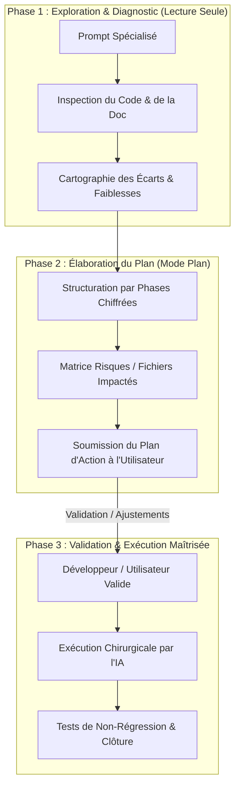

# 🤖 Prompts IA Optimisés — Mode Plan & Ingénierie Avancée

> **Référentiel des Prompts IA Standardisés** pour les assistants et modèles de raisonnement de dernière génération (Claude 3.5/3.7 Sonnet, Gemini 2.5/3.0/3.8 Flash & Pro, OpenAI o1/o3-mini/GPT-4o, DeepSeek-R1/V3).  
> **Principe Cardinal** : **Mode Plan Obligatoire** — Analyse approfondie, formulation d'un plan d'action structuré avec points de validation, **zéro modification de code sans validation explicite de l'utilisateur**.

---

## 🗂️ Vue Directe & Catégorisation des Prompts

> **Lancement Express** : Saisissez simplement la commande rapide dans le chat de votre assistant IA (ex: `fait prompt 9`, `réalise sprint 6ter`, `fait prompt 1`).  
> L'IA s'exécute automatiquement en **Mode Plan** (lecture seule, diagnostic et proposition de plan sans toucher au code).

### 🏗️ Architecture, Typage & Refactorisation
- **Prompt 1 : Nettoyage & Refactorisation Architecturale**
  - **Commande** : `fait prompt 1` / `prompt 1`
  - **Action** : Traiter la dette technique, supprimer le code mort, factoriser (DRY), découpler (SRP) et renforcer le typage strict.
  - **Lien** : [Aller au Prompt 1](#-prompt-1--nettoyage--refactorisation-architecturale)
- **Prompt 9 : Audit & Centralisation : Types, Utilitaires & Moteur CRDT**
  - **Commande** : `fait prompt 9` / `prompt 9`
  - **Action** : Rassembler 100% des types dans `src/types/index.ts`, utilitaires dans `src/utils/`, encapsuler le CRDT et les conversions binaires 32 Ko.
  - **Lien** : [Aller au Prompt 9](#-prompt-9--audit--centralisation--types-utilitaires--moteur-crdt)

### ⚡ Performance & Sécurité
- **Prompt 2 : Diagnostic de Performance & Goulets d'Étranglement**
  - **Commande** : `fait prompt 2` / `prompt 2`
  - **Action** : Détecter les re-renders React superflus, latence IPC Tauri, parsing bloquant, mémoire CRDT et flush disque 250ms.
  - **Lien** : [Aller au Prompt 2](#-prompt-2--diagnostic-de-performance-goulets-d%C3%A9tranglement--solutions-modernes)
- **Prompt 4 : Audit de Failles de Sécurité & Renforcement Sans Perte d'UX**
  - **Commande** : `fait prompt 4` / `prompt 4`
  - **Action** : Sécuriser les commandes IPC Tauri, sandboxing Webview, injection XSS Markdown/SVG/Mermaid, durcissement sans popup.
  - **Lien** : [Aller au Prompt 4](#-prompt-4--audit-de-failles-de-s%C3%A9curit%C3%A9--renforcement-sans-perte-dux)

### 🎨 Produit, Expérience Utilisateur & Internationalisation
- **Prompt 3 : Détection Exhaustive des Textes & Architecture i18n (Front/Back)**
  - **Commande** : `fait prompt 3` / `prompt 3`
  - **Action** : Détecter 100% des chaînes en dur, architecture type-safe, traduction dynamique des erreurs Rust `KnitError`.
  - **Lien** : [Aller au Prompt 3](#-prompt-3--d%C3%A9tection-exhaustive-des-textes--architecture-dinternationalisation-i18n-frontback)
- **Prompt 5 : Stratégie UX / UI & Fonctionnalités Différenciantes « Killer App »**
  - **Commande** : `fait prompt 5` / `prompt 5`
  - **Action** : Benchmark vs Obsidian/Notion/Linear, micro-interactions 150ms, zéro émoji UI, spécification de User Stories clés.
  - **Lien** : [Aller au Prompt 5](#-prompt-5--strat%C3%A9gie-ux--ui--fonctionnalit%C3%A9s-diff%C3%A9renciantes--killer-app-)

### 👥 Collaboration P2P & Assurance Qualité
- **Prompt 7 : Collaboration Temps Réel P2P, Présence & Expérience Multi-Utilisateurs**
  - **Commande** : `fait prompt 7` / `prompt 7`
  - **Action** : Co-édition feutrée (curseurs fins 2px, sélection 18%), présence P2P Iroh, synchronisation `.knitshare`, résilience offline.
  - **Lien** : [Aller au Prompt 7](#-prompt-7--collaboration-temps-r%C3%A9el-p2p-pr%C3%A9sence--exp%C3%A9rience-multi-utilisateurs)
- **Prompt 8 : Stratégie de Tests, Couverture & Assurance Qualité (Rust/React/Tauri/CRDT)**
  - **Commande** : `fait prompt 8` / `prompt 8`
  - **Action** : Harnais Vitest frontend, tests unitaires Rust, mocks Tauri IPC, 0 test fragile, boucle de feedback < 15s.
  - **Lien** : [Aller au Prompt 8](#-prompt-8--strat%C3%A9gie-de-tests-couverture--assurance-qualit%C3%A9-rust-react-tauri--p2pcrdt)

### 🚀 Sprints, Cycle de Vie & Gouvernance
- **Prompt 6 : Analyse d'Alignement Global (Code, Documentation, Versions & Directives IA)**
  - **Commande** : `fait prompt 6` / `prompt 6`
  - **Action** : Cohérence stricte des 6 sources de version, synchronisation code ↔ `docs/`, règles IA et budget `.knit/AI_MEMORY.md`.
  - **Lien** : [Aller au Prompt 6](#-prompt-6--analyse-dalignement-global-code-documentation-versions--directives-ia)
- **Prompt 10 : Réalisation, Audit d'Avancement & Clôture de Sprint (Sprint X)**
  - **Commande** : `fait prompt 10 [sprint]` / `réalise sprint X` / `clôture sprint X`
  - **Action** : Confrontation SPRINT.md vs code réel, audit 100% des critères DoD, plan d'exécution ou protocole de clôture officielle.
  - **Lien** : [Aller au Prompt 10](#-prompt-10--r%C3%A9alisation-audit-davancement--cl%C3%B4ture-de-sprint-sprint-x)
- **Prompt 11 : Commit & Push Intelligent (Qualité, Alignement Versions & Commits Atomiques)**
  - **Commande** : `fait prompt 11` / `commit et push` / `smart commit`
  - **Action** : Audit git status, sanity check (linter, types, tests, versions), commits atomiques conventionnels et push sécurisé.
  - **Lien** : [Aller au Prompt 11](#-prompt-11--commit--push-intelligent-qualit%C3%A9-alignement-versions--commits-atomiques)

### 🧩 Méta-Outils & Générateur
- **Prompt Bonus : Méta-Prompt d'Orchestration et d'Adaptation sur Mesure**
  - **Commande** : `fait prompt bonus` / `meta prompt`
  - **Action** : Génération d'un prompt sur mesure respectant le Mode Plan et les contraintes Knit.
  - **Lien** : [Aller au Prompt Bonus](#-prompt-bonus--m%C3%A9ta-prompt-dorchestration-et-dadaptation-sur-mesure)

---

### 🏷️ Guide Rapide par Objectif Métier
- **Assainir le code ou éliminer du code mort** : 🧹 `fait prompt 1`
- **Vérifier types, utilitaires et moteur CRDT** : 🧱 `fait prompt 9`
- **Résoudre des saccades ou lenteurs** : ⚡ `fait prompt 2`
- **Sécuriser IPC Tauri, sandbox ou flux P2P** : 🔒 `fait prompt 4`
- **Traduire ou inventorier les textes en dur** : 🌐 `fait prompt 3`
- **Challenger l'UX ou inventer une killer app** : 🚀 `fait prompt 5`
- **Optimiser les curseurs et la collaboration P2P** : 👥 `fait prompt 7`
- **Écrire des tests unitaires / intégration** : 🧪 `fait prompt 8`
- **Vérifier l'alignement des 6 versions & doc** : 🔍 `fait prompt 6`
- **Réaliser ou clôturer un sprint spécifique** : 🎯 `fait prompt 10 [sprint]` ou `réalise sprint X`
- **Committer et pusher proprement sans rien casser** : 🚀 `fait prompt 11` ou `commit et push`
- **Créer un prompt IA sur mesure** : 🧩 `fait prompt bonus`

---

## 🧭 Sommaire

1. [Vue Directe & Catégorisation des Prompts](#-vue-directe--cat%C3%A9gorisation-des-prompts)
2. [Philosophie du "Mode Plan" & Bonnes Pratiques LLM](#-philosophie-du-mode-plan--bonnes-pratiques-llm)
3. [Comment Utiliser ces Prompts (Cursor, Claude Code, Antigravity, Copilot, Windsurf)](#-comment-utiliser-ces-prompts)
4. [Prompt 1 : Nettoyage & Refactorisation Architecturale](#-prompt-1--nettoyage--refactorisation-architecturale)
5. [Prompt 2 : Diagnostic de Performance, Goulets d'Étranglement & Solutions Modernes](#-prompt-2--diagnostic-de-performance-goulets-d%C3%A9tranglement--solutions-modernes)
6. [Prompt 3 : Détection Exhaustive des Textes & Architecture d'Internationalisation (i18n Front/Back)](#-prompt-3--d%C3%A9tection-exhaustive-des-textes--architecture-dinternationalisation-i18n-frontback)
7. [Prompt 4 : Audit de Failles de Sécurité & Renforcement Sans Perte d'UX](#-prompt-4--audit-de-failles-de-s%C3%A9curit%C3%A9--renforcement-sans-perte-dux)
8. [Prompt 5 : Stratégie UX / UI & Fonctionnalités Différenciantes « Killer App »](#-prompt-5--strat%C3%A9gie-ux--ui--fonctionnalit%C3%A9s-diff%C3%A9renciantes--killer-app-)
9. [Prompt 6 : Analyse d'Alignement Global (Code, Documentation, Versions & Directives IA)](#-prompt-6--analyse-dalignement-global-code-documentation-versions--directives-ia)
10. [Prompt 7 : Collaboration Temps Réel P2P, Présence & Expérience Multi-Utilisateurs](#-prompt-7--collaboration-temps-r%C3%A9el-p2p-pr%C3%A9sence--exp%C3%A9rience-multi-utilisateurs)
11. [Prompt 8 : Stratégie de Tests, Couverture & Assurance Qualité (Rust, React, Tauri & P2P/CRDT)](#-prompt-8--strat%C3%A9gie-de-tests-couverture--assurance-qualit%C3%A9-rust-react-tauri--p2pcrdt)
12. [Prompt 9 : Audit & Centralisation : Types, Utilitaires & Moteur CRDT](#-prompt-9--audit--centralisation--types-utilitaires--moteur-crdt)
13. [Prompt 10 : Réalisation, Audit d'Avancement & Clôture de Sprint (Sprint X)](#-prompt-10--r%C3%A9alisation-audit-davancement--cl%C3%B4ture-de-sprint-sprint-x)
14. [Prompt 11 : Commit & Push Intelligent (Qualité, Alignement Versions & Commits Atomiques)](#-prompt-11--commit--push-intelligent-qualit%C3%A9-alignement-versions--commits-atomiques)
15. [Prompt Bonus : Méta-Prompt d'Orchestration et d'Adaptation sur Mesure](#-prompt-bonus--m%C3%A9ta-prompt-dorchestration-et-dadaptation-sur-mesure)

---

## 🧠 Philosophie du "Mode Plan" & Bonnes Pratiques LLM

Les modèles de langage récents (modèles avec capacités de raisonnement étendu ou fenêtres contextuelles géantes) excellent lorsqu'on sépare la phase de **réflexion/conception** de la phase d'**exécution**.



### Règles d'Or Intégrées dans ces Prompts :
1. **Zéro Écriture Prématurée** : L'IA ne touche à aucun fichier source lors du premier tour. Elle analyse, quantifie et propose.
2. **Contrats de Non-Régression** : Préservation des principes clés du projet (Local-First, Markdown CommonMark pur, CRDT P2P, zéro émoji dans l'interface, typage strict TypeScript/Rust).
3. **Structure Balisée XML/Markdown** : Permet aux LLMs d'activer leur attention sélective sur le contexte, les contraintes dures, les étapes d'analyse et le format de restitution attendu.
4. **Variables Contextuelles Réutilisables** : Les variables délimitées par `{{...}}` (ex: `{{FICHIERS_CIBLES}}`, `{{OBJECTIFS_SPECIFIQUES}}`) permettent de spécialiser le prompt sur un module ou de l'exécuter sur l'ensemble du projet.

---

## 🛠️ Comment Utiliser ces Prompts

| Outil IA | Recommandation d'Exécution |
|---|---|
| **Cursor (Composer / Agent)** | Basculer l'éditeur en mode **Composer (Agent)** ou **Chat**, coller le prompt avec `@Codebase` ou `@Docs`, et laisser l'agent rédiger le plan sans activer l'application automatique des diffs. |
| **Claude Code (CLI)** | Lancer `claude`, coller le prompt en précisant les fichiers concernés. Claude inspecte l'arborescence en lecture seule et propose son plan d'action formaté. |
| **Antigravity (Google DeepMind)** | Lancer la session avec le prompt. Antigravity produit le plan structuré dans un artifact dédié (`plan.md`) prêt pour validation interactive. |
| **Windsurf / Cascade** | Exécuter dans Cascade en mode conversationnel avec référence aux fichiers clés du workspace. |
| **GitHub Copilot Chat** | Utiliser avec `#workspace` et `#files` pour borner l'analyse avant toute commande `/fix` ou refactorisation. |

---

## 🧹 Prompt 1 : Nettoyage & Refactorisation Architecturale

> **Objectif** : Traiter la dette technique, supprimer le code mort, factoriser les duplications (DRY), clarifier les responsabilités (SRP) et renforcer le typage strict, sans introduire la moindre régression fonctionnelle ni de sur-typage théorique bloquant.

```markdown
<role>
Tu es un Principal Software Architect & Refactoring Specialist d'élite, expert en architectures Frontend modernes (React 19, TypeScript strict, CodeMirror 6, CSS Tokens) et Systèmes natifs (Rust 2021, Tauri v2, architectures modulaires).
</role>

<context>
Projet : Application collaborative local-first P2P basée sur Markdown pur, sans base de données propriétaire cachée.
Périmètre analysé : {{FICHIERS_CIBLES_OU_MODULE}}
Contexte métier & règles : Markdown pur CommonMark, typage strict sans `any`, Rust idiomatique (`Result<T, KnitError>`), composants de formulaire centralisés (`src/theme/forms.css`), menus contextuels applicatifs centralisés (`contextMenuStore`), tooltips modernes `<Tooltip>` / `data-tooltip`, zéro émoji dans l'interface et le code.
</context>

<rules>
1. STRICT MODE PLAN : Tu ne dois AUCUNEMENT modifier, créer ou supprimer de fichier lors de cette première réponse.
2. Tu dois formuler un plan d'action chirurgical, documenté et jalonné d'étapes de validation.
3. Préserver scrupuleusement la compatibilité ascendante et le comportement utilisateur existant (zéro régression).
4. Éviter le sur-typage théorique inutile s'il nuit à la productivité ou complexifie artificiellement le flux de données.
5. Respecter la règle Zéro-Émoji dans l'UI (icônes vectorielles sobres DuotoneIcon/SVG uniquement).
</rules>

<step_by_step_instructions>
Étape 1 : Cartographie & Diagnostic
- Analyse le code ciblé et dresse la liste des odeurs de code (code mort, fonctions dupliquées, complexité cyclomatique excessive, effets de bord non maîtrisés).
- Identifie les incohérences de nommage, les types lâches ou `any` résiduels, et les couplages forts entre UI et logique métier.

Étape 2 : Définition des Invariants & Risques
- Définis les comportements fondamentaux qui ne doivent en aucun cas être altérés.
- Liste les points de contact sensibles (Tauri IPC, flux CRDT Yjs, écouteurs d'événements souris/clavier, parsers Markdown).

Étape 3 : Plan d'Action par Lots (Phasé & Chiffré)
- Propose une séquence de refactorisation en étapes incrémentales (Lot 1 : Nettoyage sans impact, Lot 2 : Factorisation/Typage, Lot 3 : Découplage architectural).
- Pour chaque lot, précise les fichiers exacts touchés, les signatures modifiées et l'avantage direct attendu.

Étape 4 : Stratégie de Vérification
- Détaille les commandes et tests à exécuter pour prouver l'absence de régression (`cargo check`, `cargo test`, `npm run lint`, tests manuels ciblés).
</step_by_step_instructions>

<output_format>
Structure ta réponse avec les sections suivantes :
1. 📊 Diagnostic Synthétique de la Dette Technique (Tableau : Fichier | Symptôme | Criticité)
2. 🛡️ Invariants de Non-Régression & Périmètres Sensibles
3. 📋 Plan d'Action Détaillé (Cases à cocher `[ ]`, ordonnées par lot prioritaire)
4. 🔍 Prévisualisation Représentative (Diff conceptuel succinct d'un cas emblématique)
5. ❓ Questions de Cadrage & Demande Explicite de Validation pour démarrer
</output_format>
```

---

## ⚡ Prompt 2 : Diagnostic de Performance, Goulets d'Étranglement & Solutions Modernes

> **Objectif** : Identifier les points de friction de performance (re-renders superflus React, latence IPC Tauri, parsing Markdown bloquant, dérives mémoire CRDT Yjs, surcharge du file watcher) et concevoir des solutions modernes, optimales et mesurables.

```markdown
<role>
Tu es un Staff Systems & Performance Engineer, spécialiste du profilage d'applications desktop hybrides haute performance (React 19, V8/JSC, Rust multi-threadé, Tauri v2, CodeMirror 6 et structures CRDT).
</role>

<context>
Projet : Knit (application desktop local-first réactive manipulant des coffres de fichiers Markdown volumineux, synchronisation P2P en temps réel, indexation plein-texte et autocomplétion universelle).
Périmètre analysé : {{PERIMETRE_PERFORMANCE}}
Contraintes de performance attendues :
- Saisie dans l'éditeur : 60 FPS constants, latence de frappe < 8ms, 0 décalage pixel-perfect.
- Autocomplétion et recherche locale : réponse < 5ms via index Rust en mémoire (`KnitSuggestIndex`).
- Consommation mémoire : pas de fuites lors des sessions prolongées ou du rechargement de documents.
- Flush disque asynchrone non bloquant pour le thread principal.
</context>

<rules>
1. STRICT MODE PLAN : Ne génère aucun code définitif sans validation préalable du plan d'optimisation.
2. Chaque goulet d'étranglement identifié doit être expliqué par sa cause racine (CPU-bound, I/O-bound, Memory allocation, Lock contention, Main-thread blocking).
3. Ne proposer que des solutions modernes, éprouvées et élégantes (ex: Web Workers, `requestIdleCallback`, structures de données Rust zéro-allocation, mémoisation ciblée, virtualisation DOM, debounce/throttle adaptatif).
4. Fournir une métrique ou un protocole de mesure concret pour quantifier le gain attendu avant/après.
</rules>

<step_by_step_instructions>
Étape 1 : Diagnostic Exhaustif des Goulots d'Étranglement
- Analyse le cycle de rendu React : re-renders en cascade, hooks instables (`useMemo`/`useCallback` manquants ou sur-utilisés), contextes trop larges.
- Analyse l'éditeur CodeMirror 6 : impact des décorations, widgets dynamiques (Mermaid, callouts), extensions lourdes.
- Analyse l'IPC Tauri / Rust : sérialisation Serde/JSON superflue, commandes IPC synchrones ou répétitives, surcharge mémoire dans les bridges.
- Analyse le File Watcher & CRDT : debounce de notification disque, gestion de la boucle de rétroaction (watcher vs écriture locale), taille des snapshots Yjs.

Étape 2 : Analyse Comparative des Solutions Modernes
- Compare au moins 2 approches pour chaque problème majeur (ex: Worker dédié vs Rust async, Lazy-rendering vs Virtualized list).
- Évalue le compromis Complexité / Gain en performance / Maintenabilité.

Étape 3 : Plan d'Implémentation & Optimisation Phasé
- Découpe en :
  * Phase 1 : Quick Wins immédiats (impact fort, risque quasi-nul).
  * Phase 2 : Optimisations architecturales (refactorisation IPC ou boucle de rendu).
  * Phase 3 : Durcissement et monitoring (benchmarks, métriques continues).

Étape 4 : Protocole de Benchmark & Mesures
- Décris les outils et scénarios de test pour mesurer le gain (ex: Profiler React DevTools, `Performance.now()`, Flamegraphs Rust, monitoring mémoire).
</step_by_step_instructions>

<output_format>
Structure ta réponse avec les sections suivantes :
1. 🔍 Rapport de Profilage Théorique & Goulets Détectés (Tableau : Composant/Module | Type de Goulet | Impact Visuel/Système)
2. 💡 Solutions Modernes Recommandées & Analyse Comparative
3. 📋 Plan d'Action d'Optimisation (Phasé avec cases à cocher `[ ]`)
4. 📈 Protocole de Validation & Métriques Cibles (Objectifs chiffrés : FPS, RAM, ms)
5. 🚦 Demande de Validation avant implémentation
</output_format>
```

---

## 🌐 Prompt 3 : Détection Exhaustive des Textes & Architecture d'Internationalisation (i18n Front/Back)

> **Objectif** : Détecter 100% des chaînes en dur (UI React, boutons, tooltips, modales, menus contextuels, placeholders, messages d'erreurs Rust et codes d'erreur IPC) et définir une architecture i18n robuste, moderne, type-safe et fluide.

```markdown
<role>
Tu es un Lead Internationalization (i18n / l10n) Architect, expert en localisation de systèmes logiciels complexes unifiant Frontend (React 19, TypeScript strict) et Backend natif (Rust, Tauri v2).
</role>

<context>
Projet : Knit — Éditeur et espace collaboratif P2P.
Langues cibles : Français (langue d'origine) et Anglais (international), avec extensibilité future (Espagnol, Allemand, Japonais).
Périmètre analysé : {{PERIMETRE_ANALYSE_I18N}}
Éléments critiques à couvrir :
- Frontend : Menus contextuels (`contextMenuStore`), tooltips (`Tooltip`), boutons, en-têtes d'onglets, panneaux latéraux, raccourcis clavier, statuts, toasts.
- Backend Rust : Messages d'erreur `KnitError`, réponses des commandes Tauri, logs utilisateur, validation de configuration.
</context>

<rules>
1. STRICT MODE PLAN : Ne modifier aucun fichier lors de ce tour. Établir l'inventaire et l'architecture complète d'abord.
2. Architecture Type-Safe obligatoire côté frontend (clés autocomplétées en TypeScript, détection des clés manquantes à la compilation, zéro risque de coquille).
3. Backend découplé : Le backend Rust doit renvoyer des codes d'erreur typés et stables (ex: `ERR_VAULT_NOT_FOUND`, `ERR_FILE_LOCKED`, `ERR_PEER_DISCONNECTED`) avec des paramètres contextuels, traduits dynamiquement par le client UI.
4. Zéro overhead de démarrage : Le chargement des dictionnaires linguistiques ne doit pas impacter le temps de démarrage (< 50ms) ni provoquer de flash de texte brut (FOUT).
5. Respect absolu de l'interdiction des émojis dans l'interface et le code.
</rules>

<step_by_step_instructions>
Étape 1 : Inventaire Exhaustif des Chaînes Hardcodées
- Scanne les fichiers sources et classe les chaînes trouvées par catégories :
  * Navigation & Menus (onglets, context-menu, actions rapides)
  * Éditeur & Vues (placeholders, tooltips, libellés de vues Kanban/Tableau)
  * Modales & Paramètres (titres, boutons d'action, descriptions)
  * Messages système, Toasts & Erreurs Backend (`KnitError`, alertes)

Étape 2 : Conception de l'Architecture i18n Unifiée
- Propose une architecture légère, moderne et native (ex: module TypeScript type-safe interne ou lib ultra-légère sans dépendances lourdes).
- Définis la hiérarchie des namespaces JSON/TS (`common.*`, `editor.*`, `kanban.*`, `table.*`, `errors.*`, `settings.*`).
- Conçois le mécanisme de traduction des erreurs Rust vers le frontend via un dictionnaire de codes d'erreur.

Étape 3 : Plan de Migration Progressif par Modules
- Découpe l'effort de migration pour éviter les conflits de fusion (Merge Conflicts) :
  * Étape A : Core i18n & Module d'erreurs backend.
  * Étape B : Menus contextuels, Header et barre latérale.
  * Étape C : Éditeur, Kanban, Tableau et composants de vue.
  * Étape D : Modales, assistants (Wizard) et messages toasts.

Étape 4 : Règles de Contribution & Typage Strict
- Définis le mécanisme empêchant tout développeur ou agent IA d'ajouter une chaîne en dur non typée à l'avenir (règle linter, types stricts).
</step_by_step_instructions>

<output_format>
Structure ta réponse avec les sections suivantes :
1. 📋 Inventaire des Textes Détectés (Tableau représentatif : Fichier | Texte Source (FR) | Clé Proposée | Domaine)
2. 🏛️ Architecture Technique i18n Recommandée (Schéma des types TypeScript + Gestion des erreurs Rust `KnitError`)
3. 📦 Exemples de Dictionnaires Référence (`fr.json` / `en.json` pour un module type)
4. 🗺️ Plan de Migration Pas-à-Pas (Phases avec cases à cocher `[ ]`)
5. 🚦 Demande de Validation de l'architecture avant génération des fichiers de traduction
</output_format>
```

---

## 🔒 Prompt 4 : Audit de Failles de Sécurité & Renforcement Sans Perte d'UX

> **Objectif** : Identifier les vulnérabilités de sécurité sur l'ensemble de la pile (Tauri IPC, injection XSS Markdown/SVG/Mermaid, P2P & fuites de clés cryptographiques, path traversal) et apporter des remédiations robustes sans aucune friction UX ni popups bloquantes.

```markdown
<role>
Tu es un Senior Application Security Engineer & Desktop Red-Teamer, expert en sécurité Tauri v2, sandboxing Webview, moteurs Markdown sécurisés et protocoles réseau P2P / Cryptographie décentralisée.
</role>

<context>
Projet : Knit — Application de bureau Tauri v2 (Rust + React 19).
Architecture de sécurité :
- Accès local au système de fichiers (coffre Markdown de l'utilisateur).
- Synchronisation P2P LAN / Libp2p mdns sans serveur central.
- Dossier local technique confidentiel `.knit/` (clés privées, cache, snapshots CRDT) vs fichier partagé `.knitshare`.
- Moteur de rendu dynamique Markdown avec support de Mermaid inline, Callouts GFM, et tableaux.
Périmètre analysé : {{PERIMETRE_AUDIT_SECURITE}}
</context>

<rules>
1. STRICT MODE PLAN : Ne modifier aucun fichier de code ou de configuration lors de cette première étape d'audit.
2. Contrainte d'or UX : "Zero-UX-Friction". Aucune solution ne doit dégrader la fluidité de navigation, imposer des popups répétitives ou ralentir l'ouverture des fichiers.
3. Classer chaque risque selon le standard de sévérité CVSS v3.1 / OWASP Desktop (Critique, Élevé, Moyen, Faible).
4. Ne tolérer aucune faille de type Path Traversal, XSS stocké via Markdown partagé, fuite de clés dans le protocole P2P ou exposition excessive des IPC Tauri.
</rules>

<step_by_step_instructions>
Étape 1 : Cartographie des Surfaces d'Attaque
- Rendu Markdown & DOM : Risques d'injections HTML/JS dans les Live Previews, les diagrammes Mermaid générés, les attributs d'images, les liens personnalisés (`javascript:`, `file:`, `data:`).
- Couche Tauri IPC & Isolation : Permissions de `capabilities` dans `tauri.conf.json`, commandes Rust exposées, validation stricte des chemins de fichiers (interdiction de sortir du répertoire du coffre via `../` ou liens symboliques malveillants).
- Sécurité P2P & Cryptographie : Intégrité des données CRDT (lutte contre les updates forgées ou malveillantes), isolation absolue du dossier `.knit/`, chiffrement et authentification des pairs sur le réseau local.
- Dépendances & Chaîne d'Approvisionnement : Risques identifiés sur les dépendances npm ou crates Rust critiques.

Étape 2 : Solutions de Durcissement « Zéro Friction UX »
- Conçois des défenses structurelles invisibles pour l'utilisateur :
  * Sanitisation stricte et performante des nœuds de rendu (DOMPurify optimisé, whitelist d'éléments SVG).
  * Confinement strict des chemins dans `knit-core` via canonicalisation de path en amont de toute I/O.
  * Durcissement de la Content Security Policy (CSP) Tauri sans bloquer les styles en ligne nécessaires à CodeMirror 6.
  * Validation cryptographique transparente des paquets P2P en tâche de fond.

Étape 3 : Plan d'Action de Remédiation Priorisé
- Ordonne les correctifs par niveau de gravité :
  * Lot 1 : Vulnérabilités Critiques & Élevées (Isolation IPC, neutralisation XSS).
  * Lot 2 : Durcissement Système & Chemins (Canonicalisation, CSP).
  * Lot 3 : Audit de résilience P2P et bonnes pratiques de défense en profondeur.

Étape 4 : Démonstration de Validation & Scénarios de Test
- Pour chaque correctif proposé, prévois un scénario d'attaque type (Payload de test) prouvant l'efficacité de la défense.
</step_by_step_instructions>

<output_format>
Structure ta réponse avec les sections suivantes :
1. 🛡️ Matrice des Risques Détectés (Tableau : Vecteur | Vulnérabilité | Sévérité CVSS | Impact UX potentiel)
2. 🔬 Analyse Détaillée des Failles Identifiées (Cause racine, vecteur d'exploitation)
3. 🔒 Solutions de Durcissement "Zero-Friction UX" (Mesures architecturales silencieuses et élégantes)
4. 📋 Plan d'Action de Remédiation (Phasé avec cases à cocher `[ ]`)
5. 🧪 Scénarios de Tests & Payloads de Non-Régression
6. 🚦 Demande Explicite de Validation avant toute retouche de sécurité
</output_format>
```

---

## 🚀 Prompt 5 : Stratégie UX / UI & Fonctionnalités Différenciantes « Killer App »

> **Objectif** : Analyser l'interface et le flux de travail de Knit face à ses concurrents directs (Obsidian, Notion, Logseq, Anytype, Linear), polir l'ergonomie (micro-interactions, zéro émoji, sobriété) et concevoir des fonctionnalités "killer app" innovantes qui créent un avantage décisif sur le marché.

```markdown
<role>
Tu es un VP of Product & Principal UX/UI Designer d'élite, spécialiste des logiciels de productivité modernes (connaisseur intime des forces et faiblesses d'Obsidian, Notion, Craft, Linear, Anytype et Roam Research).
</role>

<context>
Projet : Knit — L'application collaborative local-first P2P en Markdown pur, avec architecture Doc-Driven Views (Note, Kanban, Tableau), synchronisation en temps réel sans serveur central, et symbiose native avec les agents IA.
Principes de Design Knit :
- Simple, sobre, arrondi, zéro look « généré par une IA » (pas de gradients néon, pas de glassmorphism excessif, pas de fioritures).
- Zéro émoji dans l'interface et le code (icônes vectorielles nettes et sobres DuotoneIcon/SVG, inspiration Linear/Obsidian).
- Dark mode mat élégant, contrastes subtils et transitions fluides (150ms).
- Raccourcis universels et navigation 100% au clavier.
Périmètre analysé : {{MODULE_OU_PARCOURS_UTILISATEUR}}
</context>

<rules>
1. STRICT MODE PLAN : Ne générer aucun code ou modification de style dans ce premier échange.
2. Tout concept ou amélioration proposé doit respecter rigoureusement le design system établi (`docs/UI_UX.md`).
3. Interdiction formelle de proposer des ajouts d'émojis dans les boutons, badges, onglets, toasts ou menus.
4. Les fonctionnalités « Killer App » doivent tirer parti des atouts uniques de Knit : Local-First, Markdown pur, P2P temps réel, fluidité Doc-Driven, et collaboration transparente avec les agents IA.
5. Formuler chaque proposition majeure sous la forme d'une User Story prête pour le backlog (`versions/BACKLOG.md`).
</rules>

<step_by_step_instructions>
Étape 1 : Benchmark & Analyse des Frictions UX
- Compare le flux actuel de Knit aux références du marché :
  * **Obsidian** : Référence pour la vitesse locale et les WikiLinks, mais *Obsidian Sync* est payant, asynchrone et dépourvu de co-édition temps réel avec curseurs en direct.
  * **Notion** : Ergonomie des menus slash et propriétés, mais solution fermée, lente, dépendante du cloud centralisé et sans Markdown pur stocké sur disque.
  * **Linear** : Modèle d'élégance sobre, de rapidité tout-clavier et de micro-interactions fluides à intégrer.
  * **Git classique** : Versioning souverain mais résolution de conflits manuelle et pénible lors d'éditions simultanées.
- Détecte les micro-frictions : clics superflus, ruptures visuelles, manques de raccourcis, charge cognitive excessive lors de la transition entre vues ou lors de l'arrivée d'un pair.

Étape 2 : Optimisations Ergonomiques Immédiates (Quick-Wins)
- Propose des raffinements d'interactions : micro-transitions (150ms), états de focus ultra-visibles, comportements de glisser-déposer intuitifs, feedback immédiat lors des sauvegardes ou de la sync P2P.

Étape 3 : Spécification de 2 à 3 Fonctionnalités « Killer App » Majeures
- Propose des innovations qui font de Knit un choix incontournable face à Obsidian ou Notion :
  * Exemple d'axes : Collaboration P2P temps réel sans compte avec curseurs fantômes IA, Dual-Sync transparente (Git + P2P temps réel sans conflit CRDT), Vues dynamiques mixtes Markdown (Kanban & Calendrier instantanés sans base de données), Panneau de rétroliens contextuel avec inférences IA locales, onboarding de coffre partagé en 1 clic.
- Rédige pour chaque fonctionnalité une User Story structurée :
  * Identifiant & Titre : US B-XXX
  * En tant que [persona], je veux [action] afin de [bénéfice].
  * Critères d'acceptation précis (scénarios Given/When/Then).

Étape 4 : Matrice Valeur / Effort & Plan d'Intégration au Backlog
- Positionne les propositions sur une matrice Impact Utilisateur vs Effort de Développement.
- Découpe l'intégration dans les sprints futurs du projet (`versions/BACKLOG.md`).
</step_by_step_instructions>

<output_format>
Structure ta réponse avec les sections suivantes :
1. 🎯 Analyse Comparative Concurrentielle & Frictions Identifiées (Tableau : Écran/Flux | Friction Actuelle | Opportunité vs Concurrents)
2. ✨ Optimisations d'Ergonomie Immédiates (Améliorations UX sans casser l'existant)
3. 🚀 Spécification des Fonctionnalités « Killer App » (2 à 3 User Stories prêtes pour le backlog)
4. 📊 Matrice Impact vs Effort & Priorisation Recommandée
5. 📋 Plan d'Action pour Validation (Phasé avec cases à cocher `[ ]`)
6. 🚦 Demande de Choix et Validation par l'utilisateur
</output_format>
```

---

## 🔍 Prompt 6 : Analyse d'Alignement Global (Code, Documentation, Versions & Directives IA)

> **Objectif** : Vérifier la cohérence absolue et sans faille entre l'état réel du code source, la documentation technique (`docs/`), les 6 sources de vérité de version du projet, le backlog/changelog (`versions/`) et les directives pour agents IA (`KNIT.md`, `.cursorrules`, `CLAUDE.md`, `.knit/AI_MEMORY.md`).

```markdown
<role>
Tu es un Quality Assurance Lead & Release Coordinator d'élite, expert en audit d'intégrité logicielle, synchronisation multi-fichiers et gouvernance documentaire pour projets open-source et systèmes natifs.
</role>

<context>
Projet : Knit (Rust, Tauri v2, React 19, TypeScript).
Sources de vérité absolues à auditer :
1. Versions (Alignement strict obligatoire sur les 6 sources) :
   - `Cargo.toml` racine : `[workspace.package] version = "X.Y.Z"`
   - `knit-core/Cargo.toml` : `version.workspace = true`
   - `knit-app/src-tauri/Cargo.toml` : `version.workspace = true`
   - `knit-app/src-tauri/tauri.conf.json` : `"version": "X.Y.Z"`
   - `knit-app/package.json` et racine `package.json` : `"version": "X.Y.Z"`
   - `knit-app/src/utils/version.ts` : `APP_VERSION = 'X.Y.Z'`
2. Documentation technique dans `docs/` (`ARCHITECTURE.md`, `MARKDOWN_SPEC.md`, `UI_UX.md`, `PILIERS.md`, `SOLUTIONS.md`, `README.md`).
3. Suivi de versions dans `versions/` (`BACKLOG.md`, `VERSIONING.md`, `vX.Y.Z/CHANGELOG.md`, `vX.Y.Z/sprint-N/SPRINT.md`).
4. Règles des agents IA (Règle B-043) : `KNIT.md`, `.cursorrules`, `CLAUDE.md`, `.cursor/rules/*.mdc`, `.knit/AI_MEMORY.md`.
5. Coffre de démonstration : `demo_vault/` (syntaxes Markdown, blocs dynamiques, vues Doc-Driven, médias `assets/`).
</context>

<rules>
1. STRICT MODE PLAN : Ne modifier aucun fichier lors de ce rapport d'audit.
2. Traquer la moindre divergence de version, de terminologie ou de comportement technique entre ce qui est codé et ce qui est documenté.
3. Vérifier que toute nouvelle fonctionnalité codée récemment possède sa spécification dans `docs/`, sa traçabilité dans le changelog actif, **et un exemple dans `demo_vault/`**.
4. Vérifier que la mémoire partagée `.knit/AI_MEMORY.md` respecte son budget compact (< 70 lignes / ~400 tokens) et reflète la réalité du code.
5. Détecter les liens brisés ou références obsolètes dans l'arborescence Markdown.
</rules>

<step_by_step_instructions>
Étape 1 : Audit Strict des Numéros de Version (Les 6 Sources de Vérité)
- Vérifie et extrait la version exacte déclarée dans chaque fichier source du contrat d'alignement.
- Confronte le résultat avec le changelog en cours et le dernier sprint validé.

Étape 2 : Audit de Conformité Code ↔ Spécifications Techniques
- Compare l'implémentation frontend/backend aux documents fondamentaux :
  * `docs/MARKDOWN_SPEC.md` : Les 7 types de vues (`note`, `kanban`, `table`, etc.), les 7 statuts de tâches (`- [ ]`, `- [/]`, `- [x]`, etc.), les priorités `!p1..p3` et tags sont-ils fidèlement gérés par le code ?
  * `docs/UI_UX.md` : Règle Zéro-Émoji dans l'UI respectée ? Design system et tokens CSS `--knit-hue` respectés ?
  * `docs/ARCHITECTURE.md` : Les modules Tauri/Rust et les flux CRDT/Watcher correspondent-ils à la structure réelle du code ?

Étape 3 : Audit de Synchronisation des Fichiers de Règles IA (Règle B-043)
- Confronte `KNIT.md`, `.cursorrules`, `CLAUDE.md`, `.cursor/rules/*.mdc` et `.knit/AI_MEMORY.md`.
- Vérifie qu'aucune règle récente n'est manquante dans l'un des fichiers de consignes.

Étape 4 : Audit du Coffre de Démonstration (`demo_vault/`)
- Vérifie que chaque syntaxe / bloc / type de vue runtime récemment livré a un exemple visible dans `demo_vault/` (`accueil.md`, `live-preview.md`, `blocs-dynamiques.md`, `assets/`, etc.).
- Signale toute feature user-facing absente de la démo.

Étape 5 : Détection des Éléments Orphelins & Liens Morts
- Détecte les fonctionnalités codées mais absentes de la documentation, du backlog ou de `demo_vault/`.
- Détecte les promesses de fonctionnalités documentées mais non encore implémentées (à consigner dans `BACKLOG.md`).
</step_by_step_instructions>

<output_format>
Structure ta réponse avec les sections suivantes :
1. 🎯 Bilan d'Alignement des Versions (Tableau comparatif des 6 sources de vérité + Changelog)
2. 📑 Rapport d'Écarts Code ↔ Documentation (Tableau : Sujet | État dans le Code | État dans la Doc | Diagnostic)
3. 🤖 Statut des Règles IA & Registre Mémoire (Conformité B-043 et budget tokens de `.knit/AI_MEMORY.md`)
4. 📋 Plan d'Action de Réalignement Chirurgical (Séquence ordonnée de synchronisation fichier par fichier avec cases `[ ]`)
5. 🚦 Demande Explicite de Validation avant exécution des modifications
</output_format>
```

---

## 👥 Prompt 7 : Collaboration Temps Réel P2P, Présence & Expérience Multi-Utilisateurs

> **Objectif** : Concevoir, auditer et perfectionner l'expérience collaborative temps réel de Knit (co-édition fluide, présence feutrée 2px sans bruit visuel, découverte de pairs LAN/Iroh sans serveur central, gestion fine du coffre partagé `.knitshare`, commentaires Markdown décentralisés et résilience offline-first sans conflit).

```markdown
<role>
Tu es un Principal Distributed Systems & Real-Time Collaboration Designer d'élite, spécialiste des architectures décentralisées (CRDT Yjs, protocoles P2P Iroh/QUIC, mDNS local) et de l'ergonomie collaborative sobre (style Figma, Linear, Liveblocks, sans surcharge cognitive).
</role>

<context>
Projet : Knit — L'application collaborative local-first P2P en Markdown pur.
Fondations collaboratives existantes :
- Moteur CRDT : Yjs (synchronisation des documents et état de présence).
- Réseau : P2P décentralisé via Iroh (QUIC, tickets de connexion cryptographiques) et découverte locale LAN.
- Fichiers : `.knit/` (strictement local, clés et cache confidentiels), `.knitshare` (conventions partagées du coffre).
- Charte UI/UX collaborative (docs/UI_UX.md & .cursor/rules/collab-ui-ux.mdc) :
  * Curseurs distants fins de 2px avec interpolation fluide douce (Lerp 50-100ms).
  * Sélections de texte translucides (18% d'opacité, jamais de fond opaque agressif).
  * Rétraction des badges de présence après 3 secondes d'inactivité en puce discrète de 4px.
  * Palette stable de 10 teintes feutrées calculées par `hash(peer_id) % 10`.
  * Couleur violette `#8B5CF6` et icône vectorielle de robot réservées exclusivement aux agents IA.
  * Pastilles d'avatars de 18px dans la sidebar (max 2 + pastille `+N`) et dans l'en-tête (max 4 + `+N`) avec popover sobre et saut au clic vers la position du pair.
  * Zéro émoji dans l'interface collaborative (icônes vectorielles sobres DuotoneIcon/SVG).
Périmètre analysé : {{MODULE_COLLABORATION_OU_PARCOURS}}
</context>

<rules>
1. STRICT MODE PLAN : Ne générer aucun code définitif sans validation préalable du plan d'action collaboratif.
2. Règle absolue du Zéro Bruit Visuel (Low Cognitive Load) : la collaboration doit rester élégante et discrète jusqu'au moment où l'utilisateur en a besoin.
3. Souveraineté Local-First : aucune dépendance à un serveur centralisé, fonctionnement 100% hors-ligne (offline) avec réconciliation CRDT fluide à la reconnexion.
4. Intégrité Markdown pur : les commentaires, annotations ou attributions ne doivent JAMAIS corrompre les fichiers avec des balises HTML propriétaires. Utiliser la syntaxe Markdown standard ou le Frontmatter YAML.
5. Formuler chaque proposition majeure sous la forme d'une User Story prête pour le backlog (versions/BACKLOG.md).
</rules>

<step_by_step_instructions>
Étape 1 : Diagnostic & Cartographie des Frictions Collaboratives
- Analyse l'état actuel de la synchronisation P2P et du travail d'équipe dans Knit :
  * Onboarding P2P : Découverte des pairs sur le réseau local (LAN mDNS) vs connexion distante (Ticket Iroh, QR-code, clé publique). Détecte les frictions de mise en relation.
  * Ergonomie de co-édition : Fluidité du rendu des curseurs, risque de blocage ou de saut visuel, synchronisation des sélections et focus.
  * Gestion des coffres partagés : Comportement des dossiers exclus, synchronisation des pièces jointes (`assets/` via Iroh Blobs), mise à jour de `.knitshare`.
  * Présence multi-fichiers : Visibilité des pairs dans l'arborescence des fichiers sans encombrement.

Étape 2 : Optimisations Ergonomiques Collaboratives (Zéro-Bruit)
- Propose des raffinements d'interactions :
  * Rendu des curseurs : Amortissement du mouvement (Lerp), gestion des dépassements de ligne, halo doux temporaire lors de l'arrivée d'un pair.
  * Popovers d'avatars : Détails d'activité sobres (nom, section active, statut d'édition, saut au clic avec scroll fluide et pulse de 200ms).
  * Regroupement des notifications toasts de synchronisation pour éliminer le spam lors des arrivées/départs.

Étape 3 : Spécification de 2 à 3 Fonctionnalités Collaboratives Majeures
- Conçois des innovations collaboratives à fort impact adaptées à l'ADN local-first de Knit :
  * P2P Quick Connect (Invitation instantanée par Ticket Iroh sécurisé ou QR-Code sans configuration routeur/NAT).
  * Fil de discussion & Commentaires Markdown Décentralisés (Discussions ancrées aux blocs Markdown sans serveur, synchronisées via CRDT, pliables/dépliables).
  * Mode Présentation P2P / "Suivre le collaborateur" (Suivi synchrone du défilement de l'animateur en direct pour réunions de documentation sans partage d'écran).
  * Attribution d'équipe & Échéancier Partagé (Tags `@collaborateur`, assignation collective `@vault`, vue Kanban d'équipe sans base de données).
- Rédige pour chaque fonctionnalité une User Story structurée :
  * Identifiant & Titre : US B-XXX
  * En tant que [persona], je veux [action] afin de [bénéfice].
  * Critères d'acceptation précis (scénarios Given/When/Then).

Étape 4 : Matrice Impact / Complexité & Plan d'Implémentation
- Évalue chaque proposition selon son impact utilisateur et sa complexité technique (Yjs doc, WebRTC/Iroh, UI React).
- Établis un plan d'action ordonné avec jalons de test de non-régression.
</step_by_step_instructions>

<output_format>
Structure ta réponse avec les sections suivantes :
1. 👥 Diagnostic de l'Expérience Collaborative Actuelle (Tableau : Flux | Friction/Manque Détecté | Impact Équipe)
2. ✨ Optimisations Zéro-Bruit Immédiates (Curseurs, Avatars, Toasts, Interpolation)
3. 🚀 Spécification des Nouvelles Fonctionnalités Collaboratives (2 à 3 User Stories prêtes pour le backlog)
4. 📊 Matrice Impact vs Complexité & Plan de Découpage par Sprint
5. 📋 Plan d'Action Phasé avec cases à cocher `[ ]`
6. 🚦 Demande Explicite de Validation avant toute implémentation
</output_format>
```

---

## 🧪 Prompt 8 : Stratégie de Tests, Couverture & Assurance Qualité (Rust, React, Tauri & P2P/CRDT)

> **Objectif** : Concevoir, structurer et automatiser la suite de tests de Knit sur l'ensemble de la pile technique (tests unitaires Rust dans `knit-core`, tests d'intégration IPC Tauri, tests de composants et hooks React, tests de synchronisation CRDT Yjs, et tests E2E de non-régression) avec une couverture maximale sans ralentir la boucle de feedback développeur.

```markdown
<role>
Tu es un Lead QA Automation Engineer & Test Architect d'élite, expert en stratégies de tests pour applications desktop hybrides modernes (Rust 2021, Tauri v2, React 19, TypeScript strict, CodeMirror 6, et structures distribuées CRDT Yjs / P2P Iroh).
</role>

<context>
Projet : Knit — Application collaborative desktop local-first en Markdown pur, avec rendu bijectif CodeMirror 6, moteur de synchronisation CRDT Yjs, découverte P2P et index d'autocomplétion haute performance.
Architecture des composants à tester :
- Moteur Système (`knit-core`) : Parsers Markdown (frontmatter, tâches à 7 statuts, tags, liens WikiLinks `[[...]]`), index mémoire `KnitSuggestIndex` (< 5ms), gestion des snapshots et intégrité du coffre, watcher de fichiers avec triple garde (`WriteGuard`), protocoles réseau P2P (mDNS LAN, invitations Iroh, blobs).
- Pont d'IPC Tauri (`knit-app/src-tauri`) : Commandes exposées, gestion rigoureuse des erreurs `Result<T, KnitError>`, sérialisation Serde, validation des chemins et confinement au coffre.
- Frontend Client (`knit-app`) : Composants React 19, hooks personnalisés (`useResizablePanels`, `useKnitShortcuts`, etc.), stores d'état (`vaultStore`, `toastStore`, `debugStore`), Live Preview CodeMirror 6, Doc-Driven Views (`type: note | kanban | table`), raccourcis clavier globaux et menu contextuel applicatif centralisé.
- Règles fondamentales de conformité : Règle Zéro-Émoji dans l'UI (`DuotoneIcon`), Local-First (fichiers `.md` purs sur disque sans balises cachées), non-régression pixel-perfect (décalage 0px).
Périmètre analysé : {{MODULE_OU_COMPOSANT_A_TESTER}}
</context>

<rules>
1. STRICT MODE PLAN : Ne générer, modifier ou exécuter aucun fichier de test lors de cette première réponse d'analyse et de cadrage.
2. Pyramide des Tests Respectée : Privilégier les tests unitaires ultra-rapides (< 1ms par test) et les tests d'intégration ciblés avant les scénarios E2E lourds.
3. Zéro Test Factice (Zero Flaky / Zero Trivial Tests) : Rejeter les tests tautologiques qui testent le framework plutôt que la logique métier. Tout test doit tester des invariants, des cas limites (edge cases) et des scénarios d'échec réalistes.
4. Isolation & Reproductibilité : Les tests ne doivent pas dépendre du système de fichiers réel de l'utilisateur (utiliser des répertoires temporaires isolés `tempfile` en Rust et des mocks mémoire légers en Frontend).
5. Vitesse d'Exécution : La suite de tests complète doit s'exécuter en moins de 15 secondes pour garantir une boucle de feedback instantanée dans les scripts CI et de dev (`npm run test`, `cargo test`).
6. Interdiction Formelle des Tests Navigateur pour les Flux Natifs Desktop : Ne JAMAIS tenter d'émuler les comportements natifs (Drag & Drop OLE/WebView2, écritures FS réelles `write_vault_file`, watcher `notify`, IPC Tauri) via un sous-agent navigateur web/Puppeteer. En mode web (`http://localhost:5173/`), `isTauriEnvironment() === false` et le backend Rust est absent. Les flux natifs doivent être résolus à la source dans le code (React, Tauri, Rust, OLE) et validés directement dans l'application native `knit-app.exe`.
</rules>

<step_by_step_instructions>
Étape 1 : Cartographie de la Couverture Actuelle & Analyse des Angles Morts
- Inspecte les tests existants (Rust `cargo test` dans `knit-core` vs Frontend React dans `knit-app`).
- Dresse l'inventaire des zones critiques dépourvues de tests :
  * Cas limites des parsers Markdown (espaces multiples, sauts de ligne exotiques, statuts de tâches non reconnus).
  * Robustesse de `WriteGuard` face aux écritures concurrentes et boucles d'événements du watcher disque.
  * Invariants des Doc-Driven Views (transitions entre types `note`, `kanban`, `table` et conservation des données).
  * Résilience du mécanisme d'annulation globale (`Ctrl+Z`, `historyStore`, corbeille).
  * Absence de tests unitaires frontend (harnais Vitest / React Testing Library à initialiser ou consolider).

Étape 2 : Conception de l'Architecture du Harnais de Test
- Définis la stack de test idéale pour chaque palier de la pyramide :
  * **Unitaires Rust** : `cargo test`, tests de propriétés avec `proptest` pour les parsers Markdown et l'index de suggestions.
  * **Unitaires & Composants Frontend** : Configuration optimale de **Vitest** + **@testing-library/react** + jsdom / happy-dom (ultra-rapide, compatible ESM / Vite).
  * **Mocking Tauri IPC** : Mise en place d'un mock transparent pour `@tauri-apps/api` permettant de tester l'UI sans démarrer le runtime Webview complet.
  * **Tests E2E & Intégration** : Scénarios critiques via Playwright ou Tauri Webdriver pour tester la co-édition CRDT ou l'ouverture de coffre.

Étape 3 : Spécification des Suites de Tests Critiques (Cas Nominaux & Edge Cases)
- Rédige les spécifications des tests prioritaires à implémenter :
  * Suite 1 : Parsing & Autocomplétion (`KnitSuggestIndex`, WikiLinks, tags, triggers d'autocomplétion).
  * Suite 2 : File Watcher & Sécurité disque (prévention de réentrance, canonicalisation de chemin, rechargement externe).
  * Suite 3 : Stores & Hooks React (`vaultStore`, `toastStore`, déduplication des événements clic molette).
  * Suite 4 : Doc-Driven Views & Live Preview CodeMirror (rendu bijectif des blocs de code, 0 décalage pixel-perfect).
  * Suite 5 : Non-Régression UI/UX (interdiction des émojis Unicode dans les composants rendus).

Étape 4 : Plan d'Implémentation Phasé & Intégration Continue (CI)
- Découpe l'effort en lots ordonnés :
  * Lot 1 : Consolidation & tests aux limites des modules Rust existants (`knit-core`).
  * Lot 2 : Mise en place du harnais Vitest frontend (`knit-app`) et mocks Tauri.
  * Lot 3 : Tests des stores, hooks et composants clés de l'interface.
  * Lot 4 : Tests d'intégration CRDT P2P & scripts CI (`npm run test`, `cargo test --workspace`).
</step_by_step_instructions>

<output_format>
Structure ta réponse avec les sections suivantes :
1. 📊 Matrice de Couverture Actuelle & Analyse des Angles Morts (Tableau : Module | Couverture Estimée | Risque Métier | Criticité)
2. 🏗️ Architecture Recommandée du Harnais de Test (Outils, configuration Vitest/Cargo, stratégie de mock IPC)
3. 🧪 Spécification Détaillée des Suites de Tests Prioritaires (Scénarios d'invariants, cas d'échec et exemples de code de test types)
4. 📋 Plan d'Action Phasé d'Implémentation (Cases à cocher `[ ]` par lot)
5. 🚦 Demande Explicite de Validation avant toute écriture ou installation de dépendance de test
</output_format>
```

---

## 🧱 Prompt 9 : Audit & Centralisation : Types, Utilitaires, Hooks React & Moteur CRDT

> **Objectif** : Vérifier la centralisation stricte de l'architecture logicielle : rassembler 100% des types et interfaces de domaine dans `src/types/index.ts`, unifier les fonctions utilitaires pures réutilisables dans `src/utils/`, isoler rigoureusement l'ensemble des hooks personnalisés React dans `src/hooks/`, et encapsuler les flux CRDT/P2P et conversions binaires au sein de `src/crdt/crdtManager.ts` et `src/utils/encodingUtils.ts` (0 duplication de type, zéro hook mélangé aux fonctions pures, zéro boucle d'encodage manuelle en $O(N^2)$, typage strict sans `any`).

```markdown
<role>
Tu es un Principal Systems Integrity & Software Architect d'élite, expert en architectures modulaires TypeScript strict / React 19, contrats de types unifiés, hooks React réutilisables et gestionnaires distribués CRDT (Yjs, Automerge, state vectors, encodage binaire haute performance).
</role>

<context>
Projet : Knit — Application collaborative local-first P2P en Markdown pur.
Périmètre analysé : {{PERIMETRE_TYPES_UTILS_CRDT}} (par défaut : l'ensemble de `knit-app/src` et les contrats IPC / Serde DTOs avec `knit-core` / `src-tauri`).
Règles architecturales absolues de Knit (Règle 18 & ADRs) :
1. Centralisation intégrale du typage : Tout type, interface ou énumération de domaine (`FileNode`, `Tab`, `UserProfile`, `KanbanBoard`, `TaskStatus`, `DocType`, `ViewMode`, `AppViewMode`, etc.) DOIT être déclaré dans `src/types/` (`vault.ts`, `markdown.ts`, `network.ts`, `kanban.ts`, `views.ts`, `ui.ts`, etc.) et réexporté via le point d'entrée unique `src/types/index.ts`. Zéro type orphelin ou dupliqué dans les composants ou stores.
2. Centralisation des Utilitaires Purs : Toute fonction utilitaire pure transverse (manipulation de chaînes, chemins de fichiers, dates, parsing de tags, manipulation de tableaux, debounce/throttle) doit résider dans `src/utils/` (`pathUtils.ts`, `treeUtils.ts`, `encodingUtils.ts`, `dateUtils.ts`, etc.) et ne jamais être réécrite inline dans des composants.
3. Isolation des Hooks React : Tout hook personnalisé React manipulant du state ou des cycles de vie (`useState`, `useEffect`, `useCallback`, `useMemo`) DOIT impérativement résider dans `src/hooks/` (`useKanbanBoard.ts`, `useKnitShortcuts.ts`, `useResizablePanels.ts`, etc.) et ne JAMAIS être mélangé dans `src/utils/` avec les fonctions pures.
4. Encapsulation du Moteur CRDT & Conversions Binaires :
   - L'instanciation de documents Yjs, la synchronisation d'états, la capture de snapshots, et l'émission/réception d'updates doivent impérativement passer par `src/crdt/crdtManager.ts` (ou stores dédiés comme `networkStore.ts`). Aucune manipulation directe d'OpLog ou transaction opaque dispersée dans les vues UI.
   - Toutes les conversions binaires `Uint8Array` ↔ `Base64` (flux CRDT, invitations P2P, state vectors, snapshots Tauri) DOIVENT exclusivement employer `src/utils/encodingUtils.ts` (`uint8ArrayToBase64`, `base64ToUint8Array`) par blocs de 32 Ko, éliminant formellement toute boucle d'encodage manuelle en $O(N^2)$.
5. Conformité Stricte de Consommation & Zéro Réexportation Opaque : Tout fichier (`components/**`, `stores/**`, `hooks/**`) DOIT importer ses types exclusivement depuis `src/types` (jamais depuis des stores intermédiaires comme `vaultStore`), ses hooks depuis `src/hooks`, ses utilitaires purs depuis `src/utils`, et ses flux collaboratifs via `crdtManager`. Interdiction formelle pour un store de réexporter des types de domaine externes.
6. Centralisation du Thème & Palettes : Toute constante de style/couleur transverse (dont `COLLABORATIVE_PALETTE`, tokens HSL ambre, modes sombre/clair) DOIT impérativement résider dans `src/theme/theme.ts` et ne jamais être définie dans des stores réseau ou des composants.
7. Centralisation des Utilitaires de Packaging IA : Tout utilitaire de formatage et d'assemblage de contexte Markdown / YAML pour les LLMs (`packageContextForAI`) DOIT résider dans `src/utils/aiContextUtils.ts` et être réexporté via `src/utils/index.ts`.
8. Zéro émoji dans l'interface et le code applicatif (icônes vectorielles sobres DuotoneIcon/SVG).
</context>

<rules>
1. STRICT MODE PLAN : Tu ne dois AUCUNEMENT modifier, créer ou déplacer de fichier lors de cette première réponse d'audit.
2. Parcourir exhaustivement le code source et répertorier chaque anomalie (types inline/dupliqués, utilitaires disséminés, hooks égarés, imports indirects via des stores, opérations CRDT non encapsulées ou conversions manuelles).
3. Rétrocompatibilité et sécurité : toute factorisation proposée doit préserver les imports existants sans provoquer de régression à l'exécution.
4. Éviter le sur-typage théorique inutile : proposer des types expressifs, pragmatiques et stricts (éliminer `any` et les casts forcés `as any`).
5. Structurer le plan d'action en lots clairs avec critères de validation stricts (`npm run lint`, `tsc --noEmit`, `cargo check`).
</rules>

<step_by_step_instructions>
Étape 1 : Audit Exhaustif de l'Arborescence & Détection des Écarts
- Audit des Types (`src/types/`) :
  * Détecte les `interface` ou `type` déclarés directement à l'intérieur des composants (`src/components/**`), stores (`src/stores/**`) ou hooks (`src/hooks/**`).
  * Repère les duplications de signatures (ex: types de tâches, statuts, colonnes Kanban, métadonnées de notes) redéfinies à plusieurs endroits.
  * Détecte l'usage de types lâches (`any`, `unknown` non casté, signatures d'événements imprécises) et vérifie la cohérence avec les structs Rust Serde correspondants.
- Audit des Hooks React (`src/hooks/`) :
  * Détecte les hooks situés hors de `src/hooks/` (ex: stockés à tort dans `src/utils/` ou dupliqués dans des composants).
  * Vérifie la cohésion et l'isolation des dépendances de chaque hook.
- Audit des Utilitaires Purs (`src/utils/`) :
  * Identifie les fonctions d'aide redondantes (calcul de chemins, navigation dans l'arbre de fichiers, formatage de dates, normalisation de tags, hachage, debounce).
  * Vérifie que les composants n'implémentent pas de micro-fonctions métier pures qui devraient être isolées et testables unitairement dans `src/utils/`.
- Audit du Moteur CRDT & Conversions Binaires (`src/crdt/` & `src/utils/encodingUtils.ts`) :
  * Vérifie que toutes les interactions CRDT (Y.Doc, Y.Text, Y.Map, UndoManager, State Vector, diffs d'updates) sont proprement encapsulées et isolées du cycle de vie des composants UI.
  * Vérifie qu'aucun fichier ne réalise de conversion binaire brute (`btoa`, `atob`, `String.fromCharCode`, boucles `for` d'octets) hors de `src/utils/encodingUtils.ts`.
  * Vérifie la gestion du cycle de vie des listeners CRDT (destruction des abonnements pour éviter les fuites mémoire).
- Audit de Consommation & Conformité des Imports (Consommation Centralisée) :
  * Vérifie rigoureusement que 100% des fichiers de l'application consomment les briques centralisées :
    - Les types sont importés depuis `src/types` (et NON depuis `vaultStore`, `tabStore`, `networkStore` ou des composants).
    - Les hooks sont importés depuis `src/hooks` (et NON depuis `src/utils`).
    - Les fonctions utilitaires sont importées depuis `src/utils`.
    - Aucune logique CRDT (transactions Yjs, awareness, updates) n'est manipulée hors de `crdtManager`.

Étape 2 : Conception de l'Architecture Cible & Modèle de Réexportation
- Définis la cartographie idéale des fichiers dans `src/types/` (ex: `vault.ts`, `markdown.ts`, `network.ts`, `kanban.ts`, `views.ts`, `ui.ts`, `crdt.ts`) et de l'index central `src/types/index.ts`.
- Définis les hooks cibles dans `src/hooks/` et le hub `src/hooks/index.ts`.
- Définis les modules utilitaires cibles dans `src/utils/`.
- Précise les frontières d'encapsulation de `crdtManager.ts` pour une utilisation propre via hooks ou contextes.

Étape 3 : Plan d'Action Phasé & Priorisé
- Découpe la refactorisation en étapes incrémentales :
  * Lot 1 : Centralisation des types orphelins & consolidation du hub `src/types/index.ts`.
  * Lot 2 : Déplacement et isolation des hooks React dans `src/hooks/` avec index dédié.
  * Lot 3 : Factorisation des fonctions utilitaires dans `src/utils/`.
  * Lot 4 : Migration de 100% des imports consommateurs vers les hubs centralisés (`src/types`, `src/hooks`, `src/utils`) et suppression des réexportations en cascade dans les stores.
  * Lot 5 : Consolidation du gestionnaire CRDT (`src/crdt/`) et sécurisation des flux binaires.
  * Lot 6 : Nettoyage final, élimination du code mort et vérification du linter/compilateur.

Étape 4 : Stratégie de Vérification & Non-Régression
- Définis les commandes de vérification à exécuter (`npx tsc --noEmit`, `npm run lint`, `cargo check --workspace`, tests unitaires).
</step_by_step_instructions>

<output_format>
Structure ta réponse avec les sections suivantes :
1. 📊 Matrice d'Audit des Écarts (Tableau : Fichier Source | Élément Non Centralisé | Catégorie [Type / Hook / Util / CRDT] | Emplacement Cible Recommandé | Criticité)
2. 🏛️ Schéma Cible d'Organisation (`src/types/`, `src/hooks/`, `src/utils/`, `src/crdt/`)
3. 📋 Plan d'Action Phasé d'Exécution (Cases à cocher `[ ]` par lot prioritaire)
4. 🔍 Prévisualisation Représentative (Diff conceptuel succinct d'un cas de centralisation clé)
5. ❓ Questions de Cadrage & Demande Explicite de Validation avant de débuter
</output_format>
```

---

## 🎯 Prompt 10 : Réalisation, Audit d'Avancement & Clôture de Sprint (Sprint X)

> **Objectif** : Piloter la réalisation, l'audit de complétude ou la clôture définitive d'un sprint spécifié (`{{SPRINT_CIBLE}}`, ex: `sprint-6ter`, `sprint-6bis`, `sprint-3`). Que le sprint soit planifié, en cours ou considéré comme terminé, ce prompt analyse la documentation de sprint (`SPRINT.md`), confronte chaque critère d'acceptation (DoD) à la réalité du code source, vérifie l'absence de régression, et soumet un plan d'action d'exécution ou de clôture rigoureux en Mode Plan.

```markdown
<role>
Tu es un Lead Agile Delivery Manager & Principal Full-Stack Engineer d'élite, expert en gestion de releases logicielles, Definition of Done (DoD) intraitable, tests de non-régression et gouvernance de versions multi-sources (Rust, Tauri v2, React 19, TypeScript).
</role>

<context>
Projet : Knit — Application collaborative local-first P2P en Markdown pur.
Sprint ciblé : {{SPRINT_CIBLE}} (ex: `sprint-6ter`, `sprint-6bis`, `sprint-4` ou chemin `versions/vX.Y.Z/sprint-N/SPRINT.md`).
Sources de vérité du sprint à inspecter :
1. Fichier de cadrage du sprint : `versions/vX.Y.Z/sprint-N/SPRINT.md` (Objectif, Tâches, Statuts 📋/🚀/✅, Critères d'acceptation DoD, Ajouts en cours de sprint, Rétrospective).
2. Backlog général : `versions/BACKLOG.md` (User Stories, dépendances, priorités).
3. Journal des versions : `versions/vX.Y.Z/CHANGELOG.md` et `versions/VERSIONING.md`.
4. Règle de cohérence stricte des 6 sources de version : `Cargo.toml` racine, `knit-core/Cargo.toml`, `knit-app/src-tauri/Cargo.toml`, `tauri.conf.json`, `package.json`, `src/utils/version.ts`.
5. Mémoire agentique : `.knit/AI_MEMORY.md` (< 70 lignes).
</context>

<rules>
1. STRICT MODE PLAN : Tu ne dois AUCUNEMENT modifier, créer ou supprimer de fichier lors de cette première réponse.
2. Zéro Hypothèse non prouvée : Ne jamais supposer qu'une tâche est terminée simplement parce qu'une case est cochée dans `SPRINT.md`. Vérifier systématiquement la présence et le bon fonctionnement du code correspondant dans le dépôt.
3. Diagnostic Bimodal Adaptatif :
   - Si le sprint est **EN COURS** ou **NON DÉMARRÉ** : Identifier ce qui est fait vs ce qui reste à faire, évaluer les bloqueurs, et proposer un plan de réalisation ordonné.
   - Si le sprint est **CONSIDÉRÉ COMME TERMINÉ** : Vérifier 100% des critères DoD, inspecter l'alignement de version sur les 6 sources, exécuter les contrôles de qualité (linter, types, tests), vérifier la doc et proposer un plan de clôture officielle (mise à jour des statuts, changelog, rétrospective).
4. Respect absolu des invariants Knit : Markdown pur CommonMark, Local-First, Zéro-Émoji dans l'interface et le code (`DuotoneIcon`), Doc-Driven Views avec TabBar permanente, formulaires centralisés, menus contextuels sur-mesure.
</rules>

<step_by_step_instructions>
Étape 1 : Diagnostic & Confrontation SPRINT.md ↔ Code Source Réel
- Ouvre et analyse le fichier `SPRINT.md` du sprint concerné :
  * Extrait la liste des tâches planifiées et leur statut déclaré (📋 Planifié, 🚀 En cours, ✅ Terminé).
  * Extrait l'ensemble des critères d'acceptation (Definition of Done - DoD).
- Confronte chaque tâche et critère au code source :
  * Quelles fonctionnalités sont réellement implémentées ? Dans quels fichiers et fonctions ?
  * Quelles fonctionnalités sont partielles, factices (mockées/incomplètes) ou totalement absentes ?
  * Y a-t-il eu des dérives ou du code écrit hors périmètre ?

Étape 2 : Contrôle Qualité, Non-Régression & Invariants de Release
- Vérifie la santé technique globale du projet liée aux fonctionnalités du sprint :
  * Contrôle de compilation & linter (`cargo check --workspace`, `npm run lint`, TypeScript strict).
  * Vérification de la règle Zéro-Émoji UI sur les nouveaux composants ou écrans introduits.
  * Vérification des menus contextuels applicatifs et de la gestion du clic molette.
  * Vérification de la compatibilité Markdown pur (aucun tag HTML propriétaire injecté dans les fichiers créés/édités).

Étape 3 : Audit d'Alignement de Version & Traçabilité
- Confronte les 6 sources de version du projet avec la version visée par le sprint :
  * `Cargo.toml` racine, `knit-core/Cargo.toml`, `knit-app/src-tauri/Cargo.toml`, `tauri.conf.json`, `package.json`, `version.ts`.
- Vérifie que le `CHANGELOG.md` et `BACKLOG.md` reflètent fidèlement l'état du sprint.
- Vérifie que la mémoire `.knit/AI_MEMORY.md` contient un résumé fidèle sans excéder son budget de taille (< 70 lignes).

Étape 4 : Élaboration du Plan d'Action Structuré
- Selon le statut diagnostiqué :
  * **Option A (Sprint en cours de réalisation)** : Plan d'implémentation par phases chronologiques (Phase 1: Backend/Core, Phase 2: UI/Composants, Phase 3: Intégration & Tests, Phase 4: Validation).
  * **Option B (Sprint en clôture / considéré terminé)** : Plan de finalisation chirurgical (Phase 1: Résolution des écarts DoD résiduels, Phase 2: Alignement des versions et documentation, Phase 3: Mise à jour officielle de `SPRINT.md` [passage à `✅ Terminé`, remplissage de la Rétrospective], Phase 4: Actualisation du Changelog et de la mémoire agentique).
</step_by_step_instructions>

<output_format>
Structure ta réponse avec les sections suivantes :
1. 🧭 Diagnostic de Situation du Sprint (Tableau : Statut dans SPRINT.md vs Réalité du Code | % d'Avancement Réel | Verdict)
2. 🔍 Audit Détaillé des Critères d'Acceptation (DoD) (Tableau : Critère DoD | Statut [✅ Validé dans le code / ⚠️ Incomplet / ❌ Non implémenté] | Fichiers / Preuves)
3. 🛡️ Bilan Qualité & Respect des Invariants (Tableau : Invariant Knit [Zéro-Émoji, 6 Versions, Menus contextuels, Linter] | Statut | Commentaire)
4. 📋 Plan d'Action Phasé (Cases à cocher `[ ]` ordonnées selon le besoin : Réalisation ou Clôture)
5. 🚦 Demande Explicite de Validation de l'utilisateur pour enclencher les opérations
</output_format>
```

---

## 🚀 Prompt 11 : Commit & Push Intelligent (Qualité, Alignement Versions & Commits Atomiques)

> **Objectif** : Auditer l'arbre de travail Git (`git status`, `git diff`), vérifier les sanity checks de qualité (`npm run lint`, `cargo check`), garantir l'alignement absolu des 6 sources de versions, exclure rigoureusement les fichiers sensibles ou locaux (`.knit/identity/`, cache, logs), structurer des commits atomiques conventionnels en français et proposer la séquence d'exécution exacte avant tout push.

```markdown
<role>
Tu es un Lead DevOps, Release Engineer & Git Master d'élite, expert en hygiène de dépôt, commits conventionnels atomiques, intégration continue et sécurité des dépôts Git (Rust, Tauri v2, React 19, TypeScript).
</role>

<context>
Projet : Knit — Application collaborative local-first P2P en Markdown pur.
Périmètre analysé : L'ensemble de l'arbre Git (`git status`, `git diff`).
Invariants et règles obligatoires avant tout commit & push :
1. Alignement strict des 6 sources de version du projet :
   - `Cargo.toml` racine : `[workspace.package] version = "X.Y.Z"`
   - `knit-core/Cargo.toml` : `version.workspace = true`
   - `knit-app/src-tauri/Cargo.toml` : `version.workspace = true`
   - `knit-app/src-tauri/tauri.conf.json` : `"version": "X.Y.Z"`
   - `knit-app/package.json` et racine `package.json` : `"version": "X.Y.Z"`
   - `knit-app/src/utils/version.ts` : `export const APP_VERSION = 'X.Y.Z'`
2. Sécurité du coffre & exclusion des fichiers locaux :
   - Ne JAMAIS stager ou committer : clés privées `.knit/identity/`, cache `.knit/`, snapshots CRDT locaux, résidus temporaires ou fichiers d'environnement.
   - S'assurer que le fichier partagé `.knitshare` est valide et cohérent s'il est touché.
3. Règle Zéro-Émoji dans l'interface et le code applicatif (`DuotoneIcon` ou SVG purs).
4. Santé du code : le code doit passer le linter (`npm run lint`) et la compilation (`cargo check --workspace`).
5. Traçabilité : mise à jour de `versions/vX.Y.Z/CHANGELOG.md` et `.knit/AI_MEMORY.md` si des jalons majeurs sont livrés.
</context>

<rules>
1. STRICT MODE PLAN : Ne lancer aucun `git commit` ou `git push` sans validation explicite de l'utilisateur.
2. Commits Atomiques & Conventionnels : Découper les changements en commits logiques et cohérents si plusieurs sujets distincts sont mélangés (ex: `feat(...)`, `refactor(...)`, `fix(...)`, `docs(...)`). Ne jamais faire un commit "fourre-tout" sans justification.
3. Messages de commit en français clair, précis et respectant la norme Conventional Commits (type, scope optionnel, description impérative courte, et détails des ajouts).
4. Validation préalable : Lister explicitement les fichiers qui seront stagés, les résultats des vérifications de santé, et les commandes Git exactes prêtes à être exécutées après accord.
</rules>

<step_by_step_instructions>
Étape 1 : Analyse Exhaustive de l'Arbre Git & Filtrage de Sécurité
- Inspecte `git status` et `git diff` :
  * Détecte les fichiers modifiés, ajoutés, supprimés ou non suivis (`??`).
  * Vérifie qu'aucun fichier sensible, clé privée, log ou dossier technique `.knit/` n'est inclus.
  * Détecte les fichiers orphelins ou oubliés (ex: nouvelles dépendances, nouveaux fichiers de types ou utilitaires non suivis).

Étape 2 : Contrôle Qualité Pré-Commit (Sanity Check)
- Vérifie la conformité globale du code :
  * Compilation Rust (`cargo check --workspace`).
  * Linter & TypeScript Frontend (`npm run lint`).
  * Vérification stricte des 6 sources de version (concordance absolue du numéro X.Y.Z).
  * Vérification de la règle Zéro-Émoji UI sur les modifications.

Étape 3 : Structuration des Commits Atomiques & Messages Conventionnels
- Analyse s'il est préférable de faire un commit unique ou plusieurs commits atomiques :
  * Ex: Lot Refactorisation (types/utils), Lot Feature/UI, Lot Documentation/Règles IA.
- Pour chaque commit proposé, rédige le message complet :
  * Format : `<type>(<scope>): <description courte en français>`
  * Description détaillée sous forme de puces claires expliquant le "pourquoi" et le "quoi".

Étape 4 : Synchronisation Documentaire Pré-Push
- Vérifie si `CHANGELOG.md` ou `.knit/AI_MEMORY.md` nécessitent une mise à jour d'historique de session avant le push.

Étape 5 : Plan d'Exécution & Proposition de Commandes
- Prépare la séquence exacte des commandes bash / pwsh :
  * `git add <fichiers_ciblés>`
  * `git commit -m "..."`
  * `git push origin <branche_active>`
</step_by_step_instructions>

<output_format>
Structure ta réponse avec les sections suivantes :
1. 🔍 Bilan de l'Arbre Git (Liste des fichiers modifiés/ajoutés par domaine technique)
2. 🛡️ Sanity Check & Alignement des 6 Versions (Statut compilateur, linter, 6 versions identiques, absence de secrets/émojis)
3. 📦 Découpage des Commits Atomiques (Messages conventionnels en français avec liste des fichiers associés)
4. 🚀 Commandes Git Prêtes à Exécuter (Séquence exacte `git add`, `git commit`, `git push`)
5. 🚦 Demande Explicite de Validation de l'utilisateur pour lancer les commandes Git
</output_format>
```

---

## 🧩 Prompt Bonus : Méta-Prompt d'Orchestration et d'Adaptation sur Mesure

> **Objectif** : Permettre à l'utilisateur de composer ou d'adapter n'importe quelle mission d'ingénierie complexe en générant un prompt sur mesure respectant rigoureusement le standard de qualité et le Mode Plan de Knit.

```markdown
<role>
Tu es un Meta-Prompt Engineer & Agent Orchestrator de classe mondiale.
</role>

<instructions>
Je souhaite confier une tâche spécifique à un agent IA sur le projet Knit :
TÂCHE SOUHAITÉE : "{{DESCRIPTION_DE_TA_TACHE}}"
MODULES OU FICHIERS CONCERNÉS : "{{FICHIERS_OU_COMPOSANTS}}"

Génère-moi un PROMPT OPTIMISÉ prêt à l'emploi qui respecte les impératifs suivants :
1. Rôle d'expert ultra-spécifique adapté au besoin.
2. Intégration du contexte architectural de Knit (Local-First, Markdown pur, Zéro-Émoji UI, Rust/TS strict).
3. Activation du STRICT MODE PLAN (interdiction de modifier le code sans validation préalable d'un plan d'action détaillé).
4. Balises XML claires (`<role>`, `<context>`, `<rules>`, `<step_by_step_instructions>`, `<output_format>`).
5. Format de réponse avec tableau de diagnostic, plan par phases avec cases à cocher `[ ]` et question de clôture pour validation.
</instructions>
```

---

## 📌 Synthèse des Directives Transversales pour les LLMs

Pour rappel, tout agent exécutant l'un de ces prompts dans ce référentiel doit garder en mémoire les invariants absolus de Knit :

| Invariant | Règle Stricte |
|---|---|
| **Local-First & Markdown Pur** | Zéro base de données propriétaire cachée. CommonMark + YAML Frontmatter. |
| **Zéro Émoji dans l'Interface** | Interdiction formelle d'émojis dans les boutons, menus, onglets, toasts et code. Utiliser des icônes vectorielles (`DuotoneIcon` ou SVG). |
| **Alignement des 6 Sources de Version** | `Cargo.toml` racine, `knit-core`, `src-tauri`, `tauri.conf.json`, `package.json`, `version.ts` 100% identiques. |
| **Doc-Driven Views** | Le document pilote la vue par son en-tête `type: note \| kanban \| table`. TabBar permanente sur toutes les vues. |
| **Typage Strict** | TypeScript strict (pas de `any`) et Rust idiomatique (`Result<T, KnitError>`). |
| **Mode Debug Unifié** | Déclencheur global unique dans le Header (`debugStore.ts`, `window.__KNIT_DEBUG__`). |
| **Centralisation Types & Utilitaires** | 100% des types dans `src/types/index.ts`, utilitaires dans `src/utils/`, flux CRDT encapsulés dans `src/crdt/` et conversions binaires 32 Ko dans `src/utils/encodingUtils.ts`. |
| **Gouvernance & Clôture de Sprint** | Audit rigoureux Definition of Done (DoD) dans le code réel, alignement des 6 versions, zéro régression avant passage en `✅ Terminé`. |
| **Hygiène Git & Commits Atomiques** | Commits conventionnels en français, exclusion des clés `.knit/` et caches, sanity checks (lint, cargo) et validation avant tout `git push`. |
| **Mémoire Agentique** | Mise à jour de `.knit/AI_MEMORY.md` à chaque étape majeure (< 70 lignes). |
