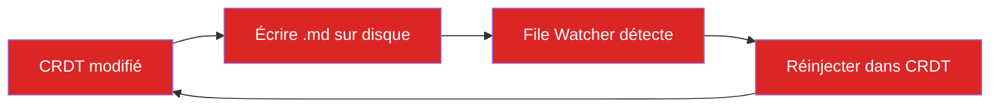
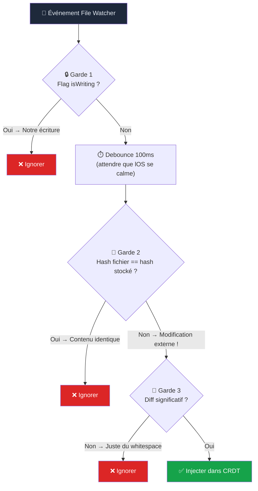
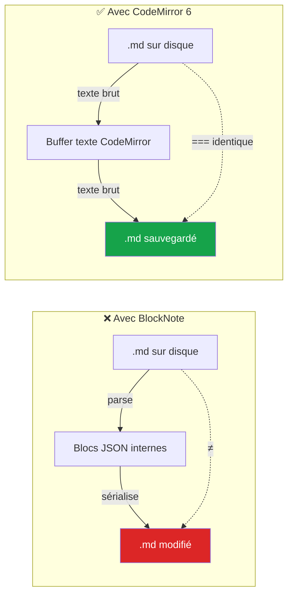
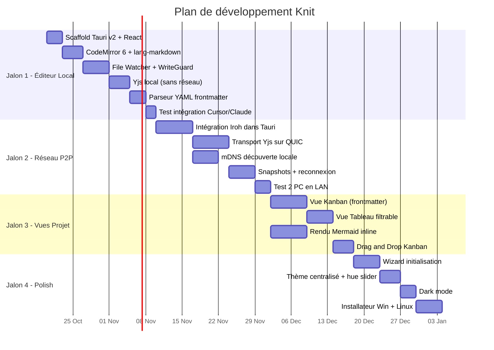
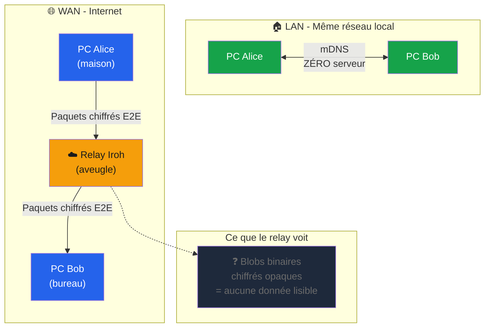
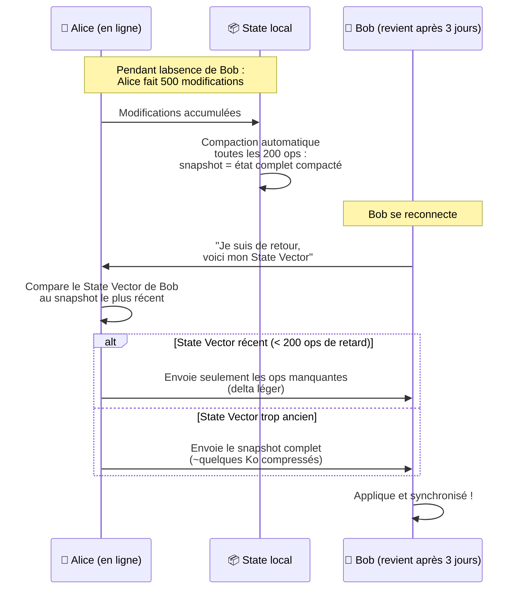
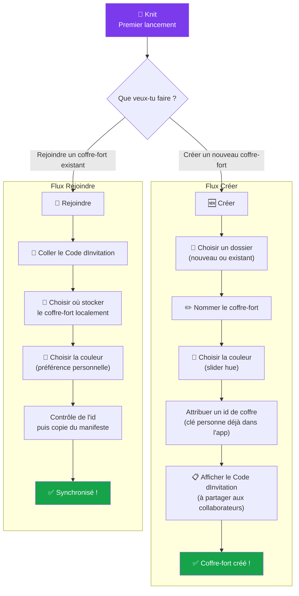
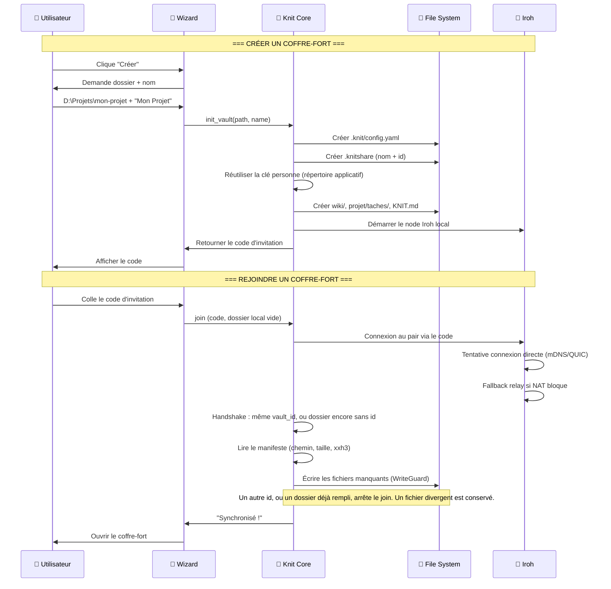

# 🧶 Knit — Solutions aux problèmes & Wizard d'initialisation

---

## 🔴 Résolution des 3 Warnings et du Caution

### WARNING 1 — La boucle infinie File Watcher ↔ CRDT

#### Le problème



Knit écrit un `.md` → le watcher le détecte → il le réinjecte dans le CRDT → le CRDT change → Knit réécrit le `.md` → **boucle infinie, CPU à 100%, crash**.

#### La solution : Triple garde

Pas un seul mécanisme, mais **trois couches de protection** qui se couvrent mutuellement :



#### Le code Rust (simplifié)

```rust
use std::collections::HashMap;
use std::sync::{Arc, Mutex};
use xxhash_rust::xxh3::xxh3_64;

/// Gestionnaire anti-boucle pour le File Watcher
pub struct WriteGuard {
    /// Flag : on est en train d'écrire nous-mêmes
    is_writing: HashMap<PathBuf, bool>,
    /// Hash du dernier contenu qu'on a écrit
    last_written_hash: HashMap<PathBuf, u64>,
}

impl WriteGuard {
    /// Appelé AVANT d'écrire un .md sur disque
    pub fn begin_write(&mut self, path: &Path, content: &[u8]) {
        self.is_writing.insert(path.to_path_buf(), true);
        self.last_written_hash.insert(path.to_path_buf(), xxh3_64(content));
    }

    /// Appelé APRÈS l'écriture (avec un délai de 50ms pour laisser le watcher se calmer)
    pub fn end_write(&mut self, path: &Path) {
        self.is_writing.insert(path.to_path_buf(), false);
    }

    /// Appelé quand le File Watcher détecte un changement
    /// Retourne true si c'est une VRAIE modification externe
    pub fn is_external_change(&self, path: &Path, new_content: &[u8]) -> bool {
        // Garde 1 : On est en train d'écrire
        if *self.is_writing.get(path).unwrap_or(&false) {
            return false;
        }

        // Garde 2 : Le contenu est identique à ce qu'on a écrit
        let new_hash = xxh3_64(new_content);
        if let Some(&last_hash) = self.last_written_hash.get(path) {
            if new_hash == last_hash {
                return false;
            }
        }

        // C'est bien une modification externe (agent IA, autre éditeur)
        true
    }
}
```

> [!TIP]
> **Pourquoi XXH3 et pas SHA-256 ?** XXH3 est ~20x plus rapide que SHA-256 et suffit pour de la détection de doublon (pas besoin de sécurité cryptographique ici). Sur un fichier de 100 Ko, XXH3 prend ~1μs.

**Statut : ✅ RÉSOLU** — Problème bien compris, solution éprouvée (c'est exactement ce que font Obsidian et VS Code en interne).

---

### WARNING 2 — La conversion CRDT → Markdown est lossy

#### Le problème

BlockNote stocke le document en **blocs JSON** (comme Notion). Le Markdown n'est qu'une *projection* de ces blocs. À chaque aller-retour :

```
Markdown original → BlockNote JSON → Markdown re-sérialisé
    "# Hello  "       {type: h1}        "# Hello"
                                         ↑ espace perdu !
```

Un agent IA qui écrit du Markdown très précis (indentation, espaces, retours à la ligne) pourrait voir son formatage "normalisé" par le round-trip.

#### La solution : CodeMirror 6 comme éditeur principal



**CodeMirror 6 travaille directement avec du texte brut.** Le fichier `.md` sur disque est **exactement** le buffer de l'éditeur, caractère pour caractère. Zéro conversion, zéro perte.

| Aspect | BlockNote | CodeMirror 6 |
|---|---|---|
| Format interne | Blocs JSON | Texte brut |
| Fidélité au `.md` sur disque | ⚠️ Approximative | ✅ Parfaite (octet pour octet) |
| Collab CRDT | Yjs natif via `withCollaboration` | Yjs via `y-codemirror.next` |
| WYSIWYG | ✅ Natif | ❌ Il faut un panneau preview à côté |
| Coloration syntaxique Markdown | ✅ (rendu visuel) | ✅ (via `@codemirror/lang-markdown`) |
| Rendu Mermaid inline | ❌ Pas supporté | ✅ Via `WidgetType` custom |

> [!IMPORTANT]
> **Mon avis honnête** : Pour Knit, la fidélité au Markdown est **plus importante** que le WYSIWYG. Le pilier "Agent-Friendly" (pilier 4) et le pilier "Markdown Pur" (pilier 3) l'exigent. Un agent IA ne comprend pas les blocs JSON de BlockNote — il comprend le Markdown.
>
> **Le compromis** : Offrir **deux vues** que l'utilisateur peut switcher :
> - **Vue Code** (CodeMirror 6) — Par défaut. Fidèle au `.md`, avec coloration syntaxique et rendu Mermaid inline.
> - **Vue Lecture** (panneau preview) — Rendu HTML du Markdown pour une lecture confortable.

**Statut : ✅ RÉSOLU** — CodeMirror 6 élimine le problème à la racine.

---

### WARNING 3 — La complexité est sous-estimée

#### Le problème

La réflexion initiale disait "Phase 1 : 1 week-end". En réalité, rien que la boucle CRDT ↔ FS avec le triple garde, l'intégration Yjs + CodeMirror dans Tauri, et le parseur YAML frontmatter = beaucoup plus.

#### La solution : Plan réaliste avec des jalons concrets

Au lieu de 3 phases floues, voici **4 jalons avec des livrables testables** :



| Jalon | Durée réaliste | Livrable testable |
|---|---|---|
| **1 — Éditeur Local** | ~3 semaines | Ouvrir un dossier, éditer un `.md`, le modifier dans Cursor → l'app se met à jour |
| **2 — Réseau P2P** | ~4 semaines | Deux PC voient les mêmes fichiers se synchroniser en temps réel |
| **3 — Vues Projet** | ~3 semaines | Vue Kanban fonctionnelle + diagrammes Mermaid rendus |
| **4 — Polish** | ~3 semaines | Wizard, thème, dark mode, installateurs |
| **Total** | **~13 semaines** | Application complète et distribuable |

> [!TIP]
> **Astuce** : Utilise les agents IA (Cursor, Claude Code, Antigravity) pour développer Knit. C'est un projet de développeur solo assisté par IA — pas un projet de développeur solo à mains nues. Ça divise le temps par ~2.

**Statut : ✅ RÉSOLU** — Plan réaliste, pas de surprise.

---

### CAUTION — Le P2P pur a des limites pratiques

#### Le problème (2 sous-problèmes)

**A) Découverte de pairs** : Comment deux PC se trouvent-ils la première fois ? "Sans serveur" est un mensonge si on utilise un relay de bootstrap.

**B) Hors-ligne prolongé** : Si un pair est offline pendant des jours, le volume d'opérations CRDT à rejouer peut exploser.

#### La solution : Modèle hybride honnête

Mon avis honnête : **le P2P à 100% sans aucun serveur n'existe pas sur Internet.** Même BitTorrent a des trackers. Même Signal a des serveurs de distribution. L'important, c'est que le serveur ne voie **jamais** les données en clair.



#### Solution A — Découverte de pairs (2 niveaux)

| Niveau | Mécanisme | Serveur ? | Quand ? |
|---|---|---|---|
| **LAN** | mDNS/DNS-SD (crate `mdns-sd`) | ❌ Aucun | Même réseau Wi-Fi / Ethernet. Découverte automatique en < 2s |
| **WAN** | Relay Iroh (bootstrap) | ⚠️ Oui, mais aveugle | Réseaux différents. Le relay transmet des paquets chiffrés qu'il ne peut pas lire |

**L'honnêteté dans la communication** : Ne pas dire "100% sans serveur". Dire plutôt :

> *"Knit est local-first et P2P. En réseau local, aucun serveur n'est impliqué. Sur Internet, un relay transmet vos données chiffrées de bout en bout sans jamais pouvoir les lire."*

#### Solution B — Hors-ligne prolongé (Snapshots + Compaction)



**Règles de compaction** :

| Règle | Valeur | Pourquoi |
|---|---|---|
| Compaction automatique | Toutes les **200 opérations** | Empêche l'historique de grossir indéfiniment |
| Taille max snapshot | **< 5 Mo** compressé | Même sur une connexion lente, ça passe |
| Garbage collection Yjs | `gc: true` | Les tombstones sont nettoyées (comportement par défaut) |
| Stockage snapshots | `.knit/snapshots/` | Binaire compacté, pas lisible par un humain |
| Fallback | Envoi du snapshot complet | Si le state vector du pair est trop vieux |

**Statut : ✅ RÉSOLU** — Honnêteté sur le relay + snapshots pour l'offline.

---

## 📁 Le dossier `.knit` — Mon avis honnête

### L'idée est bonne, MAIS avec une nuance importante

Tu as raison de vouloir un `.knit/` à la racine du coffre-fort, comme Obsidian a son `.obsidian/`. C'est un bon pattern. **Mais attention à ce qu'on y met.**

### Ce qui DOIT être dans `.knit/` (données locales de la machine)

```
.knit/
├── config.yaml              # Configuration locale du coffre-fort
├── crdt-state/              # État Yjs des fichiers fermés (rejoué à l'ouverture)
├── snapshots/               # Snapshots compactés d'un document ouvert
└── cache/                   # Cache local (peut être supprimé)
    └── mermaid-svg/         # SVGs Mermaid pré-rendus
```

La personne n'est pas le dossier. Profil et clé Ed25519 vivent dans le répertoire de données de l'application (`profiles/primary`, puis `slot-2` … si une seconde fenêtre verrouille le premier). Un ancien `.knit/identity/` peut être importé une fois ; il n'est plus la source du réseau.

### Ce qui NE DOIT PAS être dans `.knit/` (piège courant)

> [!CAUTION]
> **Ne pas mettre de données partagées entre pairs dans `.knit/`.**
>
> Le `.knit/` est **local à chaque machine**. La clé privée d'Alice n'est pas la même que celle de Bob. L'état CRDT d'Alice n'est pas binaire-identique à celui de Bob (même s'ils convergent vers le même contenu).
>
> Si tu synchronises `.knit/` entre les pairs, tu vas **écraser la clé privée de Bob avec celle d'Alice**, ou créer des conflits binaires sur l'état CRDT.

### Ce qui est partagé entre pairs = les fichiers `.md` uniquement

```
mon-coffre-fort/
├── .knit/                   # ❌ PAS synchronisé (local uniquement)
│   └── ...
│
├── wiki/                    # ✅ Synchronisé via CRDT P2P
│   └── accueil.md
├── projet/                  # ✅ Synchronisé via CRDT P2P
│   └── taches/
│       └── task-001.md
├── KNIT.md                  # ✅ Synchronisé (instructions pour les IA)
└── .knitshare               # ✅ Synchronisé — config PARTAGÉE du coffre
```

### Le fichier `.knitshare` — Config partagée du coffre-fort

Pour les informations qui doivent être **les mêmes chez tous les pairs** (nom du coffre, structure, conventions) :

```yaml
# .knitshare — Même fichier dans chaque dossier local du coffre
nom: "Mon Projet"
id: "00000000-0000-4000-8000-000000000000"
version: 2

structure:
  wiki: "wiki/"
  taches: "projet/taches/"
  sprints: "projet/sprints/"

conventions:
  statuts: [backlog, a-faire, en-cours, en-revue, termine]
  priorites: [basse, moyenne, haute, critique]
  format_id: "task-{NNN}"

mermaid:
  theme_sync: true           # Les diagrammes suivent le thème de chaque utilisateur
```

Ce fichier est du texte lisible. Au join, il est copié avec le manifeste (pas un snapshot binaire de tout le coffre). Les notes ouvertes continuent de fusionner par Yjs. Les agents IA peuvent le lire. Un ancien fichier sans `id` reste lisible : l'id est ajouté au prochain open si le dossier contient déjà des notes.

Le `.knit/config.yaml` local, lui, contient les préférences **personnelles** :

```yaml
# .knit/config.yaml — Local uniquement, PAS synchronisé
theme:
  mode: dark
  hue: 260                   # Violet

editeur:
  font_size: 14
  word_wrap: true

reseau:
  relay: "https://relay.iroh.network"
  mdns_enabled: true
```

---

## 🧙 Wizard d'initialisation

### Flux principal



### Écran 1 — Accueil (choix)

```
┌──────────────────────────────────────────────────┐
│                                                  │
│                  🧶 Knit                         │
│                                                  │
│         Ton espace de travail collaboratif       │
│         local-first & peer-to-peer               │
│                                                  │
│   ┌────────────────────┐  ┌────────────────────┐ │
│   │                    │  │                    │ │
│   │   🆕 Créer un      │  │   🔗 Rejoindre     │ │
│   │   coffre-fort      │  │   un coffre-fort   │ │
│   │                    │  │                    │ │
│   │   Démarre un       │  │   Un collaborateur │ │
│   │   nouveau projet   │  │   t'a partagé un   │ │
│   │   depuis zéro      │  │   code d'invitation│ │
│   │                    │  │                    │ │
│   └────────────────────┘  └────────────────────┘ │
│                                                  │
│   ── Coffres-forts récents ──────────────────    │
│   (vide au premier lancement)                    │
│                                                  │
└──────────────────────────────────────────────────┘
```

### Écran 2a — Créer : Choisir le dossier

```
┌──────────────────────────────────────────────────┐
│  ← Retour              Créer un coffre-fort  1/3│
│                                                  │
│  📁 Emplacement                                  │
│  ┌──────────────────────────────────────────┐    │
│  │  D:\Projets\mon-projet                   │ 📂 │
│  └──────────────────────────────────────────┘    │
│                                                  │
│  ✏️ Nom du coffre-fort                           │
│  ┌──────────────────────────────────────────┐    │
│  │  Mon Projet                              │    │
│  └──────────────────────────────────────────┘    │
│                                                  │
│  ☐ Créer la structure par défaut                 │
│    (dossiers wiki/, projet/taches/, KNIT.md)     │
│                                                  │
│  ☑ Configurer les règles pour agents IA          │
│    (Cursor, Claude Code, Antigravity, Copilot)   │
│                                                  │
│  ☐ Initialiser un dépôt Git                     │
│    (ajoute .knit/ au .gitignore)                 │
│                                                  │
│                               ┌──────────────┐  │
│                               │   Suivant →  │  │
│                               └──────────────┘  │
└──────────────────────────────────────────────────┘
```

### Écran 2b — Créer : Personnalisation

```
┌──────────────────────────────────────────────────┐
│  ← Retour              Créer un coffre-fort  2/3│
│                                                  │
│  🎨 Couleur du thème                             │
│                                                  │
│  ◄━━━━━━━━━●━━━━━━━━━━━━━━━━━━━━━━━━━━━━━━━► │
│  0        260                               360  │
│  Rouge    Violet (actuel)                  Rouge │
│                                                  │
│  Aperçu :                                        │
│  ┌────────────────────────────────────────┐      │
│  │  ● Bouton primaire    ○ Bouton hover   │      │
│  │  ■ Surface active     □ Surface fond   │      │
│  │  ▬ Lien / accent                       │      │
│  └────────────────────────────────────────┘      │
│                                                  │
│  🌗 Mode                                        │
│  ( ● ) Clair   ( ○ ) Sombre   ( ○ ) Auto (OS)   │
│                                                  │
│                               ┌──────────────┐  │
│                               │   Suivant →  │  │
│                               └──────────────┘  │
└──────────────────────────────────────────────────┘
```

### Écran 2c — Créer : Code d'invitation

```
┌──────────────────────────────────────────────────┐
│  ← Retour              Créer un coffre-fort  3/3│
│                                                  │
│  ✅ Coffre-fort "Mon Projet" créé !              │
│                                                  │
│  🔑 Ton code d'invitation :                     │
│  ┌──────────────────────────────────────────┐    │
│  │                                          │    │
│  │   knit://join/z6Mk3og9GR...aX7          │    │
│  │                                          │    │
│  └──────────────────────────────────────────┘    │
│  [ 📋 Copier ]                                   │
│                                                  │
│  Partage ce code à tes collaborateurs pour       │
│  qu'ils rejoignent le coffre-fort.               │
│                                                  │
│  ⓘ Ce code contient ta clé publique et le nom    │
│    du coffre-fort. Il ne donne PAS accès à tes   │
│    fichiers sans acceptation de ta part.          │
│                                                  │
│  ┌──────────────────────────────────────────┐    │
│  │         🧶 Ouvrir le coffre-fort         │    │
│  └──────────────────────────────────────────┘    │
└──────────────────────────────────────────────────┘
```

### Écran 3a — Rejoindre : Coller le code

```
┌──────────────────────────────────────────────────┐
│  ← Retour          Rejoindre un coffre-fort  1/2│
│                                                  │
│  🔑 Code d'invitation                           │
│  ┌──────────────────────────────────────────┐    │
│  │                                          │    │
│  │   knit://join/z6Mk3og9GR...aX7          │    │
│  │                                          │    │
│  └──────────────────────────────────────────┘    │
│  [ 📋 Coller ]                                   │
│                                                  │
│  ✅ Coffre-fort trouvé !                         │
│  ┌────────────────────────────────────────┐      │
│  │  📦 "Mon Projet"                       │      │
│  │  👤 Créé par : clé z6Mk3o...           │      │
│  │  📊 12 fichiers, 3 dossiers            │      │
│  └────────────────────────────────────────┘      │
│                                                  │
│  📁 Stocker dans :                               │
│  ┌──────────────────────────────────────────┐    │
│  │  D:\Projets\mon-projet                   │ 📂 │
│  └──────────────────────────────────────────┘    │
│                                                  │
│                               ┌──────────────┐  │
│                               │   Rejoindre  │  │
│                               └──────────────┘  │
└──────────────────────────────────────────────────┘
```

### Écran 3b — Rejoindre : Synchronisation

```
┌──────────────────────────────────────────────────┐
│            Rejoindre un coffre-fort          2/2 │
│                                                  │
│                                                  │
│              🔄 Synchronisation...               │
│                                                  │
│       ┌──────────────────────────────┐           │
│       │ ████████████░░░░░  68%       │           │
│       └──────────────────────────────┘           │
│                                                  │
│       Réception du manifeste...                  │
│       ✅ wiki/accueil.md                         │
│       ✅ wiki/architecture.md                    │
│       ✅ projet/taches/task-001.md               │
│       🔄 projet/taches/task-002.md               │
│       ○  projet/sprints/sprint-W42.md            │
│                                                  │
│       Connexion : P2P directe (LAN)             │
│       Latence : 3ms                              │
│                                                  │
└──────────────────────────────────────────────────┘
```

### Ce qui se passe techniquement pendant le wizard



---

## 📋 Résumé des décisions

| Problème | Décision | Justification |
|---|---|---|
| Boucle infinie watcher | **Triple garde** (flag + hash XXH3 + debounce 100ms) | 3 couches = zéro risque de boucle |
| Round-trip Markdown lossy | **CodeMirror 6** comme éditeur principal | Texte brut = fidélité parfaite au `.md` |
| Complexité sous-estimée | **4 jalons / 13 semaines** | Plan réaliste avec livrables testables |
| P2P sans serveur impossible | **Modèle hybride** : mDNS en LAN + relay aveugle Iroh en WAN | Honnête, sécurisé, fonctionnel |
| Dossier `.knit/` | **Local uniquement**. Personne = répertoire applicatif. `.knitshare` porte `nom` + `id` | Deux coffres distincts ne fusionnent pas ; deux dossiers du même id se répliquent |
| Wizard d'initialisation | **Créer / Rejoindre** en 3 écrans max, code d'invitation simple | Simple, efficace, pas de friction |
