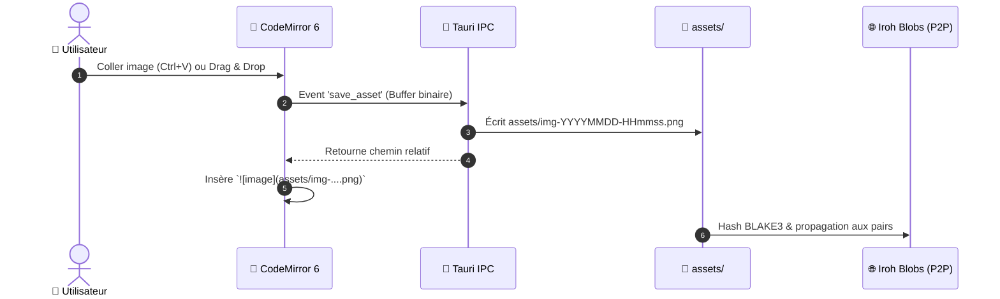

# 🎨 UI/UX — Design System

> Simple, arrondie, pas gadget. Pas de look « généré par une IA ».

---

## Principes directeurs

| Principe | Concrètement |
|---|---|
| **Simple & efficace** | Chaque écran a un but unique. Pas de sidebar avec 40 icônes |
| **Pas de look IA** | Pas de gradients néon, pas de glassmorphism excessif, pas de particules |
| **Arrondis cohérents** | 4px (tags) → 6px (boutons) → 10px (cartes) → 16px (modales) → 24px (conteneurs) |
| **Animations subtiles** | Transitions de 150ms. L'animation sert la compréhension, pas le spectacle |
| **Densité adaptée** | Mode compact pour les power users, mode aéré par défaut |

---

## Ce que Knit n'est PAS

| ❌ On évite | ✅ On fait |
|---|---|
| Gradients arc-en-ciel | Couleur principale unie + neutres doux |
| Glassmorphism flou partout | Surfaces opaques propres, ombres légères |
| Animations "wow" à chaque clic | Transitions de 150ms, presque imperceptibles |
| Sidebar pleine d'icônes colorées | Navigation minimale, hiérarchie claire |
| Typo fantaisie | Inter (ou police système), hiérarchie par taille |
| Dark mode = fond bleu marine | Dark mode = vrais noirs/gris neutres mats (style Obsidian) |
| Boutons bombés avec ombres violettes | Boutons plats et sobres, contrastes subtils |
| Émojis dans l'UI (boutons, badges, menus) | Icônes vectorielles nettes et sobres (`DuotoneIcon` / SVG) |

---

## 🏛️ L'Héritage Notion & Obsidian — Sans Réinventer la Roue

Pour concevoir une expérience immédiatement familière et ultra-productive, Knit reprend **le meilleur de Notion et d'Obsidian**, sans leurs défauts respectifs (Notion est fermé/centralisé sur le cloud, Obsidian n'est pas conçu pour le travail collaboratif en direct P2P).

```
          ┌─────────────────────────────────────────────────────────┐
          │                      🧶 KNIT                            │
          │   Local-First P2P • Markdown Pur • Zéro Conflit CRDT     │
          └───────────────┬─────────────────────────┬───────────────┘
                          │                         │
            Ce qu'on prend de NOTION   Ce qu'on prend d'OBSIDIAN
            ────────────────────────   ─────────────────────────
            • Menu Slash (/)           • WikiLinks [[Note]]
            • Callouts (> [!NOTE])     • Quick Switcher (Ctrl+O)
            • Propriétés de page       • Palette de cmd (Ctrl+P)
            • Vues Kanban / Tableau    • Arbre fidèle au disque
            • Largeur de lecture saine • Split View (Ctrl+\)
```

### 1. Ce que Knit emprunte à Notion (Ergonomie & Structure)

| Idée Notion | Implémentation concrète dans Knit |
|---|---|
| **Le menu Slash Command (`/`)** | Taper `/` sur une ligne vide ouvre un menu de sélection rapide ultra-léger : `/titre`, `/tache`, `/callout`, `/mermaid`, `/code`, `/image`, et les blocs dynamiques `/sommaire`, `/fichiers`, `/requete`, `/taches-globales` (`knit-toc` / `knit-files` / `knit-query` / `knit-tasks`). Tout se fait au clavier en 1 seconde. |
| **Les Callouts / Encarts visuels** | Standardisés en Markdown natif (`> [!NOTE]`, `> [!TIP]`, `> [!WARNING]`). Rendu sobre avec icône duotone discrète, fond neutre très doux et bordure fine. |
| **Les Propriétés en en-tête de page** | Les métadonnées du frontmatter YAML (`statut:`, `priorite:`, `assigne:`, `echeance:`) s'affichent sous forme de pastilles épurées en haut de la note. Cliquer sur un statut ouvre un dropdown sobre qui réécrit le YAML sans casser le document. |
| **Les Vues de données (Kanban & Table)** | Le dossier `projet/taches/` peut être visualisé en document simple, en colonnes Kanban déplaçables, ou en Tableau récapitulatif avec filtres. |
| **Le confort de lecture centré** | Le texte est limité par défaut à 760px de largeur pour un confort de lecture optimal (comme Notion), avec un interrupteur discret *"Pleine largeur"* pour les grands tableaux ou schémas. |
| **L'assistant de tableaux Markdown** | Mini barre d'outils au survol d'un tableau GFM pour ajouter/supprimer colonnes et lignes, avec navigation fluide par `Tab` et `Shift+Tab`. |

### 2. Ce que Knit emprunte à Obsidian (Puissance Markdown & Vitesse)

| Idée Obsidian | Implémentation concrète dans Knit |
|---|---|
| **Les WikiLinks bidirectionnels (`[[...]]`)** | Taper `[[` déclenche l'autocomplétion instantanée de toutes les notes du coffre. Cliquer sur `[[Architecture]]` navigue vers la note. Renommer un fichier met à jour ses liens. |
| **Le Quick Switcher (`Ctrl+O`)** | Boîte de recherche floue (*fuzzy search*) instantanée pour sauter à n'importe quel fichier du coffre en tapant 3 lettres au clavier. Vitesse < 10ms. |
| **La Palette de Commandes (`Ctrl+P`)** | Exécuter n'importe quelle action sans lever les mains du clavier : changer de thème, créer un fichier, insérer un schéma Mermaid, ouvrir l'historique. |
| **L'Arbre de fichiers pur et sans mensonge** | La barre latérale reflète exactement les dossiers et fichiers sur le disque dur. Aucun dossier virtuel caché. |
| **Section Favoris / Épinglés** | Épingler en un clic (icône marque-page / épingle vectorielle) ses notes centrales pour les garder accessibles en haut de la Sidebar. |
| **Multi-onglets & Split View (`Ctrl+\`)** | Travailler sur deux notes côte à côte ou scinder verticalement/horizontalement l'espace de travail. |
| **Pliage hiérarchique de titres** | Chevrons discrets dans la marge CodeMirror 6 pour plier/déplier les sections `##`, `###` (`Ctrl+Alt+[` / `]`). |
| **Vue Graphe Local 2D** | Exploration interactive des liens de la note courante sous forme de réseau de force dynamique. |

---

## 🚫 Manifeste Anti-Look « Codé par IA »

Pour garantir que l'application ne dégage **jamais** la sensation d'un template générique d'IA à la chaîne :

1. **Les vrais noirs et gris neutres (Inspiration Obsidian)** :
   - Interdiction formelle des fonds bleu marine ou violet foncé (`#0F172A`, `#1E1B4B`).
   - Le mode sombre utilise de véritables noirs mats et gris chauds : `#141414` (fond d'application), `#1E1E1E` (surfaces de cartes), `#282828` (survol).
2. **Micro-contrastes de 2% à 4% au lieu des ombres massives** :
   - Les séparations se font par de fines bordures de 1px (`#2A2A2A` en sombre, `#E5E5E5` en clair) plutôt que par de gros flous d'ombres portées.
3. **Zéro animation théâtrale** :
   - Pas de cartes qui flottent avec un rebond élastique de 500ms.
   - Les micro-interactions durent entre **80ms et 150ms** : elles sont perçues comme instantanées et tactiles.
4. **Keyboard-First absolu** :
   - Une application professionnelle se pilote aux raccourcis clavier. Si une action nécessite 4 clics de souris, l'UX a échoué.
5. **Zéro émoji dans l'interface utilisateur (Inspiration Linear & Obsidian)** :
   - Aucun bouton, badge, menu contextuel, onglet ou toast ne doit comporter d'émoji.
   - Tout visuel d'interface repose sur des tracés vectoriels fins (`DuotoneIcon` ou SVG purs). Les émojis sont strictement réservés au texte libre rédigé par l'utilisateur.

---

## 📑 Système d'Onglets & Conventions Universelles (Souris & Clavier)

Knit intègre un système multi-onglets ultra-rapide respectant **100% des conventions universelles** des navigateurs modernes et des meilleurs IDE (VS Code, Obsidian, Chrome).

```
┌──────┬──────────────────────┬──────────────────────┬──────┐
│  📌  │ 📄 architecture.md × │ 📄 accueil.md      × │  +   │
└──────┴──────────────────────┴──────────────────────┴──────┘
```

### 1. Conventions Souris (Comportement Naturel & Molette)

| Action Souris | Cible | Effet attendu |
|---|---|---|
| **Clic gauche simple** | Fichier dans l'arbre | Ouvre en mode **Aperçu** (*titre en italique*). Cliquer sur un autre fichier réutilise cet onglet sans en empiler 50 |
| **Double-clic** | Fichier dans l'arbre | Fige l'onglet en mode **Permanent** (*titre droit*) |
| **Clic Molette (Middle Click)** | Fichier dans l'arbre | **Ouvre immédiatement dans un nouvel onglet** en arrière-plan sans remplacer l'onglet actuel |
| **Clic Molette (Middle Click)** | Sur un onglet | **Ferme immédiatement l'onglet** (standard universel Chrome/Firefox/VS Code) |
| **Clic gauche sur `×`** | Bouton croix de l'onglet | Ferme l'onglet |
| **Double-clic** | Zone vide de la barre d'onglets | Crée une nouvelle note vierge (`Ctrl+N`) |
| **Glisser-Déposer (Drag & Drop)** | Onglet | Réorganise l'ordre des onglets horizontalement |
| **Glisser vers le bord** | Onglet | **Scinde la vue (Split View)** à droite ou en bas pour afficher 2 notes côte à côte |
| **Clic droit** | Sur un onglet | **Menu contextuel** complet (Fermer, Fermer les autres, Fermer à droite, Épingler, Copier le chemin) |

### 2. Raccourcis Clavier Universels (Keyboard-First)

| Raccourci | Action |
|---|---|
| **`Ctrl + W`** | Fermer l'onglet actif |
| **`Ctrl + Shift + T`** | **Rouvrir le dernier onglet fermé** (historique de réouverture) |
| **`Ctrl + Tab`** | Passer à l'onglet suivant |
| **`Ctrl + Shift + Tab`** | Revenir à l'onglet précédent |
| **`Ctrl + 1` à `Ctrl + 8`** | Sauter directement à l'onglet 1 à 8 |
| **`Ctrl + 9`** | Sauter au dernier onglet de la barre |
| **`Ctrl + T`** ou **`Ctrl + N`** | Ouvrir un nouvel onglet / nouvelle note |
| **`Ctrl + \`** | Diviser la vue en deux panneaux verticaux (Split View) |
| **`Ctrl + Clic`** | Sur un WikiLink `[[...]]` ou un fichier : ouvre dans un nouvel onglet |

### 3. Anatomie Visuelle & États des Onglets
- **Onglet Actif** : surface opaque nette (`--knit-surface`), bordure inférieure ou supérieure fine de 2px liée à `--knit-primary`, texte à 100% d'opacité.
- **Onglet Inactif** : fond discret (`--knit-bg`), texte atténué (`--knit-text-secondary`). Au survol : passage fluide en `--knit-surface-hover`.
- **Onglet Épinglé (Pinned Tab)** : réduit à une icône ou un pictogramme fixe tout à gauche, sans bouton de fermeture accidentelle.
- **Indicateur de modifications / Présence** :
  - Si un collaborateur ou un agent IA édite ce document en arrière-plan : petite pastille de couleur miniature discrète sur le bord de l'onglet.

### 4. Doc-Driven Views & TabBar Universelle Permanente
Knit rompt avec l'ergonomie rigide où l'utilisateur doit changer manuellement de vue :
- **TabBar Permanente** : La barre d'onglets reste visible et active en permanence, que le document actif soit une Note Markdown, un Tableau Kanban, une Vue Table ou une **Vue Image** (média).
- **Icônes Dynamiques par Document** : Chaque onglet affiche un pictogramme correspondant au type (`file-markdown`, `kanban`, `table`, ou `image`).
- **Navigation Zéro Clic** : Cliquer sur un fichier dans l'explorateur ou changer d'onglet résout instantanément la vue configurée dans le Frontmatter YAML (`type: kanban`, `type: table`, `type: note`).
- **Médias (`assets/`)** : clic sur `.svg` / `.png` / `.jpg` / `.gif` / `.webp`… → onglet `docType: image` (`ImageView` : aperçu, copie ``, révélation explorateur). Pas de bascule Source ni conversion YAML.
- **Bouton Universel Source `</>` ↔ Rendu** : Dans l'en-tête de chaque onglet Markdown, un bouton sobre `[Code Source </>]` (raccourci `Ctrl+E` ou `Ctrl+/`) permet de basculer entre la représentation visuelle et le Markdown brut CodeMirror 6. Masqué sur les onglets image.

### 5. Menus Contextuels de Conversion de Document
Accessible par clic droit sur un fichier (arbre `TreeNode`) ou sur un onglet (`TabBar`) :
```
Changer le type de vue ▸
  📝 Note Markdown classique
  📋 Tableau Kanban
  📊 Vue Tableau récapitulatif
```
La sélection réécrit le Frontmatter YAML sans altérer le contenu ni le texte libre, avec historique annulable (`Ctrl+Z`).

---

## 🔍 Recherche & Système de Tags (Navigation & Découverte)

Knit propose une suite de recherche complète, pensée pour être instantanée et utilisable à 100% au clavier.

```
┌────────────────────────────────────────────────────────┐
│  🔍 RECHERCHE LOCALE (Ctrl+F) — DANS LE FICHIER ACTIF  │
│  [ CRDT                 ]  [Aa] [.*] [1/14]  ▲  ▼  ×   │
└────────────────────────────────────────────────────────┘
```

### 1. Recherche Locale dans le Fichier (`Ctrl + F` & `Ctrl + H`)
Intégrée nativement à CodeMirror 6 via l'extension `@codemirror/search` :
- **Barre de recherche flottante épurée** : s'affiche en haut à droite de l'éditeur sans décaler le texte.
- **Raccourcis** :
  - **`Ctrl + F`** : Ouvrir la recherche.
  - **`Entrée`** / **`Shift + Entrée`** : Occurrence suivante / précédente.
  - **`Ctrl + H`** : Ouvrir le mode **Rechercher & Remplacer** (remplacement unitaire ou *"Remplacer tout"*).
  - **`Échap`** : Fermer la recherche et replacer le curseur sur le texte.
- **Fonctionnalités avancées** :
  - Compteur d'occurrences dynamique (*"3 sur 18"*).
  - Options : Respecter la casse (`Aa`), Mot entier (`\b`), Expressions régulières (`.*`).
  - Toutes les occurrences sont surlignées en jaune feutré doux (`rgba(245, 158, 11, 0.25)`).
  - Marqueurs discrets le long de la barre de défilement (scrollbar) pour situer les résultats dans la page.

---

### 2. Recherche Globale dans tout le Coffre (`Ctrl + Shift + F`)
Pour chercher une information éparpillée dans des centaines de notes Markdown :
- **Raccourci** : **`Ctrl + Shift + F`** ouvre le volet de recherche globale dans la barre latérale gauche.
- **Indexation ultra-rapide** : Moteur de recherche local en mémoire Rust, résultats affichés en < 15ms.
- **Affichage des résultats** :
  - Liste groupée par fichier avec nombre de correspondances (ex: `wiki/architecture.md (4)`).
  - **Extraits de contexte (Snippets)** : affichage de la ligne avec les mots recherchés surlignés en gras.
  - Cliquer sur un extrait ouvre immédiatement la note dans un onglet et fait défiler la vue sur la ligne exacte.
- **Filtres de recherche avancés** :
  - `tag:#p2p` : recherche uniquement les fichiers contenant ce tag.
  - `path:wiki/` : restreint la recherche à un dossier spécifique.

---

### 3. Système de Tags de Fichiers (`#tags` & Frontmatter)
Les tags permettent d'organiser ses pensées de manière transversale, sans être contraint par l'arborescence des dossiers.

#### A. Les deux formats de tags supportés
1. **Dans le Frontmatter YAML** (métadonnées formelles) :
   ```yaml
   ---
   id: task-042
   statut: en-cours
   tags: [backend, p2p, rust]
   ---
   ```
2. **Dans le corps du texte (Inline Tags)** :
   - Taper `#projet` ou `#meeting` n'importe où dans le texte.
   - **Tags hiérarchiques** supportés avec le slash : `#dev/rust`, `#dev/react`, `#projet/sprint-1`.

#### B. Autocomplétion à la frappe
- Dès que l'on tape `#` dans l'éditeur, une liste déroulante sobre propose immédiatement les tags déjà existants dans le coffre avec le nombre d'occurrences.

#### C. Volet des Tags (Tag Explorer)
Dans la barre latérale, un panneau dédié regroupe tous les tags du coffre :
- Liste alphabétique ou triée par fréquence d'utilisation (ex: `#p2p (14)`, `#ui (8)`).
- **Cliquer sur un tag** filtre instantanément la vue pour n'afficher que les notes associées.
- **Sélection multiple (`Ctrl + Clic`)** : combiner plusieurs tags pour une recherche croisée (ex: `#p2p` ET `#bug`).

---

## ✨ Moteur d'Autocomplétion Universel (Omni-Trigger Autocomplete — B-052)

Knit intègre un moteur d'autocomplétion contextuel instantané (< 2ms) inspiré des meilleures ergonomies d'Obsidian et de Notion, **actif sur l'ensemble des vues de l'application**.

```
┌─────────────────────────────────────────────────────────────────┐
│  [[Architecture#Moteur C                                        │
│  ┌────────────────────────────────────────────────────────────┐ │
│  │ 📑 Architecture > ## Moteur CRDT (Ligne 42)                 │ │
│  │ 📑 Architecture > ### Moteur de Rendu Mermaid (Ligne 114)  │ │
│  └────────────────────────────────────────────────────────────┘ │
└─────────────────────────────────────────────────────────────────┘
```

### 1. Les 6 Déclencheurs Magiques (Triggers)

| Déclencheur | Syntaxe | Ce qu'il propose | Résultat inséré |
|---|---|---|---|
| **`[[`** | `[[Recherche...` | Toutes les notes du coffre (titre + chemin) | `[[wiki/architecture]]` |
| **`[[#`** | `[[#Section...` | Titres (`#`, `##`, `###`) de la **note active** | `[[#Moteur CRDT]]` |
| **`[[Note#`** | `[[Note#Sous-titre` | Titres et ancres de la **note ciblée** | `[[architecture#Moteur CRDT]]` |
| **`[[Note\|`** | `[[Note\|Alias` | Texte alternatif de lien personnalisé | `[[architecture\|Architecture Système]]` |
| **`[[Note^`** | `[[Note^block` | Référencement de blocs ou paragraphes spécifiques | `[[architecture^crdt-intro]]` |
| **`@`** | `@collaborateur` | Profils locaux, pairs connectés (Iroh) et agents IA | `@Thomas H.` (avec badge avatar interactif) |
| **`@@`** ou **`@date`** | `@@today`, `@@demain` | Raccourcis temporels et sélecteur de calendrier | `@2026-10-20` (badge d'échéance coloré) |
| **`#`** | `#tag/sous-tag` | Tags hiérarchiques du coffre avec compteur | `#projet/sprint-6 (12)` |
| **`:`** | `:emoji:` | Shortcodes d'emojis rapides | `:sparkles:` → ✨, `:check:` → ✅ |
| **`/`** | `/commande` | Commandes de blocs (titre, callout, kanban, tableau) | Bloc préformaté inséré en 1 seconde |

---

### 2. Disponibilité Universelle Multi-Vues (Cross-View Ubiquity)

L'autocomplétion ne se limite pas à l'éditeur Markdown principal :
- **Dans l'Éditeur CodeMirror 6** : surgit à l'emplacement exact du curseur de frappe.
- **Dans le Tableau Kanban** : disponible lors de l'édition ou de la création d'une carte (titre et description Markdown). Taper `[[` lie une note, `@` assigne un collaborateur, `#` ajoute un tag.
- **Dans la Vue Tableau** : disponible lors de la modification directe d'une cellule de tableau.
- **Dans les Modales et Dialogues** : accessible lors de la création rapide de note ou de tâche.

---

### 3. Architecture d'Indexation Incrémentale en Rust (`KnitSuggestIndex`)

Pour garantir un temps de réponse imperceptible (< 2ms) même dans un coffre contenant **50 000 notes** :
- Le backend Rust `knit-core` maintient en mémoire un graphe d'indexation pré-calculé :
  - **Index des Titres** : dictionnaire en mémoire associant chaque chemin de fichier à son arborescence de sections (`#`, `##`, `###`).
  - **Index des Tags** : arbre préfixe (Trie) trié par fréquence d'utilisation.
  - **Index des Pairs** : cache dynamique des collaborateurs LAN (mDNS) et WAN (Iroh).
- **Mises à jour incrémentales micro-secondes** : lorsqu'un fichier est modifié, seul son nœud d'index est recalculé sans réanalyser tout le coffre.

---

## 📅 Moteur d'Agenda, Portée de Projet & Échéancier (B-031a & KnitCalendarIndex)

Knit intègre un système d'agenda bijectif natif qui analyse en direct les fichiers Markdown du coffre sans aucune base de données propriétaire tierce.

```
┌────────────────────────────────────────────────────────────────────────────────────────┐
│ 📅 AGENDA DU PROJET (projets/alpha)  [📁 Ce projet] [Afficher tout le coffre]           │
│ Filtres : [🔘 Tout] [👤 Mes tâches & Vault] [👥 Collaborateur: Thomas H. ▼] [!p1..p3] │
│ Modes   : [ Vue Mois ] [ Vue Semaine ] [ Vue Jour ] [ Vue Liste ]                      │
├────────────────────────────────────────────────────────────────────────────────────────┤
│ Lundi 20 Octobre 2026                                                                  │
│ ┌────────────────────────────────────────────────────────────────────────────────────┐ │
│ │ [ ] 10:00 - 11:30  Point Hebdo Sprint 6   !p1     👥 @vault        (notes/sprint.md)│ │
│ │ [x] 14:00 - 15:30  Démo client P2P CRDT   !p2     👤 @Thomas H.    (clients/demo.md)│ │
│ │ [ ] 17:00          Finaliser relecture doc        👤 @Sarah        (docs/spec.md)   │ │
│ └────────────────────────────────────────────────────────────────────────────────────┘ │
└────────────────────────────────────────────────────────────────────────────────────────┘
```

### 1. Dualité : Agenda Global du Coffre vs Agenda de Projet Délimité (Scoped)
- **Principe « onglet = fichier »** : un onglet de la TabBar représente toujours un fichier Markdown (ou média) du coffre. Les vues applicatives transverses (Agenda global) ne doivent **pas** simuler un onglet virtuel.
- **Agenda Global Centralisé (modale)** : Accessible à tout instant depuis le bouton **Agenda** du Header (`Ctrl+Shift+A`), le **4ème onglet dédié de la barre latérale** (`files | search | tags | calendar`), le mini-widget calendrier (clic date ou titre), ou la palette de commandes. Il s’ouvre dans une **modale immersive** (pas un onglet) et centralise 100 % des échéances du coffre sans fichier Markdown physique.
- **Agenda de Projet Délimité (onglet fichier)** : Tout fichier note avec `type: calendar` (ex: `projets/site-web/agenda.md`) s’ouvre en **onglet** via DocumentPane. Sa portée est délimitée au dossier hôte et à ses sous-dossiers (`projets/site-web/**`). Un bouton toggle permet d’élargir la vue à tout le coffre pour vérifier les conflits.

### 2. Attribution, Statuts & Priorités
- **Attribution collective (`@vault`) ou nominative (`@collaborateur`)**.
- **Cases à cocher interactives** : cocher une tâche directement dans l'agenda bascule instantanément son statut (`- [ ]` ↔ `- [x]`) dans le document source.
- **Badges de priorités visuels** : distinction immédiate des priorités (`!p1` rouge/urgent, `!p2` ambre Knit, `!p3` bleu doux).
- **Signalement des retards** : contour rougeoyant et regroupement dédié dans la vue Liste pour les tâches échues non complétées.

### 3. Menus Contextuels Systématiques (Clic Droit) & Création Rapide
- **Clic droit sur une case de jour** : ajout rapide d'un événement via modale ergonomique, saut vers la note de journal (`journal/YYYY-MM-DD.md`), bascule en vue Jour ou copie de date ISO.
- **Clic droit sur un événement** : changement de priorité en 1 clic, reprogrammation (Aujourd'hui, Demain, Semaine prochaine), bascule de statut ou copie des chemins.
- **Popover des jours chargés** : le lien `+N autres` ouvre un panneau de détail sans tronquer les événements.
- **Panneau latéral Agenda** : mini-calendrier mensuel combiné à la liste des échéances imminentes du coffre.

---

## 🎨 Vues Immersives & Formats Visuels Déclarés (Sprint 6ter)

En complément de l'Éditeur, du Kanban et du Tableau, Knit introduit 4 nouvelles représentations visuelles réversibles en Markdown pur :

### 1. Tableau Blanc Infini (`type: canvas` — B-031b)
- **Format standard ouvert** : basé sur la spécification internationale [JSON-Canvas](https://jsoncanvas.org).
- **Cartes & Liens directionnels** : manipulation fluide de cartes de notes et connecteurs fléchés avec courbure de Bézier.
- **Navigation infinie** : zoom molette centré sur le curseur, pan avec clic molette ou barre d'espace + glisser, bouton recentrage.
- **Cross-DnD depuis la Sidebar** : glisser n'importe quelle note depuis l'arbre de fichiers dépose une nouvelle carte liée sur le canvas.

### 2. Diaporama Interactif (`type: slides` — B-031c)
- **Segmentation naturelle** : chaque diapositive est délimitée par un séparateur Markdown standard `---` (hors frontmatter).
- **Mode Plein Écran Immersif** : activation instantanée via le bouton dédié ou la touche <kbd>F</kbd>.
- **Navigation au clavier** : flèches <kbd>→</kbd> / <kbd>←</kbd>, <kbd>Espace</kbd> (avancer), <kbd>Origine</kbd> / <kbd>Fin</kbd>.
- **Compteur & Barre de progression** : jauge feutrée 2px en pied d'écran indiquant la diapositive courante (`X / Y`).

### 3. Galerie Visuelle & Fiches Frontmatter (`type: gallery` — B-031d)
- **Grille réactive** : affichage en cartes aérées avec adaptation automatique au redimensionnement de la fenêtre.
- **Bannières & Vignettes** : extraction automatique de l'image de couverture (`cover:`, `banner:` ou première image `assets/`).
- **Pastilles de métadonnées** : affichage sobre des tags YAML, statuts et dates d'échéance sous le titre de chaque fiche.
- **Glisser-déposer de réorganisation** : réordonnancement visuel fluide conforme à la charte d'excellence D&D.

### 4. Vue Graphe Local Interactive 2D (B-049)
- **Simulation de forces 2D** : projection en temps réel des relations WikiLinks (`[[...]]`) et rétroliens de la note active.
- **Poignée de redimensionnement ergonomique** : barre de séparation inférieure avec poignée feutrée (style VS Code), curseur `row-resize`, persistance de hauteur (`localStorage`), et réinitialisation rapide à 400px sur double-clic.
- **Navigation & Saut au clic** : cliquer sur un nœud ouvre instantanément la note liée dans l'espace de travail.

---

## 🧲 Standard de Drag-and-Drop (D&D) Unifié

Pour éliminer toute disparité d'ergonomie, l'ensemble des modules interactifs de Knit (Kanban, Agenda, Canvas, Galerie, Arborescence) partagent une grammaire gestuelle feutrée et ultra-précise :

| Élément D&D | Spécification Visuelle & Comportement |
|---|---|
| **Indicateur d'insertion** | Filet lumineux d'accentuation `--knit-primary` (2px) doté d'une pastille d'ancrage circulaire de 8px (`CalendarDropIndicator`). |
| **Fantôme de traînée (Ghost Drag)** | Carte ou élément traîné semi-transparent avec **`opacity: 0.35`** et curseur système `grabbing`. |
| **Surbrillance réceptrice** | Conteneur d'accueil illuminé par une bordure pointillée feutrée (`border: 1px dashed var(--knit-primary)`) et halo doux de 12px. |
| **Zone de largage vide (Placeholder)** | Encarts dédiés clairement délimités pour accueillir les éléments dans les colonnes ou conteneurs vides. |
| **Cross-DnD Inter-Vues** | Glisser une tâche Kanban sur l'Agenda la planifie à la date ciblée ; glisser une note de la Sidebar sur le Canvas crée une carte liée. |

---

## ✍️ Smart UX de Rédaction & Navigation Humaine (B-053)

Pour offrir un confort de rédaction sans précédent, Knit intègre un ensemble d'automatismes d'écriture avancés dans CodeMirror 6 :

### 1. Smart Paste (Lien ou Image sur sélection)
- **Collage d'URL** : Sélectionner un mot ou une phrase et presser `Ctrl+V` avec une URL dans le presse-papier convertit automatiquement le texte en `[Mon Texte Sélectionné](https://exemple.com)` au lieu d'écraser la sélection.
- **Collage d'Image** : Coller une image (ou capture d'écran) avec du texte sélectionné enregistre le binaire dans `assets/` et insère ``.

### 2. Auto-Wrap par Déclencheurs Symboliques
- Sélectionner du texte et presser :
  - `[` : entoure en `[[...]]` (WikiLink instantané).
  - `*` : entoure en `*...*` (ou `**...**` si double frappe).
  - `` ` `` : entoure en bloc de code en ligne `` `...` ``.
  - `~` : entoure en texte barré `~~...~~`.
  - `"` ou `'` : entoure de guillemets sans effacer la sélection.

### 3. Formatage Dynamique de Tableaux Markdown (`Tab` / `Entrée`)
- Dans un tableau Markdown brut :
  - Presser `Tab` saute à la cellule suivante et réaligne verticalement les barres `|`.
  - Presser `Shift+Tab` revient à la cellule précédente.
  - Presser `Entrée` crée automatiquement la ligne suivante pré-remplie avec le bon nombre de colonnes et aligne les bordures.

### 4. Prévisualisation Flottante au Survol (Hover Preview Tooltip)
- Hôte global (`HoverPreviewHost` + bus `knit-hover-link` + hook `useDelayedHoverPreview`) : hors éditeur aussi.
- Surfaces : Editor/CM6, Agenda, Canvas, Galerie (cartes note), Quick Switcher (item sélectionné clavier/souris), favoris sidebar, switcher Kanban, recherche, tags, pills WikiLink, blocs `knit-*`, graphe, backlinks.
- Survoler une cible fichier affiche l’extrait Markdown ; survol de la fenêtre (ou `Ctrl`/`Cmd`) fige pour scroller ; clic titre/lien ouvre.
- Agenda : clic → ouvrir ; `Ctrl`/`Cmd`+clic ou molette → nouvel onglet. Non branché (anti-spam) : arborescence, onglets, cartes image Galerie.
- **Contrat lecture partagé avec le Mode Zen** : même Live Preview verrouillé (`livePreviewVisualLockFacet` — pas de bascule source au clic Mermaid/code/table) + liens au clic simple + boutons utiles (Copier, details). **Spécifique au hover** : strip frontmatter, chrome immersif compact (`.knit-hover-chrome-hide` / `compactChrome`), troncature, portal.
- **Nested** (lien survolé dans un preview déjà figé) : **même rendu DocType** / largeur que le parent ; **non figable** (`pointer-events: none`, pas de footer pin).

### 5. Raccourci Note Quotidienne (`Ctrl+Shift+J` ou `Alt+D`)
- Crée ou ouvre instantanément la note du jour `journal/YYYY-MM-DD.md` avec horodatage automatique et modèle d'habitudes ou de log de sprint.

### 6. Panneau latéral de Rétroliens (Backlinks Panel)
- Affichage dans l'inspecteur latéral de :
  - **Mentions liées** : toutes les notes contenant un lien formel `[[Note Active]]`.
  - **Mentions non liées** : détection de texte mentionnant le titre de la note sans crochet pour transformation en WikiLink en 1 clic.

---

## Design Token System


Tout le design repose sur un fichier unique de variables CSS :

```css
/* knit-theme.css — Design tokens */
:root {
  /* === COULEUR PRINCIPALE (modifiable par l'utilisateur) === */
  --knit-hue: 260;                              /* Violet par défaut */

  /* Palette auto-générée à partir du hue */
  --knit-primary:       hsl(var(--knit-hue), 55%, 55%);
  --knit-primary-hover: hsl(var(--knit-hue), 55%, 48%);
  --knit-primary-soft:  hsl(var(--knit-hue), 40%, 94%);
  --knit-primary-muted: hsl(var(--knit-hue), 20%, 70%);

  /* Surface & fond */
  --knit-bg:            #FAFAFA;
  --knit-surface:       #FFFFFF;
  --knit-surface-hover: #F5F5F5;
  --knit-border:        #E5E5E5;

  /* Texte */
  --knit-text:          #1A1A1A;
  --knit-text-secondary:#6B6B6B;
  --knit-text-muted:    #A0A0A0;

  /* Arrondis */
  --knit-radius-xs:     4px;    /* Tags, badges */
  --knit-radius-sm:     6px;    /* Boutons, inputs */
  --knit-radius-md:     10px;   /* Cartes, panneaux */
  --knit-radius-lg:     16px;   /* Modales, dropdowns */
  --knit-radius-xl:     24px;   /* Conteneurs principaux */

  /* Ombres */
  --knit-shadow-sm:     0 1px 2px rgba(0,0,0,0.05);
  --knit-shadow-md:     0 4px 12px rgba(0,0,0,0.08);
  --knit-shadow-lg:     0 12px 32px rgba(0,0,0,0.12);

  /* Transitions */
  --knit-transition:    150ms ease;
  --knit-transition-slow: 300ms ease;

  /* Typographie */
  --knit-font:          'Inter', -apple-system, sans-serif;
  --knit-font-mono:     'JetBrains Mono', 'Fira Code', monospace;
}

/* === THEME SOMBRE === */
[data-theme="dark"] {
  --knit-bg:            #0F0F0F;
  --knit-surface:       #1A1A1A;
  --knit-surface-hover: #252525;
  --knit-border:        #2A2A2A;
  --knit-text:          #ECECEC;
  --knit-text-secondary:#8A8A8A;
  --knit-text-muted:    #555555;
  --knit-shadow-sm:     0 1px 2px rgba(0,0,0,0.2);
  --knit-shadow-md:     0 4px 12px rgba(0,0,0,0.3);
  --knit-shadow-lg:     0 12px 32px rgba(0,0,0,0.4);
}
```

---

## Formulaires & listes déroulantes (`forms.css`)

Tous les champs passent par le design system centralisé `knit-app/src/theme/forms.css` (`.knit-input`, `.knit-checkbox`, `.knit-btn`, etc.).

| Élément | Règle |
|---|---|
| **Inputs / checkboxes / boutons** | Classes `forms.css` uniquement — pas de styles ad-hoc |
| **Listes déroulantes** | **Jamais** de `<select>` natif (popup OS hors DA) |
| **React** | Composant `<KnitSelect>` (`components/Form/KnitSelect.tsx`) |
| **Widgets Live Preview (DOM)** | `createKnitSelectDom()` (`utils/knitSelect.ts`) |
| **Apparence du menu** | Même langage que les menus contextuels : `--knit-radius-md`, `--knit-surface`, `--knit-shadow-lg`, options arrondies `--knit-radius-sm`, sélection en `--knit-primary-alpha` |

Classes CSS : `.knit-select-root`, `.knit-select-trigger`, `.knit-select-menu`, `.knit-select-option`.

---

## Couleur principale — Un slider, toute la palette

L'utilisateur choisit **une seule valeur** : `--knit-hue` (0 à 360).

| Hue | Couleur | Ambiance |
|---|---|---|
| `0` | 🔴 Rouge | Énergique |
| `30` | 🟠 Orange | Chaleureuse |
| `140` | 🟢 Vert | Nature, apaisante |
| `210` | 🔵 Bleu | Pro, classique |
| `260` | 🟣 Violet | *(défaut)* Créatif, moderne |
| `330` | 🩷 Rose | Doux, original |

---

## Mermaid — Rendu natif dans l'éditeur

### Deux modes d'affichage

| Mode | Quand | Ce qu'on voit |
|---|---|---|
| **Code** | Le curseur est **dans** le bloc mermaid | Texte source avec coloration syntaxique |
| **Rendu** | Le curseur est **hors** du bloc | SVG du diagramme, dans une carte arrondie |

### Règles de design

| Règle | Détail |
|---|---|
| **Carte conteneur** | `border-radius: var(--knit-radius-md)`, ombre `var(--knit-shadow-sm)` |
| **Pas de scroll horizontal** | SVG adapté à la largeur (`max-width: 100%`) |
| **Thème Mermaid = thème Knit** | Couleurs synchronisées via `--knit-hue` |
| **Transition code ↔ rendu** | Fade-in/fade-out de 200ms |
| **Erreur gracieuse** | Message d'erreur dans la carte, pas de crash |

### Thème Mermaid synchronisé

```javascript
function getKnitMermaidTheme(hue, isDark) {
  return {
    theme: 'base',
    themeVariables: {
      background:        isDark ? '#1A1A1A' : '#FFFFFF',
      mainBkg:           `hsl(${hue}, 40%, ${isDark ? '25%' : '94%'})`,
      primaryColor:      `hsl(${hue}, 55%, 55%)`,
      primaryBorderColor:`hsl(${hue}, 55%, 40%)`,
      primaryTextColor:  isDark ? '#ECECEC' : '#1A1A1A',
      lineColor:         `hsl(${hue}, 20%, ${isDark ? '50%' : '60%'})`,
      fontFamily:        "'Inter', -apple-system, sans-serif",
      fontSize:          '14px',
    }
  };
}
```

### Types de diagrammes — Priorités

| Priorité | Type | Cas d'usage |
|---|---|---|
| 🔴 MVP | `graph` / `flowchart` | Architecture, flux, organigrammes |
| 🔴 MVP | `sequenceDiagram` | Interactions P2P, flux utilisateur |
| 🟡 v0.3.0 | `gantt` | Planning, roadmap temporelle |
| 🟡 v0.3.0 | `classDiagram` | Doc technique, modèles de données |
| 🟢 Post-v1.0 | `pie`, `mindmap`, `timeline` | Dashboards, brainstorming |

---

## 🎨 Iconographie & Style Duotone — Reicon

Knit utilise la bibliothèque d'icônes open-source **[Reicon](https://github.com/dqev/reicon)** (licence MIT) avec son style **Duotone**.

### Pourquoi Reicon ?
- **Design pixel-perfect** sur grille 24×24px, coins arrondis, pas d'effets superflus.
- **Variante Duotone** : deux couches visuelles permettant de jouer avec la couleur d'accent `--knit-hue` :
  - **Couche primaire (100% opacité)** : contours et symboles forts (`--knit-text` ou `--knit-primary`).
  - **Couche secondaire (15-25% opacité)** : remplissage doux utilisant la teinte active `hsl(var(--knit-hue), 55%, 55%)`.
- **Composants React natifs** (`reicon-react`) légers et sans dépendances lourdes.
- *Alternative éprouvée / fallback* : **Phosphor Icons** (`@phosphor-icons/react` en mode `weight="duotone"`).

---

## 🖼️ Gestion des Images — Copier, Coller & Glisser-Déposer

Dans un wiki moderne, la manipulation d'images doit être instantanée et sans friction.



### 1. Coller depuis le presse-papier (`Ctrl+V`)
- Détection automatique du type MIME `image/png`, `image/jpeg`, `image/webp` dans le presse-papier.
- Génération d'un nom horodaté unique et lisible : `assets/img-YYYYMMDD-HHmmss.png`.
- Enregistrement immédiat dans le sous-dossier `assets/` du coffre local.
- Insertion automatique de la syntaxe Markdown `` à l'emplacement exact du curseur.

### 2. Glisser-déposer (Drag & Drop)
- Glisser un ou plusieurs fichiers images depuis l'explorateur directement dans la zone de texte.
- Copie automatique dans `assets/` et insertion des liens Markdown correspondants.

### 3. Copier une image existante
- Au survol ou clic droit sur une image dans l'éditeur :
  - **Copier l'image** : place l'image binaire dans le presse-papier du système d'exploitation (`navigator.clipboard.write`).
  - **Copier le chemin** : copie `assets/nom-image.png`.
  - **Copier le tag Markdown** : copie ``.

### 4. Synchronisation P2P des images
- Les fichiers binaires dans `assets/` sont volumineux comparés aux fichiers texte `.md`.
- Ils ne passent **pas** par le CRDT Yjs textuel, mais par **Iroh Blobs** : transfert direct pair-à-pair par chunks vérifiés par hash BLAKE3, ultra-rapide et résilient.

---

## 🍞 Système de Toast Centralisé & Optimisé

Un système de notifications unifié, non intrusif, placé en bas à droite de l'application.

### Position & Empilement
- **Ancrage** : `bottom: 24px; right: 24px;`
- **Direction de la pile** : empilement vertical vers le haut (`flex-direction: column-reverse`).
- **Capacité max** : 4 toasts visibles simultanément (les plus anciens sont masqués en douceur).
- **Z-Index** : 9999 (au-dessus des modales et barres latérales).

### Les 5 Types de Toasts

| Type | Couleur / Teinte | Icône Duotone | Animation / Comportement |
|---|---|---|---|
| **`info`** | Teinte `--knit-primary` | ℹ️ `Info` | Auto-dismiss 4s, jauge de progression discrète |
| **`warning`** | Ambre `#F59E0B` | ⚠️ `WarningTriangle` | Auto-dismiss 6s, nécessite attention |
| **`error`** | Rouge bordeaux `#EF4444` | ⛔ `WarningCircle` | Reste affiché jusqu'à fermeture manuelle ou 8s |
| **`success`** | Vert émeraude `#10B981` | ✅ `CheckCircle` | Auto-dismiss 3s, subtil fade-out |
| **`sync` / `change`** | Accent dynamique `--knit-primary` | 🔄 `ArrowsClockwise` | **Micro-animation vivante** (pulsation P2P + rotation douce) |

### Spécification du Toast `sync` (Modifications en direct)
Lorsqu'un pair distant ou un agent IA modifie des fichiers :
- **Micro-animation** :
  - Icône de synchronisation en rotation continue douce (360° en 2s ease-in-out).
  - Ondes concentriques de pulsation discrètes simulant la transmission pair-à-pair.
  - Badge indiquant le nombre de changements et l'auteur : *"3 modifications synchronisées depuis Node-Bob"*.
- **Regroupement intelligent (Debounce)** : si 10 modifications arrivent en 1 seconde, un seul toast `sync` est affiché et son compteur s'incrémente dynamiquement au lieu de spammer l'écran.

### Design Tokens & CSS du Toast

```css
/* Toast Container */
.knit-toast-container {
  position: fixed;
  bottom: 24px;
  right: 24px;
  z-index: 9999;
  display: flex;
  flex-direction: column-reverse;
  gap: 10px;
  pointer-events: none;
}

/* Individual Toast */
.knit-toast {
  pointer-events: auto;
  min-width: 300px;
  max-width: 420px;
  padding: 12px 16px;
  background: var(--knit-surface);
  border: 1px solid var(--knit-border);
  border-radius: var(--knit-radius-md); /* 10px ou 12px */
  box-shadow: var(--knit-shadow-md);
  display: flex;
  align-items: flex-start;
  gap: 12px;
  animation: toast-slide-in 200ms cubic-bezier(0.16, 1, 0.3, 1);
  transition: transform 150ms ease, opacity 150ms ease;
  overflow: hidden;
  position: relative;
}

/* Animation d'entrée */
@keyframes toast-slide-in {
  from {
    opacity: 0;
    transform: translateY(16px) scale(0.96);
  }
  to {
    opacity: 1;
    transform: translateY(0) scale(1);
  }
}

/* Animation spéciale pour le Toast de Changement / Sync */
.knit-toast-sync .knit-toast-icon {
  animation: spin-pulse 2.5s infinite linear;
}

@keyframes spin-pulse {
  0% { transform: rotate(0deg) scale(1); }
  50% { transform: rotate(180deg) scale(1.1); }
  100% { transform: rotate(360deg) scale(1); }
}

/* Barre de décompte */
.knit-toast-progress {
  position: absolute;
  bottom: 0;
  left: 0;
  height: 2px;
  background: var(--knit-primary);
  opacity: 0.6;
  transition: width linear;
}
```

### Architecture du Store Centralisé (React + Tauri)

```typescript
// stores/toastStore.ts
export interface ToastOptions {
  id?: string;
  type: 'info' | 'warning' | 'error' | 'success' | 'sync';
  title: string;
  message?: string;
  duration?: number; // millisecondes (défaut: 4000)
  action?: { label: string; onClick: () => void };
}

// Accessible partout dans l'application :
// toast.show({ type: 'sync', title: 'Fichier synchronisé', message: 'mis à jour par Alice' });
// toast.error('Erreur d\'écriture sur le disque');
// toast.warning('Connexion P2P instable');
```

Le backend Rust Tauri peut également déclencher directement des toasts vers l'UI :
```rust
// Côté Rust (Tauri)
app_handle.emit("knit://toast", ToastPayload {
    toast_type: "sync".into(),
    title: "Mise à jour P2P".into(),
    message: format!("{} fichiers mis à jour", count),
})?;
```

---

## 👥 Présence & Curseurs Distants (Collaboration en Direct)

Comment les collaborateurs se voient-ils sur le même document ?

### 1. Barre de présence en en-tête d'éditeur
En haut à droite de chaque document ouvert, une barre d'avatars circulaires empilés montre qui est en train de consulter ou modifier la page :
- **Humains** : cercle avec initiales (ex: `[TH]`, `[AL]`) ou photo/avatar SVG, entouré d'une bordure de sa couleur attribuée.
- **Agent IA actif** : badge violet spécial avec une icône de robot (ex: `🤖 Cursor` ou `🤖 Claude Code`) lorsqu'une mise à jour externe est en cours de traitement.

### 2. Curseurs & Sélections en direct dans CodeMirror 6
Grâce au protocole `y-protocols/awareness` de Yjs :
- **Curseur distant** : fine barre verticale colorée qui se déplace en direct.
- **Badge d'identification** :
  - Petite étiquette arrondie flottant juste au-dessus du curseur avec les **initiales** (ex: `TH`) ou le **prénom** du collaborateur.
  - **Comportement intelligent** : lors de la frappe, l'étiquette s'affiche clairement ; après 3 secondes d'inactivité, elle se rétracte sous forme d'une puce discrète de 4px pour ne pas masquer le texte.
- **Sélection de texte** : surlignage doux semi-transparent (opacité 20%) de la couleur du collaborateur lorsque celui-ci sélectionne une portion de phrase.

```
       ┌─── TH (Thomas) ────────┐
       │                        ▼
Le CRDT|garantit une fusion sans conflit...
       │
     Curseur coloré
```

### 2bis. Curseur Fantôme IA (Ghost Cursor — B-044) & Packager Contexte (B-045)
- **Le Curseur Fantôme IA (`🤖 Agent IA`)** :
  - Lorsqu'un agent IA (Cursor, Claude Code, Antigravity) édite directement un fichier sur le disque, l'action est rejouée dans CodeMirror 6 avec un curseur violet `#8B5CF6` exclusif.
  - Les lignes modifiées s'illuminent d'un surlignage doux pendant 1.5s avant de s'estomper délicatement. L'utilisateur sait exactement où l'IA est intervenue.
- **Packager de Contexte IA (`Ctrl+Shift+C`)** :
  - Un bouton rapide ou raccourci clavier emballe la note, ses métadonnées frontmatter et les extraits des notes liées via `[[WikiLinks]]` dans un format balisé `<document>` optimisé pour copier-coller dans ChatGPT, Claude ou un LLM local.

### 3. Palette de Couleurs Sobre & Attribution Déterministe

Pour que l'interface reste **élégante, sobre et lisible**, on évite formellement les couleurs fluo / néon criardes.

#### La palette fermée des 10 teintes collaboratives

Les teintes sont calibrées pour garantir un contraste optimal (norme WCAG AA) sur fond blanc comme sur fond sombre :

| # | Teinte | Rendu (Hex) | Ambiance & Lisibilité |
|---|---|---|---|
| 1 | **Bleu Ardoise** | `#3B82F6` | Calme, classique, fort contraste |
| 2 | **Émeraude Sauge** | `#10B981` | Nature, reposant pour les yeux |
| 3 | **Ambre Doré** | `#D97706` | Chaud, lumineux sans être éblouissant |
| 4 | **Terre Cuite** | `#E11D48` | Doux, distinctif sans agressivité |
| 5 | **Cyan Pétrole** | `#0891B2` | Moderne, professionnel |
| 6 | **Indigo Feutré** | `#6366F1` | Discret, élégant |
| 7 | **Rose Poudré** | `#DB2777` | Pastel chic, subtil |
| 8 | **Cuivre Foncé** | `#C2410C` | Terreux, sobre |
| 9 | **Vert Menthe** | `#0D9488` | Frais, haute lisibilité |
| 10| **Lavande Douce** | `#9333EA` | Équilibré, créatif |

> [!NOTE]
> **Couleur réservée pour l'IA** : Pour ne **jamais confondre un humain et une IA**, les agents (Cursor, Claude Code, Antigravity) ont une couleur exclusive dédiée : **Violet Tech (`#8B5CF6`)** accompagné de l'icône `🤖`.

#### Attribution Déterministe (Stable dans le temps)
- **Hash de l'identité cryptographique** : La couleur d'un pair est calculée automatiquement à partir de sa clé publique Ed25519 (`hash(peer_id) % 10`).
- **Permanence** : Thomas aura **toujours la même couleur**, session après session, évitant la confusion mentale d'un changement de couleur à chaque redémarrage.
- **Personnalisation locale** : Tout utilisateur peut choisir sa couleur préférée dans ses paramètres locaux (`.knit/config.yaml`).

#### Règles graphiques pour une sobriété absolue
- **Curseur** : trait fin de **2px**, sans ombre portée clignotante.
- **Surlignage de texte** : opacité limitée à **15% - 20%** (`color-mix` ou rgba) pour que le texte Markdown reste 100% lisible dessous sans éblouir.
- **Badge d'initiales** : fond neutre doux (`--knit-surface`), fine bordure discrète, pastille colorée de 6px et initiales en typographie nette. Pas de gros pavé fluo.

### 4. Présence Multi-Fichiers & Explorateur (Où sont mes collaborateurs ?)

Si un collaborateur travaille dans un **autre fichier**, comment le sait-on ?

#### A. Les Cercles d'Avatars dans l'Arbre de Fichiers (Sidebar)
À droite du nom de chaque fichier dans la barre latérale, de petits cercles d'avatars de **18px** indiquent la présence en temps réel :

```
📁 wiki/
├── 📄 architecture.md      [TH] [AL]    ◄── Thomas et Alice sont dessus
├── 📄 accueil.md
└── 📄 roadmap.md           [🤖]         ◄── Agent IA en cours d'édition
```

* **Aspect visuel du cercle** :
  * Forme circulaire parfaite (`border-radius: 50%`).
  * Fond de la couleur dédiée du collaborateur (ou bordure de 2px avec fond neutre).
  * **2 Initiales en majuscules** en typographie ultra-nette (ex: `TH`, `AL`, `KB`).
  * Si un agent IA modifie le fichier : pastille violette avec icône `🤖`.
* **Empilement (Avatar Stack) & Pastille de dépassement (`+N`)** :
  - **Dans la Sidebar** : Pour ne pas surcharger l'arbre de fichiers, on affiche au maximum **2 cercles d'avatars**, suivis d'un cercle neutre `+N` si davantage de collaborateurs sont présents (ex : `[TH] [AL] [+3]`).
  - **Dans l'En-tête de Document** : On affiche jusqu'à **4 cercles**, puis la pastille `+N`.
  - **Comportement du cercle `+N`** :
    - Fond neutre discret (`var(--knit-surface-hover)`), texte fin `+N`.
    - **Au survol / clic** : ouvre un popover vertical élégant qui liste l'intégralité des collaborateurs actifs sur ce fichier avec leur pastille couleur, initiales, nom complet et bouton direct pour les rejoindre.

#### B. Ce que l'on voit au survol (Tooltip / Popover d'État)
Au survol d'un cercle dans la barre latérale ou dans l'en-tête, une infobulle sobre apparaît (délai 150ms) :

```
┌──────────────────────────────────────────┐
│  🟢 Thomas (TH)                          │
│  Statut : En train d'éditer...           │
│  Position : Ligne 42 (## Moteur CRDT)    │
│  Activité : Il y a 10 secondes           │
│  ──────────────────────────────────────  │
│  👉 Cliquer pour rejoindre (Follow Mode) │
└──────────────────────────────────────────┘
```

#### C. Clic = « Téléportation » (Jump to Collaborator)
* Cliquer sur le cercle d'un collaborateur ouvre immédiatement son fichier.
* La vue défile automatiquement jusqu'à sa position exacte.
* La ligne où il tape s'illumine brièvement d'un flash très doux (200ms) de sa couleur, puis s'estompe.


---

## ⏳ Historique de Versions & Time Travel (Diff & Restauration)

Knit permet de naviguer dans l'histoire d'un document et de revenir en arrière sans friction.

### 1. Volet latéral "Historique du document"
Un panneau rétractable accessible via l'icône chronomètre `ClockCounterClockwise` :
- **Timeline chronologique** : liste des versions sauvegardées avec horodatage relatif (*"il y a 5 min"*, *"hier à 18h20"*).
- **Attribution claire de l'auteur** :
  - 👤 *"Modifié par Thomas"* (édition humaine via l'UI Knit)
  - 🤖 *"Modifié par Agent Local (externe)"* (modification disque via Cursor, Claude Code, script)
  - 🌐 *"Synchronisé depuis Bob"* (reçu via P2P Iroh)

### 2. Visualisation du Diff bicolore
En cliquant sur une version antérieure dans la timeline :
- L'éditeur affiche un comparateur de diff instantané :
  - **Lignes ajoutées** : fond vert doux (`rgba(16, 185, 129, 0.15)`), bordure gauche verte.
  - **Lignes supprimées** : fond rouge doux (`rgba(239, 68, 68, 0.15)`), texte barré.
  - Le texte inchangé reste neutre.

### 3. Restauration en 1 clic
- Bouton clair et arrondi : **`Restaurer cette version`**.
- La restauration applique une nouvelle opération CRDT sans détruire l'historique antérieur (aucun risque de perte de données irréversible).
- Le fichier `.md` sur le disque est mis à jour instantanément, et la modification est propagée aux autres pairs P2P.

---

## Mode Lecture (Zen — Ctrl+Shift+F)

Pour les sessions de lecture immersive et de relecture sans distraction :
- **Raccourci instantané `Ctrl+Shift+F`** :
  - Masque la barre latérale (Sidebar).
  - Épure la barre d'onglets (fondue dans le fond jusqu'au survol).
  - Masque la barre d'état inférieure.
  - Centre le texte dans une largeur de lecture ergonomique de 760px avec marge généreuse.
  - **Lecture seule** sur toutes les vues Doc-Driven (note, kanban, table, agenda, canvas, slides, galerie) : aucune édition / DnD.
  - **Liens au clic simple** (pas besoin de Ctrl+clic) pour naviguer dans le coffre.
  - **Même contrat Live Preview que le Hover Preview** : widgets immersifs figés (pas de bascule source au clic) ; toolbars immersives restent visibles en Zen (chrome réduit = hover only).
- **Sortie instantanée** : Presser `Échap` ou `Ctrl+Shift+F` restaure l'interface complète et réactive l'édition.

---

## ⚡ Appairage P2P LAN Simplifié (Code PIN 6 Chiffres & QR Code)

Rejoindre un coffre d'équipe sur le même réseau local ne doit pas nécessiter de copier-coller des clés cryptographiques Ed25519 de 64 caractères :
- **Génération instantanée en 1 clic** :
  - Dans la barre latérale ou la page d'accueil, cliquer sur `👥 Inviter sur le réseau local`.
  - Une modale épurée affiche un **Code PIN éphémère à 6 chiffres** (ex: `482-901`) et un **QR Code dynamique**.
- **Connexion Zero-Config** :
  - Le collègue ouvre Knit sur son poste (ou tablette), clique sur `Rejoindre`, saisit le code à 6 chiffres ou scanne le QR Code.
  - La découverte mDNS locale identifie automatiquement la machine cible et établit le canal chiffré P2P Iroh en moins d'une seconde.

---

## 🚀 Principes d'Optimisation & Légèreté Extrême (Zéro Saccade)

Pour maintenir une fluidité à 60 FPS sur toute machine :
1. **Lazy-Rendering des Diagrammes Mermaid & Blocs Dynamiques (`IntersectionObserver`)** :
   - Les blocs de code lourds (diagrammes Mermaid, requêtes Dataview `knit-query`) ne sont calculés et rendus sous forme de SVG/HTML réactif **que lorsqu'ils entrent dans le champ de vision (viewport)** lors du défilement.
   - Les documents de 5 000 lignes contenant 20 diagrammes se chargent instantanément en 0ms.
2. **Flush Disque Atomique avec Micro-Debounce (250ms)** :
   - Toute frappe dans CodeMirror 6 met à jour immédiatement le document CRDT Yjs en mémoire vive (< 1ms).
   - L'écriture sur le disque dur est temporisée par un micro-debounce de 250ms avec hachage XXH3 (WriteGuard), évitant des millions d'écritures I/O inutiles et préservant la longévité des disques SSD.


