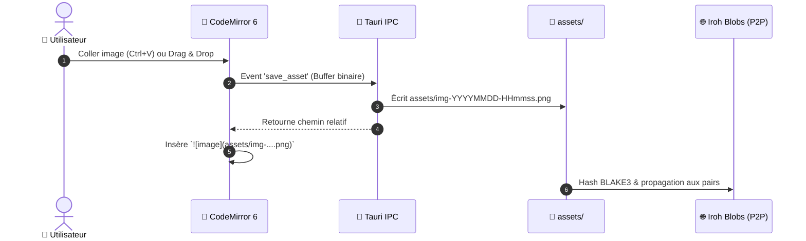

# 🎨 UI/UX — Design System

> Simple, arrondie, pas gadget. Pas de look « généré par une IA ».

---

## Principes directeurs

| Principe | Concrètement |
|---|---|
| **Simple & efficace** | Chaque écran a un but unique. Pas de sidebar avec 40 icônes |
| **Pas de look IA** | Pas de gradients néon, pas de glassmorphism excessif, pas de particules |
| **Arrondis cohérents** | 4px (tags) → 6px (boutons) → 10px (cartes) → 16px (modales) → 24px (conteneurs) |
| **Animations subtiles** | Transitions de 150ms. L'animation sert la compréhension, pas le spectacle |
| **Densité adaptée** | Mode compact pour les power users, mode aéré par défaut |

---

## Ce que Knit n'est PAS

| ❌ On évite | ✅ On fait |
|---|---|
| Gradients arc-en-ciel | Couleur principale unie + neutres doux |
| Glassmorphism flou partout | Surfaces opaques propres, ombres légères |
| Animations "wow" à chaque clic | Transitions de 150ms, presque imperceptibles |
| Sidebar pleine d'icônes colorées | Navigation minimale, hiérarchie claire |
| Typo fantaisie | Inter (ou police système), hiérarchie par taille |
| Dark mode = fond bleu marine | Dark mode = vrais noirs/gris neutres mats (style Obsidian) |
| Boutons bombés avec ombres violettes | Boutons plats et sobres, contrastes subtils |

---

## 🏛️ L'Héritage Notion & Obsidian — Sans Réinventer la Roue

Pour concevoir une expérience immédiatement familière et ultra-productive, Knit reprend **le meilleur de Notion et d'Obsidian**, sans leurs défauts respectifs (Notion est fermé/centralisé sur le cloud, Obsidian n'est pas conçu pour le travail collaboratif en direct P2P).

```
          ┌─────────────────────────────────────────────────────────┐
          │                      🧶 KNIT                            │
          │   Local-First P2P • Markdown Pur • Zéro Conflit CRDT     │
          └───────────────┬─────────────────────────┬───────────────┘
                          │                         │
            Ce qu'on prend de NOTION   Ce qu'on prend d'OBSIDIAN
            ────────────────────────   ─────────────────────────
            • Menu Slash (/)           • WikiLinks [[Note]]
            • Callouts (> [!NOTE])     • Quick Switcher (Ctrl+O)
            • Propriétés de page       • Palette de cmd (Ctrl+P)
            • Vues Kanban / Tableau    • Arbre fidèle au disque
            • Largeur de lecture saine • Split View (Ctrl+\)
```

### 1. Ce que Knit emprunte à Notion (Ergonomie & Structure)

| Idée Notion | Implémentation concrète dans Knit |
|---|---|
| **Le menu Slash Command (`/`)** | Taper `/` sur une ligne vide ouvre un menu de sélection rapide ultra-léger : `/titre`, `/tache`, `/callout`, `/mermaid`, `/code`, `/image`. Tout se fait au clavier en 1 seconde. |
| **Les Callouts / Encarts visuels** | Standardisés en Markdown natif (`> [!NOTE]`, `> [!TIP]`, `> [!WARNING]`). Rendu sobre avec icône duotone discrète, fond neutre très doux et bordure fine. |
| **Les Propriétés en en-tête de page** | Les métadonnées du frontmatter YAML (`statut:`, `priorite:`, `assigne:`, `echeance:`) s'affichent sous forme de pastilles épurées en haut de la note. Cliquer sur un statut ouvre un dropdown sobre qui réécrit le YAML sans casser le document. |
| **Les Vues de données (Kanban & Table)** | Le dossier `projet/taches/` peut être visualisé en document simple, en colonnes Kanban déplaçables, ou en Tableau récapitulatif avec filtres. |
| **Le confort de lecture centré** | Le texte est limité par défaut à 760px de largeur pour un confort de lecture optimal (comme Notion), avec un interrupteur discret *"Pleine largeur"* pour les grands tableaux ou schémas. |

### 2. Ce que Knit emprunte à Obsidian (Puissance Markdown & Vitesse)

| Idée Obsidian | Implémentation concrète dans Knit |
|---|---|
| **Les WikiLinks bidirectionnels (`[[...]]`)** | Taper `[[` déclenche l'autocomplétion instantanée de toutes les notes du coffre. Cliquer sur `[[Architecture]]` navigue vers la note. Renommer un fichier met à jour ses liens. |
| **Le Quick Switcher (`Ctrl+O`)** | Boîte de recherche floue (*fuzzy search*) instantanée pour sauter à n'importe quel fichier du coffre en tapant 3 lettres au clavier. Vitesse < 10ms. |
| **La Palette de Commandes (`Ctrl+P`)** | Exécuter n'importe quelle action sans lever les mains du clavier : changer de thème, créer un fichier, insérer un schéma Mermaid, ouvrir l'historique. |
| **L'Arbre de fichiers pur et sans mensonge** | La barre latérale reflète exactement les dossiers et fichiers sur le disque dur. Aucun dossier virtuel caché. |
| **Multi-onglets & Split View (`Ctrl+\`)** | Travailler sur deux notes côte à côte ou scinder verticalement/horizontalement l'espace de travail. |

---

## 🚫 Manifeste Anti-Look « Codé par IA »

Pour garantir que l'application ne dégage **jamais** la sensation d'un template générique d'IA à la chaîne :

1. **Les vrais noirs et gris neutres (Inspiration Obsidian)** :
   - Interdiction formelle des fonds bleu marine ou violet foncé (`#0F172A`, `#1E1B4B`).
   - Le mode sombre utilise de véritables noirs mats et gris chauds : `#141414` (fond d'application), `#1E1E1E` (surfaces de cartes), `#282828` (survol).
2. **Micro-contrastes de 2% à 4% au lieu des ombres massives** :
   - Les séparations se font par de fines bordures de 1px (`#2A2A2A` en sombre, `#E5E5E5` en clair) plutôt que par de gros flous d'ombres portées.
3. **Zéro animation théâtrale** :
   - Pas de cartes qui flottent avec un rebond élastique de 500ms.
   - Les micro-interactions durent entre **80ms et 150ms** : elles sont perçues comme instantanées et tactiles.
4. **Keyboard-First absolu** :
   - Une application professionnelle se pilote aux raccourcis clavier. Si une action nécessite 4 clics de souris, l'UX a échoué.


---

## Design Token System

Tout le design repose sur un fichier unique de variables CSS :

```css
/* knit-theme.css — Design tokens */
:root {
  /* === COULEUR PRINCIPALE (modifiable par l'utilisateur) === */
  --knit-hue: 260;                              /* Violet par défaut */

  /* Palette auto-générée à partir du hue */
  --knit-primary:       hsl(var(--knit-hue), 55%, 55%);
  --knit-primary-hover: hsl(var(--knit-hue), 55%, 48%);
  --knit-primary-soft:  hsl(var(--knit-hue), 40%, 94%);
  --knit-primary-muted: hsl(var(--knit-hue), 20%, 70%);

  /* Surface & fond */
  --knit-bg:            #FAFAFA;
  --knit-surface:       #FFFFFF;
  --knit-surface-hover: #F5F5F5;
  --knit-border:        #E5E5E5;

  /* Texte */
  --knit-text:          #1A1A1A;
  --knit-text-secondary:#6B6B6B;
  --knit-text-muted:    #A0A0A0;

  /* Arrondis */
  --knit-radius-xs:     4px;    /* Tags, badges */
  --knit-radius-sm:     6px;    /* Boutons, inputs */
  --knit-radius-md:     10px;   /* Cartes, panneaux */
  --knit-radius-lg:     16px;   /* Modales, dropdowns */
  --knit-radius-xl:     24px;   /* Conteneurs principaux */

  /* Ombres */
  --knit-shadow-sm:     0 1px 2px rgba(0,0,0,0.05);
  --knit-shadow-md:     0 4px 12px rgba(0,0,0,0.08);
  --knit-shadow-lg:     0 12px 32px rgba(0,0,0,0.12);

  /* Transitions */
  --knit-transition:    150ms ease;
  --knit-transition-slow: 300ms ease;

  /* Typographie */
  --knit-font:          'Inter', -apple-system, sans-serif;
  --knit-font-mono:     'JetBrains Mono', 'Fira Code', monospace;
}

/* === THEME SOMBRE === */
[data-theme="dark"] {
  --knit-bg:            #0F0F0F;
  --knit-surface:       #1A1A1A;
  --knit-surface-hover: #252525;
  --knit-border:        #2A2A2A;
  --knit-text:          #ECECEC;
  --knit-text-secondary:#8A8A8A;
  --knit-text-muted:    #555555;
  --knit-shadow-sm:     0 1px 2px rgba(0,0,0,0.2);
  --knit-shadow-md:     0 4px 12px rgba(0,0,0,0.3);
  --knit-shadow-lg:     0 12px 32px rgba(0,0,0,0.4);
}
```

---

## Couleur principale — Un slider, toute la palette

L'utilisateur choisit **une seule valeur** : `--knit-hue` (0 à 360).

| Hue | Couleur | Ambiance |
|---|---|---|
| `0` | 🔴 Rouge | Énergique |
| `30` | 🟠 Orange | Chaleureuse |
| `140` | 🟢 Vert | Nature, apaisante |
| `210` | 🔵 Bleu | Pro, classique |
| `260` | 🟣 Violet | *(défaut)* Créatif, moderne |
| `330` | 🩷 Rose | Doux, original |

---

## Mermaid — Rendu natif dans l'éditeur

### Deux modes d'affichage

| Mode | Quand | Ce qu'on voit |
|---|---|---|
| **Code** | Le curseur est **dans** le bloc mermaid | Texte source avec coloration syntaxique |
| **Rendu** | Le curseur est **hors** du bloc | SVG du diagramme, dans une carte arrondie |

### Règles de design

| Règle | Détail |
|---|---|
| **Carte conteneur** | `border-radius: var(--knit-radius-md)`, ombre `var(--knit-shadow-sm)` |
| **Pas de scroll horizontal** | SVG adapté à la largeur (`max-width: 100%`) |
| **Thème Mermaid = thème Knit** | Couleurs synchronisées via `--knit-hue` |
| **Transition code ↔ rendu** | Fade-in/fade-out de 200ms |
| **Erreur gracieuse** | Message d'erreur dans la carte, pas de crash |

### Thème Mermaid synchronisé

```javascript
function getKnitMermaidTheme(hue, isDark) {
  return {
    theme: 'base',
    themeVariables: {
      background:        isDark ? '#1A1A1A' : '#FFFFFF',
      mainBkg:           `hsl(${hue}, 40%, ${isDark ? '25%' : '94%'})`,
      primaryColor:      `hsl(${hue}, 55%, 55%)`,
      primaryBorderColor:`hsl(${hue}, 55%, 40%)`,
      primaryTextColor:  isDark ? '#ECECEC' : '#1A1A1A',
      lineColor:         `hsl(${hue}, 20%, ${isDark ? '50%' : '60%'})`,
      fontFamily:        "'Inter', -apple-system, sans-serif",
      fontSize:          '14px',
    }
  };
}
```

### Types de diagrammes — Priorités

| Priorité | Type | Cas d'usage |
|---|---|---|
| 🔴 MVP | `graph` / `flowchart` | Architecture, flux, organigrammes |
| 🔴 MVP | `sequenceDiagram` | Interactions P2P, flux utilisateur |
| 🟡 v0.3.0 | `gantt` | Planning, roadmap temporelle |
| 🟡 v0.3.0 | `classDiagram` | Doc technique, modèles de données |
| 🟢 Post-v1.0 | `pie`, `mindmap`, `timeline` | Dashboards, brainstorming |

---

## 🎨 Iconographie & Style Duotone — Reicon

Knit utilise la bibliothèque d'icônes open-source **[Reicon](https://github.com/dqev/reicon)** (licence MIT) avec son style **Duotone**.

### Pourquoi Reicon ?
- **Design pixel-perfect** sur grille 24×24px, coins arrondis, pas d'effets superflus.
- **Variante Duotone** : deux couches visuelles permettant de jouer avec la couleur d'accent `--knit-hue` :
  - **Couche primaire (100% opacité)** : contours et symboles forts (`--knit-text` ou `--knit-primary`).
  - **Couche secondaire (15-25% opacité)** : remplissage doux utilisant la teinte active `hsl(var(--knit-hue), 55%, 55%)`.
- **Composants React natifs** (`reicon-react`) légers et sans dépendances lourdes.
- *Alternative éprouvée / fallback* : **Phosphor Icons** (`@phosphor-icons/react` en mode `weight="duotone"`).

---

## 🖼️ Gestion des Images — Copier, Coller & Glisser-Déposer

Dans un wiki moderne, la manipulation d'images doit être instantanée et sans friction.



### 1. Coller depuis le presse-papier (`Ctrl+V`)
- Détection automatique du type MIME `image/png`, `image/jpeg`, `image/webp` dans le presse-papier.
- Génération d'un nom horodaté unique et lisible : `assets/img-YYYYMMDD-HHmmss.png`.
- Enregistrement immédiat dans le sous-dossier `assets/` du coffre local.
- Insertion automatique de la syntaxe Markdown `` à l'emplacement exact du curseur.

### 2. Glisser-déposer (Drag & Drop)
- Glisser un ou plusieurs fichiers images depuis l'explorateur directement dans la zone de texte.
- Copie automatique dans `assets/` et insertion des liens Markdown correspondants.

### 3. Copier une image existante
- Au survol ou clic droit sur une image dans l'éditeur :
  - **Copier l'image** : place l'image binaire dans le presse-papier du système d'exploitation (`navigator.clipboard.write`).
  - **Copier le chemin** : copie `assets/nom-image.png`.
  - **Copier le tag Markdown** : copie ``.

### 4. Synchronisation P2P des images
- Les fichiers binaires dans `assets/` sont volumineux comparés aux fichiers texte `.md`.
- Ils ne passent **pas** par le CRDT Yjs textuel, mais par **Iroh Blobs** : transfert direct pair-à-pair par chunks vérifiés par hash BLAKE3, ultra-rapide et résilient.

---

## 🍞 Système de Toast Centralisé & Optimisé

Un système de notifications unifié, non intrusif, placé en bas à droite de l'application.

### Position & Empilement
- **Ancrage** : `bottom: 24px; right: 24px;`
- **Direction de la pile** : empilement vertical vers le haut (`flex-direction: column-reverse`).
- **Capacité max** : 4 toasts visibles simultanément (les plus anciens sont masqués en douceur).
- **Z-Index** : 9999 (au-dessus des modales et barres latérales).

### Les 5 Types de Toasts

| Type | Couleur / Teinte | Icône Duotone | Animation / Comportement |
|---|---|---|---|
| **`info`** | Teinte `--knit-primary` | ℹ️ `Info` | Auto-dismiss 4s, jauge de progression discrète |
| **`warning`** | Ambre `#F59E0B` | ⚠️ `WarningTriangle` | Auto-dismiss 6s, nécessite attention |
| **`error`** | Rouge bordeaux `#EF4444` | ⛔ `WarningCircle` | Reste affiché jusqu'à fermeture manuelle ou 8s |
| **`success`** | Vert émeraude `#10B981` | ✅ `CheckCircle` | Auto-dismiss 3s, subtil fade-out |
| **`sync` / `change`** | Accent dynamique `--knit-primary` | 🔄 `ArrowsClockwise` | **Micro-animation vivante** (pulsation P2P + rotation douce) |

### Spécification du Toast `sync` (Modifications en direct)
Lorsqu'un pair distant ou un agent IA modifie des fichiers :
- **Micro-animation** :
  - Icône de synchronisation en rotation continue douce (360° en 2s ease-in-out).
  - Ondes concentriques de pulsation discrètes simulant la transmission pair-à-pair.
  - Badge indiquant le nombre de changements et l'auteur : *"3 modifications synchronisées depuis Node-Bob"*.
- **Regroupement intelligent (Debounce)** : si 10 modifications arrivent en 1 seconde, un seul toast `sync` est affiché et son compteur s'incrémente dynamiquement au lieu de spammer l'écran.

### Design Tokens & CSS du Toast

```css
/* Toast Container */
.knit-toast-container {
  position: fixed;
  bottom: 24px;
  right: 24px;
  z-index: 9999;
  display: flex;
  flex-direction: column-reverse;
  gap: 10px;
  pointer-events: none;
}

/* Individual Toast */
.knit-toast {
  pointer-events: auto;
  min-width: 300px;
  max-width: 420px;
  padding: 12px 16px;
  background: var(--knit-surface);
  border: 1px solid var(--knit-border);
  border-radius: var(--knit-radius-md); /* 10px ou 12px */
  box-shadow: var(--knit-shadow-md);
  display: flex;
  align-items: flex-start;
  gap: 12px;
  animation: toast-slide-in 200ms cubic-bezier(0.16, 1, 0.3, 1);
  transition: transform 150ms ease, opacity 150ms ease;
  overflow: hidden;
  position: relative;
}

/* Animation d'entrée */
@keyframes toast-slide-in {
  from {
    opacity: 0;
    transform: translateY(16px) scale(0.96);
  }
  to {
    opacity: 1;
    transform: translateY(0) scale(1);
  }
}

/* Animation spéciale pour le Toast de Changement / Sync */
.knit-toast-sync .knit-toast-icon {
  animation: spin-pulse 2.5s infinite linear;
}

@keyframes spin-pulse {
  0% { transform: rotate(0deg) scale(1); }
  50% { transform: rotate(180deg) scale(1.1); }
  100% { transform: rotate(360deg) scale(1); }
}

/* Barre de décompte */
.knit-toast-progress {
  position: absolute;
  bottom: 0;
  left: 0;
  height: 2px;
  background: var(--knit-primary);
  opacity: 0.6;
  transition: width linear;
}
```

### Architecture du Store Centralisé (React + Tauri)

```typescript
// stores/toastStore.ts
export interface ToastOptions {
  id?: string;
  type: 'info' | 'warning' | 'error' | 'success' | 'sync';
  title: string;
  message?: string;
  duration?: number; // millisecondes (défaut: 4000)
  action?: { label: string; onClick: () => void };
}

// Accessible partout dans l'application :
// toast.show({ type: 'sync', title: 'Fichier synchronisé', message: 'mis à jour par Alice' });
// toast.error('Erreur d\'écriture sur le disque');
// toast.warning('Connexion P2P instable');
```

Le backend Rust Tauri peut également déclencher directement des toasts vers l'UI :
```rust
// Côté Rust (Tauri)
app_handle.emit("knit://toast", ToastPayload {
    toast_type: "sync".into(),
    title: "Mise à jour P2P".into(),
    message: format!("{} fichiers mis à jour", count),
})?;
```

---

## 👥 Présence & Curseurs Distants (Collaboration en Direct)

Comment les collaborateurs se voient-ils sur le même document ?

### 1. Barre de présence en en-tête d'éditeur
En haut à droite de chaque document ouvert, une barre d'avatars circulaires empilés montre qui est en train de consulter ou modifier la page :
- **Humains** : cercle avec initiales (ex: `[TH]`, `[AL]`) ou photo/avatar SVG, entouré d'une bordure de sa couleur attribuée.
- **Agent IA actif** : badge violet spécial avec une icône de robot (ex: `🤖 Cursor` ou `🤖 Claude Code`) lorsqu'une mise à jour externe est en cours de traitement.

### 2. Curseurs & Sélections en direct dans CodeMirror 6
Grâce au protocole `y-protocols/awareness` de Yjs :
- **Curseur distant** : fine barre verticale colorée qui se déplace en direct.
- **Badge d'identification** :
  - Petite étiquette arrondie flottant juste au-dessus du curseur avec les **initiales** (ex: `TH`) ou le **prénom** du collaborateur.
  - **Comportement intelligent** : lors de la frappe, l'étiquette s'affiche clairement ; après 3 secondes d'inactivité, elle se rétracte sous forme d'une puce discrète de 4px pour ne pas masquer le texte.
- **Sélection de texte** : surlignage doux semi-transparent (opacité 20%) de la couleur du collaborateur lorsque celui-ci sélectionne une portion de phrase.

```
       ┌─── TH (Thomas) ────────┐
       │                        ▼
Le CRDT|garantit une fusion sans conflit...
       │
     Curseur coloré
```

### 3. Palette de Couleurs Sobre & Attribution Déterministe

Pour que l'interface reste **élégante, sobre et lisible**, on évite formellement les couleurs fluo / néon criardes.

#### La palette fermée des 10 teintes collaboratives

Les teintes sont calibrées pour garantir un contraste optimal (norme WCAG AA) sur fond blanc comme sur fond sombre :

| # | Teinte | Rendu (Hex) | Ambiance & Lisibilité |
|---|---|---|---|
| 1 | **Bleu Ardoise** | `#3B82F6` | Calme, classique, fort contraste |
| 2 | **Émeraude Sauge** | `#10B981` | Nature, reposant pour les yeux |
| 3 | **Ambre Doré** | `#D97706` | Chaud, lumineux sans être éblouissant |
| 4 | **Terre Cuite** | `#E11D48` | Doux, distinctif sans agressivité |
| 5 | **Cyan Pétrole** | `#0891B2` | Moderne, professionnel |
| 6 | **Indigo Feutré** | `#6366F1` | Discret, élégant |
| 7 | **Rose Poudré** | `#DB2777` | Pastel chic, subtil |
| 8 | **Cuivre Foncé** | `#C2410C` | Terreux, sobre |
| 9 | **Vert Menthe** | `#0D9488` | Frais, haute lisibilité |
| 10| **Lavande Douce** | `#9333EA` | Équilibré, créatif |

> [!NOTE]
> **Couleur réservée pour l'IA** : Pour ne **jamais confondre un humain et une IA**, les agents (Cursor, Claude Code, Antigravity) ont une couleur exclusive dédiée : **Violet Tech (`#8B5CF6`)** accompagné de l'icône `🤖`.

#### Attribution Déterministe (Stable dans le temps)
- **Hash de l'identité cryptographique** : La couleur d'un pair est calculée automatiquement à partir de sa clé publique Ed25519 (`hash(peer_id) % 10`).
- **Permanence** : Thomas aura **toujours la même couleur**, session après session, évitant la confusion mentale d'un changement de couleur à chaque redémarrage.
- **Personnalisation locale** : Tout utilisateur peut choisir sa couleur préférée dans ses paramètres locaux (`.knit/config.yaml`).

#### Règles graphiques pour une sobriété absolue
- **Curseur** : trait fin de **2px**, sans ombre portée clignotante.
- **Surlignage de texte** : opacité limitée à **15% - 20%** (`color-mix` ou rgba) pour que le texte Markdown reste 100% lisible dessous sans éblouir.
- **Badge d'initiales** : fond neutre doux (`--knit-surface`), fine bordure discrète, pastille colorée de 6px et initiales en typographie nette. Pas de gros pavé fluo.

### 4. Présence Multi-Fichiers & Explorateur (Où sont mes collaborateurs ?)

Si un collaborateur travaille dans un **autre fichier**, comment le sait-on ?

#### A. Les Cercles d'Avatars dans l'Arbre de Fichiers (Sidebar)
À droite du nom de chaque fichier dans la barre latérale, de petits cercles d'avatars de **18px** indiquent la présence en temps réel :

```
📁 wiki/
├── 📄 architecture.md      [TH] [AL]    ◄── Thomas et Alice sont dessus
├── 📄 accueil.md
└── 📄 roadmap.md           [🤖]         ◄── Agent IA en cours d'édition
```

* **Aspect visuel du cercle** :
  * Forme circulaire parfaite (`border-radius: 50%`).
  * Fond de la couleur dédiée du collaborateur (ou bordure de 2px avec fond neutre).
  * **2 Initiales en majuscules** en typographie ultra-nette (ex: `TH`, `AL`, `KB`).
  * Si un agent IA modifie le fichier : pastille violette avec icône `🤖`.
* **Empilement (Avatar Stack) & Pastille de dépassement (`+N`)** :
  - **Dans la Sidebar** : Pour ne pas surcharger l'arbre de fichiers, on affiche au maximum **2 cercles d'avatars**, suivis d'un cercle neutre `+N` si davantage de collaborateurs sont présents (ex : `[TH] [AL] [+3]`).
  - **Dans l'En-tête de Document** : On affiche jusqu'à **4 cercles**, puis la pastille `+N`.
  - **Comportement du cercle `+N`** :
    - Fond neutre discret (`var(--knit-surface-hover)`), texte fin `+N`.
    - **Au survol / clic** : ouvre un popover vertical élégant qui liste l'intégralité des collaborateurs actifs sur ce fichier avec leur pastille couleur, initiales, nom complet et bouton direct pour les rejoindre.

#### B. Ce que l'on voit au survol (Tooltip / Popover d'État)
Au survol d'un cercle dans la barre latérale ou dans l'en-tête, une infobulle sobre apparaît (délai 150ms) :

```
┌──────────────────────────────────────────┐
│  🟢 Thomas (TH)                          │
│  Statut : En train d'éditer...           │
│  Position : Ligne 42 (## Moteur CRDT)    │
│  Activité : Il y a 10 secondes           │
│  ──────────────────────────────────────  │
│  👉 Cliquer pour rejoindre (Follow Mode) │
└──────────────────────────────────────────┘
```

#### C. Clic = « Téléportation » (Jump to Collaborator)
* Cliquer sur le cercle d'un collaborateur ouvre immédiatement son fichier.
* La vue défile automatiquement jusqu'à sa position exacte.
* La ligne où il tape s'illumine brièvement d'un flash très doux (200ms) de sa couleur, puis s'estompe.


---

## ⏳ Historique de Versions & Time Travel (Diff & Restauration)

Knit permet de naviguer dans l'histoire d'un document et de revenir en arrière sans friction.

### 1. Volet latéral "Historique du document"
Un panneau rétractable accessible via l'icône chronomètre `ClockCounterClockwise` :
- **Timeline chronologique** : liste des versions sauvegardées avec horodatage relatif (*"il y a 5 min"*, *"hier à 18h20"*).
- **Attribution claire de l'auteur** :
  - 👤 *"Modifié par Thomas"* (édition humaine via l'UI Knit)
  - 🤖 *"Modifié par Agent Local (externe)"* (modification disque via Cursor, Claude Code, script)
  - 🌐 *"Synchronisé depuis Bob"* (reçu via P2P Iroh)

### 2. Visualisation du Diff bicolore
En cliquant sur une version antérieure dans la timeline :
- L'éditeur affiche un comparateur de diff instantané :
  - **Lignes ajoutées** : fond vert doux (`rgba(16, 185, 129, 0.15)`), bordure gauche verte.
  - **Lignes supprimées** : fond rouge doux (`rgba(239, 68, 68, 0.15)`), texte barré.
  - Le texte inchangé reste neutre.

### 3. Restauration en 1 clic
- Bouton clair et arrondi : **`Restaurer cette version`**.
- La restauration applique une nouvelle opération CRDT sans détruire l'historique antérieur (aucun risque de perte de données irréversible).
- Le fichier `.md` sur le disque est mis à jour instantanément, et la modification est propagée aux autres pairs P2P.


