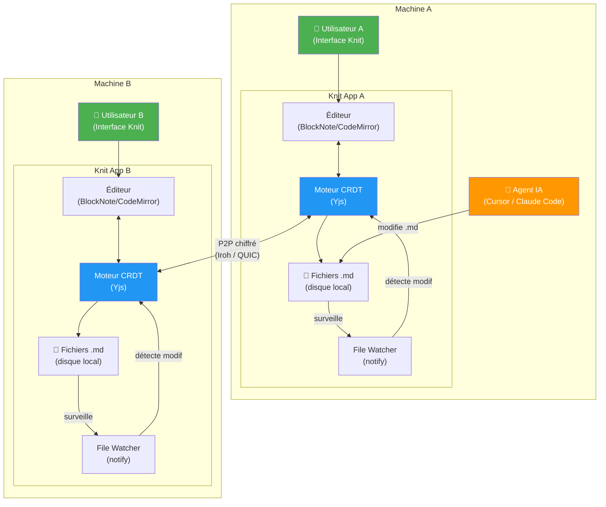
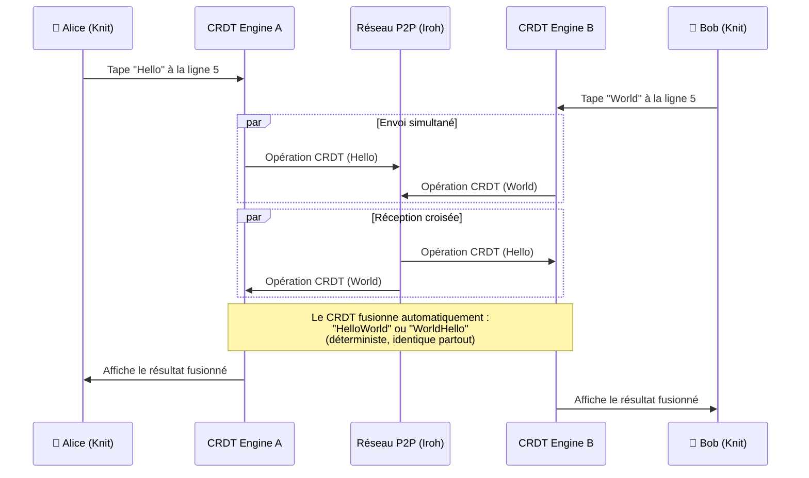
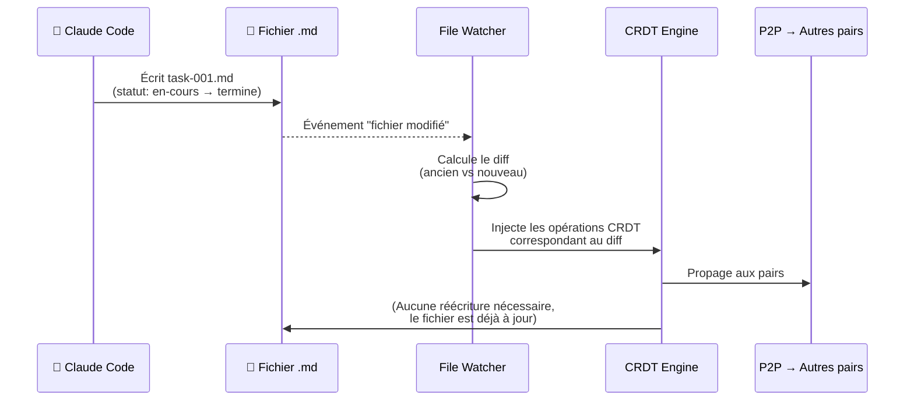

# 🧶 Knit — Documentation de Projet

> Application collaborative local-first & P2P pour le wiki, le suivi de projet et la planification, en Markdown pur — pensée pour les humains *et* les agents IA.

---

## 📋 Table des matières

1. [Vision & Problème résolu](#1-vision--problème-résolu)
2. [Architecture technique](#2-architecture-technique)
3. [Stack technologique](#3-stack-technologique)
4. [Structure des données](#4-structure-des-données)
5. [Flux de synchronisation](#5-flux-de-synchronisation)
6. [Plan de développement (MVP)](#6-plan-de-développement-mvp)
7. [Mon avis honnête](#7-mon-avis-honnête-)
8. [Propositions d'amélioration](#8-propositions-damélioration)

---

## 1. Vision & Problème résolu

### Le besoin

| Critère | Exigence |
|---|---|
| **Collaboration** | Wiki + suivi de projet + planification — édition multi-utilisateurs |
| **Format** | Markdown pur (fichiers `.md` sur disque) |
| **Réseau** | P2P sans serveur central — les machines communiquent directement |
| **Zéro conflit** | Deux personnes éditent le même fichier → fusion automatique |
| **Zéro latence** | Modifications visibles quasi-instantanément sur tous les pairs |
| **Agent-friendly** | Un agent IA (Cursor, Claude Code, Antigravity) peut lire/écrire les fichiers `.md` et l'app se met à jour en temps réel |
| **Multiplateforme** | Windows + Linux |

### La contradiction technique clé

> **Le cœur du problème** : les CRDT (zéro conflit) stockent les données en graphe binaire, mais les agents IA ont besoin de fichiers `.md` en texte brut. Knit résout cette contradiction avec un **"pont bidirectionnel"** CRDT ↔ Fichiers `.md`.

---

## 2. Architecture technique

### Le "Pont Bidirectionnel" — Schéma conceptuel



### Trois boucles critiques

| Boucle | Déclencheur | Flux |
|---|---|---|
| **Humain → Réseau** | L'utilisateur tape dans l'éditeur | Éditeur → CRDT → P2P → Pairs + écriture `.md` sur disque |
| **IA → Réseau** | Un agent IA modifie un `.md` | File Watcher → diff → CRDT → P2P → Pairs |
| **Réseau → Local** | Un pair envoie une modification | P2P → CRDT → mise à jour éditeur + écriture `.md` sur disque |

---

## 3. Stack technologique

### Composants retenus

| Composant | Technologie | Version / Maturité | Rôle |
|---|---|---|---|
| **Shell natif** | [Tauri v2](https://tauri.app) | v2.12+ — ✅ Stable, production-ready | Conteneur multiplateforme (Win/Linux). ~10 Mo vs ~150 Mo Electron |
| **Moteur CRDT** | [Yjs](https://yjs.dev) | Mature, standard de facto | Fusion sans conflit du texte riche. Intégration native BlockNote |
| **Réseau P2P** | [Iroh](https://iroh.computer) | v1.0+ — ✅ Stable | Connexion pair-à-pair via QUIC, NAT traversal, chiffrement E2E |
| **File Watcher** | [notify](https://crates.io/crates/notify) (Rust) | Très mature | Détection des modifications fichier en < 1 ms |
| **Éditeur riche** | [BlockNote](https://blocknotejs.org) | Stable | Éditeur Markdown block-based avec collab Yjs native |
| **Interface** | React ou Svelte | — | Frontend pour le wiki, les vues Kanban, calendrier |

### Pourquoi Yjs plutôt que Loro ?

> [!IMPORTANT]
> La réflexion initiale mentionnait Loro comme option. Après vérification : **BlockNote et tout l'écosystème ProseMirror n'ont des bindings que pour Yjs**. Utiliser Loro nécessiterait de réécrire un binding ProseMirror complet — un projet en soi. **Yjs est le choix pragmatique** pour le MVP. Loro pourra être envisagé plus tard pour des cas spécifiques (arbres, historique avancé).

---

## 4. Structure des données

### Organisation du coffre-fort (Vault)

```
mon-projet/
├── .knit/                      # Métadonnées Knit (ignoré par git si souhaité)
│   ├── config.yaml             # Config du vault (nom, clé de partage P2P)
│   └── crdt-state/             # État CRDT persisté (binaire, pas éditable)
│
├── wiki/                       # Pages du wiki
│   ├── accueil.md
│   ├── architecture.md
│   └── guide-contribution.md
│
├── projet/                     # Suivi de projet
│   ├── roadmap.md
│   ├── sprints/
│   │   ├── sprint-2026-W42.md
│   │   └── sprint-2026-W43.md
│   └── taches/
│       ├── task-001-moteur-crdt.md
│       ├── task-002-reseau-p2p.md
│       └── task-003-interface-kanban.md
│
├── KNIT.md                     # Instructions pour les agents IA
└── README.md
```

### Format des tâches (YAML Frontmatter)

```markdown
---
id: task-001
type: tache
titre: Créer le moteur de synchronisation P2P
statut: en-cours          # backlog | a-faire | en-cours | en-revue | termine
assigne: Thomas
priorite: haute           # basse | moyenne | haute | critique
sprint: 2026-W42
echeance: 2026-10-20
tags: [backend, p2p, mvp]
---

# Créer le moteur de synchronisation P2P

## Description
Implémenter la couche réseau P2P avec Iroh pour permettre la synchronisation
CRDT entre deux instances de Knit.

## Critères d'acceptation
- [x] Initialiser Tauri avec le plugin Iroh
- [x] Configurer le NAT traversal
- [ ] Tester la synchronisation entre 2 PC
- [ ] Mesurer la latence (objectif < 50ms sur LAN)

## Notes
La connexion utilise le protocole QUIC avec chiffrement E2E automatique.
```

---

## 5. Flux de synchronisation

### Scénario 1 : Deux humains éditent simultanément



### Scénario 2 : Un agent IA modifie un fichier



---

## 6. Plan de développement (MVP)

### Phase 1 — Le Pont Local (1–2 week-ends)

> **Objectif** : Un éditeur Markdown local qui reste synchronisé avec le système de fichiers.

| Tâche | Détail |
|---|---|
| Scaffold Tauri v2 | `npx -y create-tauri-app@latest` avec React/Svelte |
| Intégrer BlockNote + Yjs | Éditeur collaboratif connecté à un `Y.Doc` local |
| File Watcher Rust | Crate `notify` : surveiller le dossier du vault |
| Boucle CRDT ↔ FS | Quand l'éditeur modifie → écrire le `.md`. Quand le `.md` change sur disque → injecter dans Yjs |
| Parseur YAML Frontmatter | Lire/écrire les métadonnées des tâches |

### Phase 2 — Le Tuyau P2P (2–3 semaines)

> **Objectif** : Deux instances de Knit sur deux PC se synchronisent en temps réel.

| Tâche | Détail |
|---|---|
| Intégrer Iroh | Node P2P embarqué dans le backend Rust de Tauri |
| Protocole de sync Yjs | Encoder/décoder les updates Yjs sur les streams QUIC d'Iroh |
| Découverte de pairs | Partage d'identifiant (clé publique) ou mDNS local |
| Gestion de la déconnexion | Rejouer les opérations manquées au retour en ligne |
| Chiffrement E2E | Natif via Iroh (QUIC + clé Ed25519) |

### Phase 3 — Les Vues Projets (2–3 semaines)

> **Objectif** : Transformer les fichiers `.md` en vues dynamiques (Kanban, calendrier, tableau).

| Tâche | Détail |
|---|---|
| Vue Kanban | Colonnes basées sur `statut:` du frontmatter |
| Vue Tableau | Liste filtrable/triable de toutes les tâches |
| Vue Calendrier | Basée sur `echeance:` et `sprint:` |
| Drag & Drop | Glisser une carte = modifier le frontmatter du `.md` |
| Recherche | Full-text search sur tous les fichiers du vault |

### Phase 4 — Polish & Production (continu)

| Tâche | Détail |
|---|---|
| Gestion des conflits FS | Boucle anti-rebond (debounce) pour éviter les écritures en cascade |
| Curseurs distants | Voir en temps réel où tape chaque collaborateur |
| Historique / Time Travel | Exploiter l'OpLog Yjs pour naviguer dans l'historique |
| Thème sombre / clair | Interface premium |
| Installateur | `.msi` (Windows) + `.AppImage` / `.deb` (Linux) |

---

## 7. Mon avis honnête 🔍

### Ce que je trouve excellent dans cette réflexion

**1. Le positionnement est unique et pertinent**
Il n'existe pas d'application qui coche toutes les cases : P2P + Markdown sur disque + collaboration temps réel + compatible agents IA. C'est un vrai créneau vide. Obsidian + Syncthing s'en approche mais **Syncthing ne fait pas de fusion de contenu** — il génère des fichiers de conflit (`file.sync-conflict-*.md`).

**2. Le choix de Tauri v2 est excellent**
Tauri v2 est production-ready (v2.12+), pèse ~10x moins qu'Electron, et le backend Rust permet d'embarquer nativement Iroh et le file watcher. C'est le meilleur choix possible en 2026.

**3. Iroh v1.0 est le bon timing**
Iroh vient d'atteindre sa v1.0 stable avec des garanties d'API. Le NAT traversal via QUIC est robuste et le fallback relay chiffré résout le cas des réseaux d'entreprise restrictifs.

**4. L'architecture "pont bidirectionnel" est la bonne approche**
C'est exactement le pattern que des projets comme CollabMD et p2panda-tauri utilisent. La réflexion a identifié le bon pattern architectural.

### Ce qui me préoccupe

> [!WARNING]
> **1. La boucle File Watcher ↔ CRDT est le point le plus dangereux du projet**
>
> C'est un problème d'**ingénierie de boucle de rétroaction** : quand le CRDT écrit un `.md` sur disque, le File Watcher détecte la modification et tente de la ré-injecter dans le CRDT, ce qui provoque une nouvelle écriture, etc. → **boucle infinie**.
>
> Ce n'est pas mentionné dans la réflexion initiale et c'est pourtant le défi #1. Il faut un mécanisme de **debounce + signature de dernière écriture** (hash du contenu, flag "écriture interne" verrouillé le temps de l'écriture).

> [!WARNING]
> **2. La conversion CRDT → Markdown n'est pas triviale**
>
> BlockNote utilise un format de blocs JSON interne, pas du Markdown brut. La conversion BlockNote JSON → `.md` et `.md` → BlockNote JSON est **lossy** (perte d'information). Le formatage exact, les espaces, les retours à la ligne peuvent changer à chaque aller-retour. Un agent IA qui écrit du Markdown très spécifique pourrait voir son formatage "normalisé" par le round-trip.

> [!WARNING]
> **3. La complexité est sous-estimée**
>
> La réflexion initiale dit "Phase 1 : 1 week-end". C'est **très optimiste**. Rien que la boucle CRDT ↔ FS avec debounce anti-boucle, la gestion du YAML frontmatter, et l'intégration BlockNote + Yjs dans Tauri représentent facilement **2–4 semaines** de développement pour un développeur expérimenté.

> [!CAUTION]
> **4. Le P2P pur a des limites pratiques**
>
> - **Découverte de pairs** : sans serveur de signalisation, comment deux PC se trouvent-ils la première fois ? Iroh utilise un relay de bootstrap — ce n'est techniquement **pas** du "sans serveur" à 100%, même si le relay ne voit pas le contenu.
> - **Hors-ligne prolongé** : si un pair est hors-ligne pendant des jours, le volume d'opérations CRDT à rejouer peut être conséquent. Il faut implémenter des **snapshots/checkpoints**.

---

## 8. Propositions d'amélioration

### 🔧 Améliorations techniques

#### A. Utiliser CodeMirror 6 au lieu de BlockNote pour le MVP

> [!TIP]
> **Pourquoi** : CodeMirror 6 travaille directement avec du texte brut (le Markdown tel quel), pas avec un format JSON de blocs. Cela **élimine complètement le problème de round-trip lossy** entre le format interne et les fichiers `.md`. L'intégration avec Yjs existe via `y-codemirror.next`. L'expérience pour les agents IA sera **parfaite** car le fichier sur disque est exactement ce qui est dans l'éditeur.
>
> BlockNote pourra être ajouté plus tard comme vue alternative "WYSIWYG" pour les utilisateurs non-techniques.

#### B. Implémenter un "Write Lock" pour la boucle FS

```
Quand Knit écrit un .md :
  1. Mettre un flag `isInternalWrite = true`
  2. Calculer le hash SHA-256 du contenu écrit
  3. Stocker dans une map : { "chemin/fichier.md": hash }
  4. Écrire le fichier

Quand le File Watcher détecte un changement :
  1. Calculer le hash du nouveau contenu
  2. Si hash == hash stocké dans la map → IGNORER (c'est notre propre écriture)
  3. Sinon → C'est une modification externe (IA/utilisateur) → injecter dans CRDT
```

#### C. Ajouter un mode "LAN-first" avec mDNS

Avant de passer par Iroh (qui nécessite un relay pour le bootstrap), implémenter une découverte locale via **mDNS/DNS-SD** (crate `mdns-sd` en Rust). Sur un réseau local (même maison, même bureau), les pairs se trouvent automatiquement **sans aucun serveur**, pas même un relay. Iroh intervient seulement pour les connexions inter-réseaux.

#### D. Séparer le "runtime" Knit de l'interface

```
knit-core/          # Crate Rust : CRDT + File Watcher + P2P (Iroh)
                    # Peut tourner en mode "headless" (sans UI)
                    # → Un agent IA peut lancer `knit daemon` dans un terminal

knit-app/           # Application Tauri : interface graphique
                    # Utilise knit-core en tant que dépendance
```

> [!TIP]
> **Avantage** : un agent IA ou un script CI/CD peut exécuter `knit daemon` sans interface graphique pour synchroniser un vault en arrière-plan. Un serveur Linux headless peut participer au réseau P2P.

### 📐 Améliorations fonctionnelles

#### E. Système de permissions par fichier/dossier

Pour la collaboration en équipe, ajouter un mécanisme de permissions dans le frontmatter ou dans `.knit/permissions.yaml` :

```yaml
# .knit/permissions.yaml
regles:
  - chemin: "wiki/**"
    acces: lecture-ecriture
    pour: tous

  - chemin: "projet/roadmap.md"
    acces: lecture-seule
    pour: [collaborateur]
    
  - chemin: "projet/taches/**"
    acces: lecture-ecriture
    pour: tous
```

#### F. Journal d'activité (Activity Feed)

Un fichier `.knit/activity.log` (ou une vue dans l'app) qui trace :
```
[2026-10-15 14:32] 👤 Thomas a modifié wiki/architecture.md
[2026-10-15 14:35] 🤖 Claude Code a créé projet/taches/task-015.md
[2026-10-15 14:36] 👤 Marie a déplacé task-012 → statut: termine
[2026-10-15 14:40] 🔄 Synchronisation avec le pair "PC-Bureau" terminée
```

#### G. Templates de tâches et de pages wiki

Ajouter un dossier `.knit/templates/` avec des modèles :

```
.knit/templates/
├── tache.md            # Template par défaut pour une tâche
├── bug-report.md       # Template pour un rapport de bug
├── page-wiki.md        # Template pour une page wiki
└── sprint.md           # Template pour un sprint
```

L'utilisateur (ou l'IA) peut créer une tâche avec `knit new tache "Nom de la tâche"` qui copie le template et pré-remplit les métadonnées.

#### H. Fichier `KNIT.md` — Instructions pour les agents IA

À la racine du vault, un fichier `KNIT.md` que les agents IA lisent automatiquement :

```markdown
# Instructions pour les agents IA

## Structure du projet
- Les tâches sont dans `projet/taches/` au format `task-XXX-description.md`
- Le wiki est dans `wiki/`
- Les sprints sont dans `projet/sprints/`

## Conventions
- Les statuts valides sont : backlog, a-faire, en-cours, en-revue, termine
- Les priorités valides sont : basse, moyenne, haute, critique
- Les IDs de tâches sont incrémentaux : task-001, task-002, etc.
- Toujours inclure le YAML frontmatter complet

## Commandes fréquentes
- Pour créer une tâche : créer un fichier dans projet/taches/
- Pour terminer une tâche : changer statut: en-cours → statut: termine
- Pour documenter : ajouter/modifier des fichiers dans wiki/
```

### 🚀 Améliorations ambitieuses (post-MVP)

#### I. Plugin système pour des vues custom

Permettre aux utilisateurs de créer des vues personnalisées en JavaScript/HTML qui lisent les fichiers `.md` du vault. Par exemple : un graphe de dépendances entre tâches, un burndown chart, un dashboard de sprint.

#### J. Export/Import Git

Intégrer un bouton "Commit & Push" qui commit l'état du vault dans un dépôt Git. Cela donne un **historique Git** en plus de l'historique CRDT, et permet de collaborer avec des personnes qui n'utilisent pas Knit (via GitHub/GitLab).

#### K. Mode "Présentation"

Transformer une page wiki en présentation (slides) à la manière de [Marp](https://marp.app) ou [Slidev](https://sli.dev). Les séparateurs `---` dans le Markdown deviennent des transitions entre slides.

---

## 📊 Matrice de risques

| Risque | Probabilité | Impact | Mitigation |
|---|---|---|---|
| Boucle infinie File Watcher ↔ CRDT | 🔴 Élevée | 🔴 Critique | Write Lock + hash de signature (voir amélioration B) |
| Perte de formatage Markdown (round-trip) | 🟡 Moyenne | 🟡 Moyen | Utiliser CodeMirror 6 pour le MVP (voir amélioration A) |
| NAT traversal échoue (réseau restrictif) | 🟡 Moyenne | 🟡 Moyen | Fallback relay chiffré Iroh (natif) |
| Volume CRDT trop important après hors-ligne prolongé | 🟡 Moyenne | 🟡 Moyen | Snapshots/checkpoints périodiques |
| Conflits de merge CRDT produisant du texte incohérent | 🟢 Faible | 🟡 Moyen | Fichiers atomiques (1 tâche = 1 fichier) |
| Complexité sous-estimée → abandon | 🟡 Moyenne | 🔴 Critique | MVP strict en 3 phases, pas de feature creep |

---

## 🏁 Verdict final

**Ce projet est ambitieux mais réalisable.** Le timing est excellent : Tauri v2, Iroh v1.0 et Yjs sont tous matures et stables en 2026. Le créneau est vide — aucun concurrent ne coche toutes les cases.

Les **3 décisions les plus importantes** à prendre avant de coder :

1. **CodeMirror 6 ou BlockNote ?** — Je recommande CodeMirror 6 pour le MVP (fidélité au Markdown), BlockNote en vue alternative plus tard.
2. **Yjs ou Loro ?** — Yjs pour le MVP (écosystème d'intégrations), Loro à évaluer en Phase 4 pour des fonctionnalités avancées.
3. **Mono-crate ou architecture modulaire ?** — Je recommande fortement la séparation `knit-core` / `knit-app` dès le départ (voir amélioration D).

> [!NOTE]
> **Estimation réaliste du temps de développement** (développeur solo assisté par IA) :
> - Phase 1 (Pont Local) : **3–4 semaines**
> - Phase 2 (P2P) : **4–6 semaines**  
> - Phase 3 (Vues Projets) : **3–4 semaines**
> - Phase 4 (Polish) : **Continu**
> - **Total MVP utilisable : ~3 mois**
