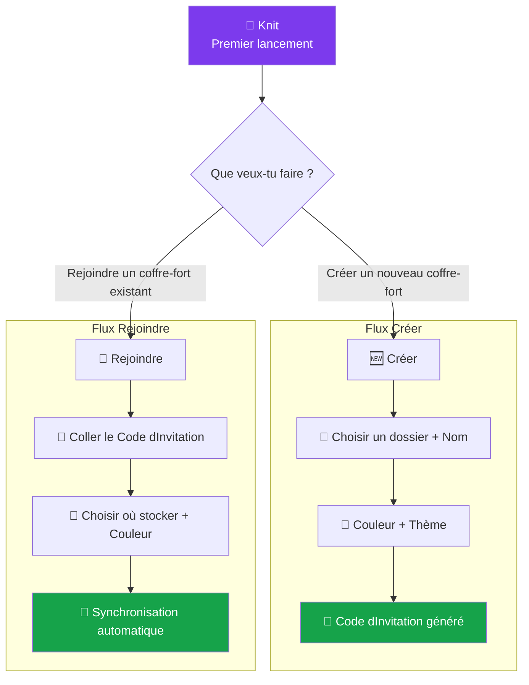

# 🧙 Wizard d'initialisation

> Créer un coffre-fort ou rejoindre un coffre-fort existant — en 3 écrans maximum.

---

## Flux principal



---

## Écrans — Flux "Créer"

### Écran 1 : Accueil

```
┌──────────────────────────────────────────────────┐
│                                                  │
│                  🧶 Knit                         │
│                                                  │
│         Ton espace de travail collaboratif       │
│         local-first & peer-to-peer               │
│                                                  │
│   ┌────────────────────┐  ┌────────────────────┐ │
│   │                    │  │                    │ │
│   │   🆕 Créer un      │  │   🔗 Rejoindre     │ │
│   │   coffre-fort      │  │   un coffre-fort   │ │
│   │                    │  │                    │ │
│   │   Démarre un       │  │   Un collaborateur │ │
│   │   nouveau projet   │  │   t'a partagé un   │ │
│   │   depuis zéro      │  │   code d'invitation│ │
│   │                    │  │                    │ │
│   └────────────────────┘  └────────────────────┘ │
│                                                  │
│   ── Coffres-forts récents ──────────────────    │
│   (vide au premier lancement)                    │
│                                                  │
└──────────────────────────────────────────────────┘
```

### Écran 2 : Dossier + Nom (1/3)

```
┌──────────────────────────────────────────────────┐
│  ← Retour              Créer un coffre-fort  1/3│
│                                                  │
│  📁 Emplacement                                  │
│  ┌──────────────────────────────────────────┐    │
│  │  D:\Projets\mon-projet                   │ 📂 │
│  └──────────────────────────────────────────┘    │
│                                                  │
│  ✏️ Nom du coffre-fort                           │
│  ┌──────────────────────────────────────────┐    │
│  │  Mon Projet                              │    │
│  └──────────────────────────────────────────┘    │
│                                                  │
│  ☐ Créer la structure par défaut                 │
│    (wiki/, projet/taches/, KNIT.md)              │
│                                                  │
│  ☑ Configurer les règles pour agents IA          │
│    (Cursor, Claude Code, Antigravity, Copilot)   │
│                                                  │
│  ☐ Initialiser un dépôt Git                     │
│    (ajoute .knit/ au .gitignore)                 │
│                                                  │
│                               ┌──────────────┐  │
│                               │   Suivant →  │  │
│                               └──────────────┘  │
└──────────────────────────────────────────────────┘
```

### Écran 3 : Couleur + Thème (2/3)

```
┌──────────────────────────────────────────────────┐
│  ← Retour              Créer un coffre-fort  2/3│
│                                                  │
│  🎨 Couleur du thème                             │
│                                                  │
│  ◄━━━━━━━━━●━━━━━━━━━━━━━━━━━━━━━━━━━━━━━━━► │
│  0        260                               360  │
│                                                  │
│  Aperçu :                                        │
│  ┌────────────────────────────────────────┐      │
│  │  ● Bouton primaire    ○ Bouton hover   │      │
│  │  ■ Surface active     □ Surface fond   │      │
│  └────────────────────────────────────────┘      │
│                                                  │
│  🌗 Mode                                        │
│  ( ● ) Clair   ( ○ ) Sombre   ( ○ ) Auto (OS)   │
│                                                  │
│                               ┌──────────────┐  │
│                               │   Suivant →  │  │
│                               └──────────────┘  │
└──────────────────────────────────────────────────┘
```

### Écran 4 : Code d'invitation (3/3)

```
┌──────────────────────────────────────────────────┐
│  ← Retour              Créer un coffre-fort  3/3│
│                                                  │
│  ✅ Coffre-fort "Mon Projet" créé !              │
│                                                  │
│  🔑 Ton code d'invitation :                     │
│  ┌──────────────────────────────────────────┐    │
│  │   knit://join/z6Mk3og9GR...aX7          │    │
│  └──────────────────────────────────────────┘    │
│  [ 📋 Copier ]                                   │
│                                                  │
│  Partage ce code à tes collaborateurs.           │
│                                                  │
│  ⓘ Ce code contient ta clé publique. Il ne      │
│    donne PAS accès à tes fichiers sans ton       │
│    acceptation.                                  │
│                                                  │
│  ┌──────────────────────────────────────────┐    │
│  │         🧶 Ouvrir le coffre-fort         │    │
│  └──────────────────────────────────────────┘    │
└──────────────────────────────────────────────────┘
```

---

## Écrans — Flux "Rejoindre"

### Écran 1 : Coller le code (1/2)

```
┌──────────────────────────────────────────────────┐
│  ← Retour          Rejoindre un coffre-fort  1/2│
│                                                  │
│  🔑 Code d'invitation                           │
│  ┌──────────────────────────────────────────┐    │
│  │   knit://join/z6Mk3og9GR...aX7          │    │
│  └──────────────────────────────────────────┘    │
│  [ 📋 Coller ]                                   │
│                                                  │
│  ✅ Coffre-fort trouvé !                         │
│  ┌────────────────────────────────────────┐      │
│  │  📦 "Mon Projet"                       │      │
│  │  👤 Créé par : clé z6Mk3o...           │      │
│  │  📊 12 fichiers, 3 dossiers            │      │
│  └────────────────────────────────────────┘      │
│                                                  │
│  📁 Stocker dans :                               │
│  ┌──────────────────────────────────────────┐    │
│  │  D:\Projets\mon-projet                   │ 📂 │
│  └──────────────────────────────────────────┘    │
│                                                  │
│                               ┌──────────────┐  │
│                               │   Rejoindre  │  │
│                               └──────────────┘  │
└──────────────────────────────────────────────────┘
```

### Écran 2 : Synchronisation (2/2)

```
┌──────────────────────────────────────────────────┐
│            Rejoindre un coffre-fort          2/2 │
│                                                  │
│              🔄 Synchronisation...               │
│                                                  │
│       ┌──────────────────────────────┐           │
│       │ ████████████░░░░░  68%       │           │
│       └──────────────────────────────┘           │
│                                                  │
│       📥 Réception du snapshot...                │
│       ✅ wiki/accueil.md                         │
│       ✅ wiki/architecture.md                    │
│       🔄 projet/taches/task-002.md               │
│       ○  projet/sprints/sprint-W42.md            │
│                                                  │
│       Connexion : P2P directe (LAN)             │
│       Latence : 3ms                              │
│                                                  │
└──────────────────────────────────────────────────┘
```

---

## Ce qui se crée sur le disque

### Après "Créer un coffre-fort"

```
mon-projet/
├── .knit/
│   ├── config.yaml          # Thème personnel (hue, mode)
│   ├── identity/
│   │   └── keypair.bin      # Clé privée locale
│   ├── crdt-state/          # (vide au départ)
│   ├── snapshots/           # (vide au départ)
│   └── cache/               # (vide au départ)
├── .knitshare               # Config partagée (nom, conventions)
├── KNIT.md                  # Instructions universelles pour les IA
├── .cursor/rules/knit.mdc   # Règles d'édition pour Cursor IDE
├── CLAUDE.md                # Directives pour Claude Code CLI
├── .agents/skills/knit/     # Skill outillé pour Antigravity / Gemini
├── .github/copilot-instructions.md # Règles GitHub Copilot
├── .windsurfrules           # Règles pour Windsurf IDE
├── assets/                  # Pièces jointes et images (vide au départ)
├── wiki/
│   └── accueil.md           # Page d'accueil du wiki
└── projet/
    ├── taches/              # (vide, prêt pour les tâches)
    └── sprints/             # (vide, prêt pour les sprints)
```

### Après "Rejoindre un coffre-fort"

Même structure, mais les fichiers `.md` sont téléchargés depuis le pair via le snapshot CRDT. Le `.knit/` est généré localement avec une clé privée **unique à ce pair**.
