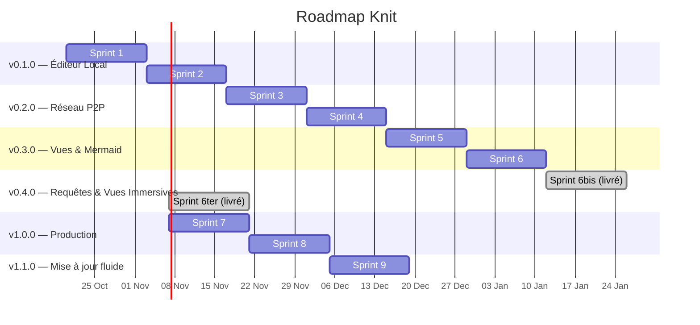

# 📦 Système de Versioning

> Comment Knit gère ses versions, ses sprints, et son backlog.

---

## Méthodologie

### Format de version

**SemVer** : `vMAJOR.MINOR.PATCH`

| Composant | Quand on incrémente |
|---|---|
| **MAJOR** | Changement incompatible (format de vault, protocole P2P) |
| **MINOR** | Nouvelle fonctionnalité rétrocompatible |
| **PATCH** | Correction de bug **ou** push sur `main` pour relancer une Release CI (voir §1bis) |

### Structure des sprints

Chaque version contient **1 à 3 sprints** de **1 à 2 semaines** chacun.

```
versions/
├── VERSIONING.md           # Ce fichier
├── BACKLOG.md              # Backlog global (modifiable à tout moment)
│
├── v0.1.0/                 # Version 0.1.0 — Éditeur Local
│   ├── CHANGELOG.md        # Ce qui a changé dans cette version
│   ├── sprint-1/
│   │   └── SPRINT.md       # Objectifs, tâches, statut du sprint
│   └── sprint-2/
│       └── SPRINT.md
│
├── v0.2.0/                 # Version 0.2.0 — Réseau P2P
│   ├── CHANGELOG.md
│   ├── sprint-3/
│   │   └── SPRINT.md
│   └── sprint-4/
│       └── SPRINT.md
│
├── v0.3.0/                 # Version 0.3.0 — Vues Projet & Mermaid
│   ├── CHANGELOG.md
│   ├── sprint-5/
│   │   └── SPRINT.md
│   └── sprint-6/
│       └── SPRINT.md
│
├── v0.4.0/                 # Version 0.4.0 — Requêtes & Vues Immersives
│   ├── CHANGELOG.md
│   ├── sprint-6bis/
│   │   └── SPRINT.md
│   └── sprint-6ter/
│       └── SPRINT.md
│
├── v1.0.0/                 # Version 1.0.0 — Production Release
│   ├── CHANGELOG.md
│   ├── sprint-7/
│   │   └── SPRINT.md
│   └── sprint-8/
│       └── SPRINT.md
│
├── v1.1.0/                 # Version 1.1.0 — Mise à jour fluide
│   ├── CHANGELOG.md
│   └── sprint-9/
│       └── SPRINT.md
│
├── v1.1.2/                 # Version 1.1.2 — Licence, Paramètres, updater
│   └── CHANGELOG.md
│
└── v1.2.0/                 # Version livrée — personnes, coffres distincts (sprint 10)
    ├── CHANGELOG.md
    └── sprint-10/
        └── SPRINT.md
```

---

## 🏛️ Architecture Centralisée & Protocole d'Alignement des Versions

Knit est un projet hybride combinant un cœur Rust multi-crates (`knit-core`, `knit-desktop`), un orchestrateur de bureau Tauri v2, et une interface React / TypeScript (`knit-app`).

Pour éviter toute désynchronisation, **la gestion des versions est strictement centralisée**.

### Matrice des 6 Sources de Vérité

| Fichier | Type | Rôle & Mécanisme de Synchronisation |
|---|---|---|
| **`Cargo.toml` (racine)** | Rust Workspace | **Source unique de vérité** via `[workspace.package] version = "X.Y.Z"` |
| **`knit-core/Cargo.toml`** | Rust Crate | Hérite automatiquement via `version.workspace = true` |
| **`knit-app/src-tauri/Cargo.toml`** | Rust Crate | Hérite automatiquement via `version.workspace = true` |
| **`knit-app/src-tauri/tauri.conf.json`** | Tauri Desktop | Configuration native : `"version": "X.Y.Z"` (Windows/macOS/Linux) |
| **`knit-app/package.json`** (+ racine) | Node/Vite | Package frontend : `"version": "X.Y.Z"` |
| **`knit-app/src/utils/version.ts`** | TypeScript UI | Constante de secours web `APP_VERSION = 'X.Y.Z'` + `getAppVersion()` Tauri |

### Règles IA & Développeurs pour les 3 Jalons Clés

> [!IMPORTANT]
> **Règle absolue pour tout agent IA et contributeur** : Zéro écart de version toléré.

1. **Lors d'un Commit Git ou `git push`** :
   - Vérifier que la version est parfaitement alignée sur l'ensemble des 6 fichiers.
   - Ne jamais committer une mise à jour de version partielle (ex: modifier `package.json` sans `Cargo.toml` et `tauri.conf.json`).
   - Consulter `versions/VERSIONING.md`, le `CHANGELOG` / sprint actifs et le tag Git le plus récent (`git tag --list 'v*' --sort=-v:refname`).

1ter. **Mise à jour des paquets (Prompt 11 / push `main`)** :
   - Avant un push vers `main`/`master`, mettre à jour les dépendances **Rust et npm**, **y compris les majeurs** quand disponibles (`notify`, `ed25519-dalek`, TypeScript, etc.), puis valider `cargo check` / `cargo test` / `npm run lint` / `tsc` / `test:unit`.
   - Exécuter les contrôles DevSecOps : `npm audit --audit-level=high`, `cargo audit`, `cargo deny check advisories licenses sources` (`deny.toml`, `.cargo/audit.toml`).
   - Les ignores RUSTSEC doivent être documentés (raison + suivi upstream). Le job CI `devsecops` (gitleaks + audits + deny) est **bloquant** pour `tag-if-needed`.

1bis. **Push sur `main` / `master` → bump PATCH obligatoire (relance Release)** :
   - **SemVer** : `MAJOR.MINOR.PATCH` — le « dernier chiffre » est le **PATCH** (`1.0.0` → `1.0.1`).
   - **Quand** : dès qu'un agent exécute un `git push` (ou `commit et push` / Prompt 11) vers **`main` ou `master`**, après évaluation doc ↔ code.
   - **Quoi** : incrémenter le PATCH sur les **6 sources**, mettre à jour `versions/vX.Y.Z/CHANGELOG.md` (ou créer le dossier patch si besoin), `.knit/AI_MEMORY.md`, puis pusher.
   - **Effet CI** : après CI verte, le job `tag-if-needed` crée `vX.Y.Z` s'il n'existe pas et déclenche le workflow **Release** (builds multi-OS + draft GitHub Release).
   - **Exceptions** (pas de bump) : push hors `main`/`master` ; push purement documentaire de règles IA sans livrable ; l'utilisateur refuse explicitement le bump ; le tag de la version courante n'existe pas encore et le push vise justement à le créer (ex. première livraison `1.0.0`).
   - **MINOR / MAJOR** : uniquement sur consigne explicite (nouvelle feature rétrocompatible / breaking) — jamais silencieux au push.

2. **Lors de la Construction / Cadrage d'un Sprint** (`SPRINT.md`) :
   - Vérifier que le numéro de version cible (`| **Version** | vX.Y.Z |`) correspond bien au jalon planifié dans `versions/VERSIONING.md`.
   - Si le sprint démarre une nouvelle version SemVer (ex: passage de `v0.1.0` à `v0.2.0`), exécuter le bump de version simultanément sur les 6 fichiers dès l'initialisation du sprint.

3. **À la Livraison d'un Sprint ou Clôture de Version** (`Statut: ✅ Terminé`) :
   - **Checklist de livraison obligatoire** :
     - [ ] `Cargo.toml` racine à jour
     - [ ] `knit-app/src-tauri/tauri.conf.json` à jour
     - [ ] `knit-app/package.json` et `package.json` racine à jour
     - [ ] `knit-app/src/utils/version.ts` (`APP_VERSION`) à jour
     - [ ] `versions/vX.Y.Z/CHANGELOG.md` rédigé avec les nouveautés et corrections
     - [ ] `versions/vX.Y.Z/sprint-N/SPRINT.md` passé en `✅ Terminé`
     - [ ] `versions/VERSIONING.md` roadmap mise à jour
     - [ ] `.knit/AI_MEMORY.md` actualisé
     - [ ] Compilation validée : `cargo check --workspace` et `npm run build`

---


## Règles du backlog

### Le backlog est TOUJOURS modifiable

Le fichier `BACKLOG.md` peut être mis à jour **à tout moment**, y compris en milieu de sprint. C'est la liste vivante de tout ce qui reste à faire.

### Ajout en milieu de sprint

Quand une nouvelle tâche est ajoutée au backlog **pendant** un sprint en cours :

1. Ajouter la tâche dans `BACKLOG.md` avec le statut `💡 nouveau`
2. Dans le `SPRINT.md` du sprint en cours, ajouter une entrée dans la section **"Ajouts en cours de sprint"**
3. La tâche n'est **PAS** automatiquement ajoutée au sprint en cours — elle sera planifiée dans un sprint futur, sauf décision contraire

### Statuts des tâches dans le backlog

| Icône | Statut | Signification |
|---|---|---|
| 💡 | `nouveau` | Vient d'être ajouté, pas encore planifié |
| 📋 | `planifie` | Assigné à un sprint spécifique |
| 🔄 | `en-cours` | En cours de développement |
| ✅ | `termine` | Terminé et livré |
| ❌ | `annule` | Annulé / abandonné |
| ⏸️ | `suspendu` | Mis en pause, à reprendre plus tard |

### Priorités

| Icône | Priorité |
|---|---|
| 🔴 | Critique — Bloquant |
| 🟠 | Haute — Important pour le sprint |
| 🟡 | Moyenne — Souhaitable |
| 🟢 | Basse — Nice to have |

---

## Format d'un SPRINT.md

```markdown
# Sprint N — [Nom du sprint]

> Objectif : [Objectif principal en une phrase]

| Info | Détail |
|---|---|
| **Version** | vX.Y.Z |
| **Durée** | [date début] → [date fin] |
| **Statut** | 🟡 En cours / ✅ Terminé / ❌ Annulé |

## Tâches du sprint

| # | Tâche | Priorité | Statut | Assigné |
|---|---|---|---|---|
| 1 | Description... | 🔴 | ✅ | — |
| 2 | Description... | 🟠 | 🔄 | — |

## Ajouts en cours de sprint

> Tâches ajoutées au backlog pendant ce sprint.

| Date | Tâche ajoutée | Raison | Intégré au sprint ? |
|---|---|---|---|
| — | — | — | — |

## Rétrospective

### Ce qui a bien marché
- ...

### Ce qu'on peut améliorer
- ...
```

---

## Format d'un CHANGELOG.md

```markdown
# Changelog — vX.Y.Z

> [Description courte de la version]

## ✨ Nouveautés
- Feature 1
- Feature 2

## 🐛 Corrections
- Bug fix 1

## 🔧 Technique
- Refactoring, optimisation...

## 💥 Breaking Changes
- (si applicable)
```

---

## Roadmap


